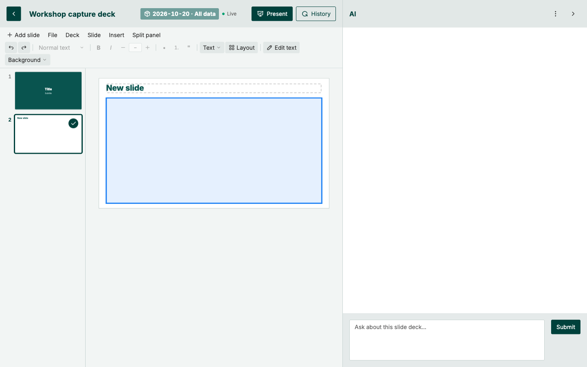
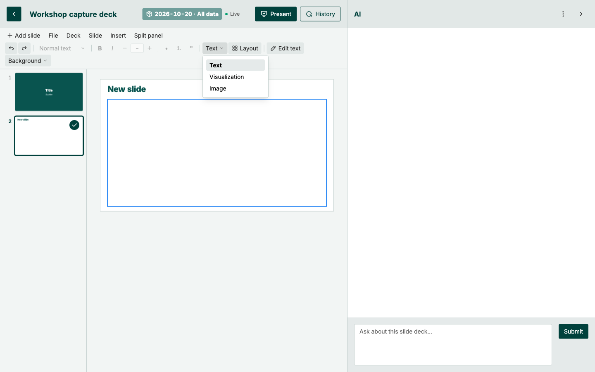
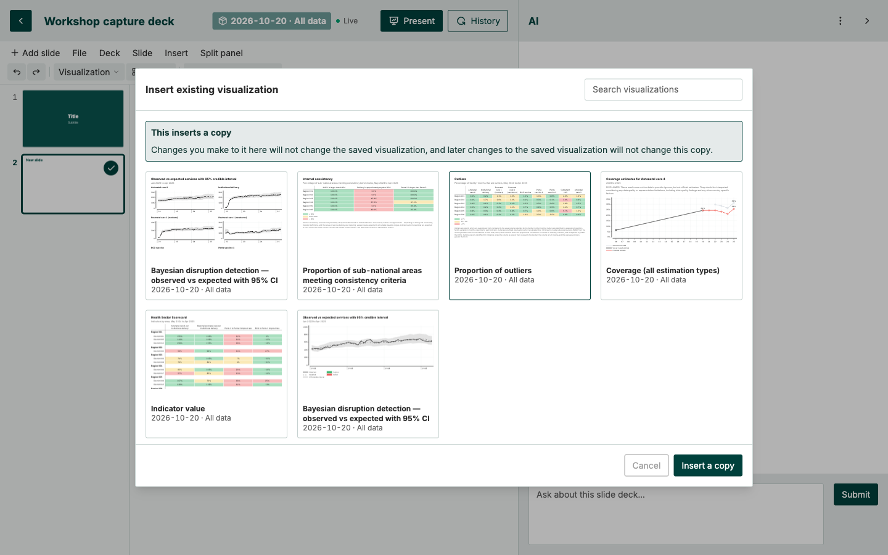

Criar apresentação → Adicionar manualmente → Adicionar com IA → Editar e finalizar

# Adicionar uma visualização (manualmente)

<strong>Atividade</strong> · <strong>Apresentações</strong> · <strong>~15 min</strong>

<aside class="p1-sidebar">

Antes de começar

- ☐ Criou a sua apresentação com um diapositivo de conteúdo (ver *Criar a sua primeira apresentação*)
- ☐ Tem uma visualização guardada que quer incluir
- ☐ A apresentação está aberta no diapositivo de conteúdo

</aside>

## O que vai fazer

Colocar uma cópia de uma visualização guardada no diapositivo de conteúdo, e depois dividir o diapositivo para o gráfico ter texto ao lado. São três movimentos na primeira vez; rápido depois disso.

<h2 class="step-h">1Selecionar o bloco</h2>

Clique no diapositivo de conteúdo na lista da esquerda, e depois clique no bloco vazio no meio do diapositivo. Aparece um contorno azul em volta dele e uma barra de ferramentas do bloco acima do diapositivo: uma lista pendente **Texto**, **Disposição**, **Editar texto**, **Fundo**.

---

<h2 class="step-h">2Torná-lo um bloco de visualização</h2>

Abra a lista pendente **Texto** e escolha **Visualização**. O bloco passa a ser um bloco de visualização e a barra de ferramentas oferece **Inserir visualização**.

<h2 class="step-h">3Inserir o gráfico guardado</h2>

Clique em **Inserir visualização** e depois em **Visualização existente…**. Um seletor lista as visualizações guardadas da instância, cada uma com uma miniatura; a caixa de pesquisa filtra por nome. Clique na sua e depois em **Inserir uma cópia**. O gráfico aparece no diapositivo.

> **É uma cópia.** As alterações que fizer ao gráfico no diapositivo não alteram a visualização guardada, e as alterações posteriores à visualização guardada não chegam ao diapositivo. Para atualizar o diapositivo depois de melhorar o original, selecione o bloco e use **Substituir visualização → Substituir por visualização existente**.

---

<h2 class="step-h">4Dar ao gráfico um bloco de texto ao lado</h2>

Com o bloco do gráfico selecionado, clique em **Disposição**, depois em **Adicionar**, e depois numa coluna à direita. Aparece um novo bloco vazio ao lado do gráfico; o seu tipo é **Texto**. Clique dentro dele e escreva uma conclusão numa linha. Arraste o separador entre os dois blocos para dar mais espaço ao gráfico.

<h2 class="step-h">5Dar um título ao diapositivo</h2>

Clique no cabeçalho do diapositivo («Novo diapositivo») e escreva um título que enuncie a conclusão. Não há nada para guardar: a apresentação guarda-se em direto.

## Ponto de verificação

O seu diapositivo de conteúdo deverá mostrar um dos seus gráficos guardados, com um texto curto ao lado e um título que diz o que o gráfico mostra.

---

## Dicas

> **Reutilize, não recrie.** Se já construiu o gráfico, insira o existente. **Nova visualização…** no mesmo menu abre a caixa de diálogo de métrica e predefinição para construir um a partir de zero, no diapositivo.

- Não encontra o seu gráfico no seletor: ainda não é uma visualização guardada, ou está numa pasta que não pode ver. Escreva parte do nome na caixa de pesquisa do seletor.
- O gráfico parece apertado: é o esperado nesta fase. *Editar e finalizar* trata do redimensionamento e da simplificação.
- Um bloco pode também conter uma **Imagem** (a mesma lista pendente), para um logótipo ou uma fotografia.
- **Dividir**, na barra superior, acrescenta um painel lateral ao diapositivo: uma segunda área para texto ou para um segundo gráfico.

## A seguir

Avance para **Adicionar uma visualização (com o assistente de IA)**: a mesma tarefa, num só pedido no painel de IA.
