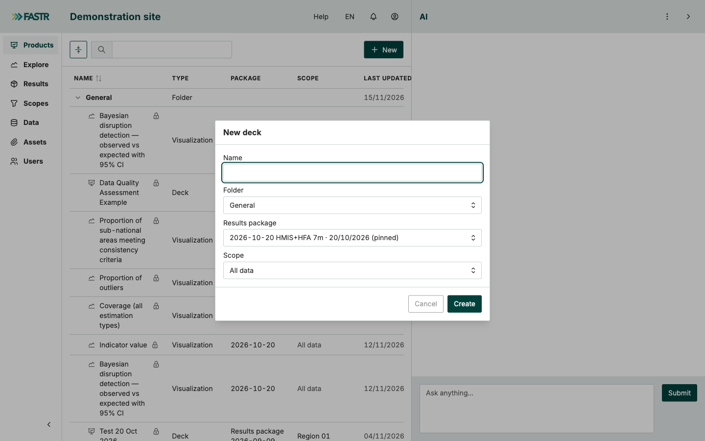
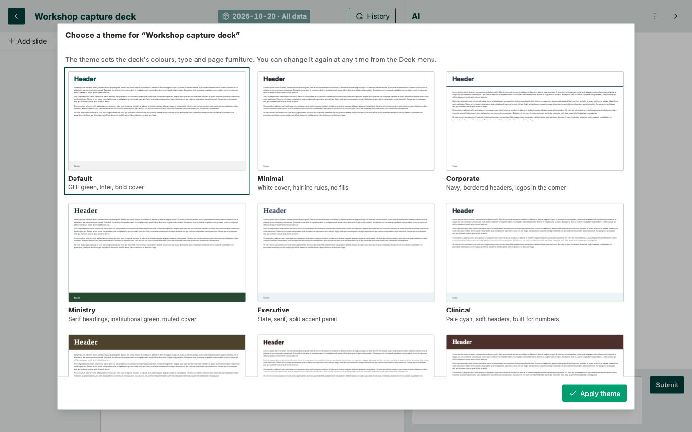
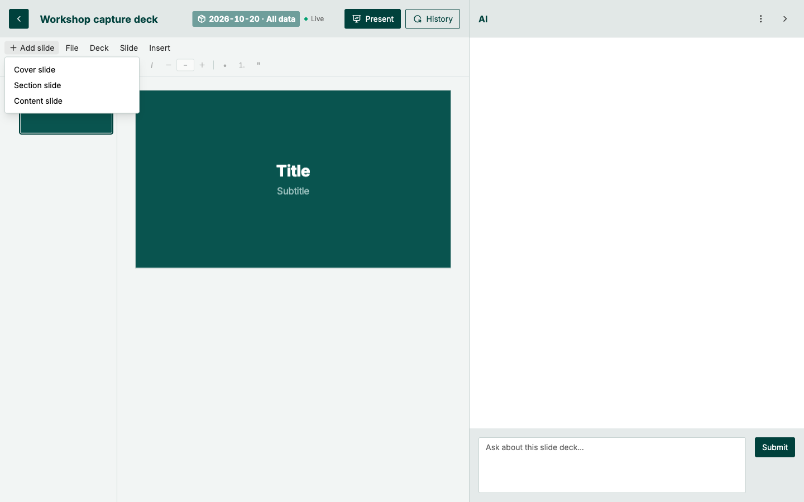

Criar apresentação → Adicionar manualmente → Adicionar com IA → Editar e finalizar

# Criar a sua primeira apresentação

<strong>Atividade</strong> · <strong>Apresentações</strong> · <strong>~10 min</strong>

<aside class="p1-sidebar">

Antes de começar

- ☐ Tem sessão iniciada e está na página **Produtos**
- ☐ Tem uma pasta sua (ver *Criar uma pasta para o seu trabalho*)
- ☐ Tem pelo menos uma visualização guardada que queira usar

</aside>

## O que vai fazer

Criar uma apresentação, escolher o seu aspeto e adicionar um diapositivo de conteúdo. Este é o contentor; as próximas atividades enchem-no de gráficos e interpretação.

<h2 class="step-h">1Criar a apresentação</h2>

Na página **Produtos**, clique em **Novo** e depois em **Nova apresentação**. A caixa de diálogo pede um **Nome** e uma **Pasta**: dê-lhe um nome (por exemplo *Revisão 1.º tri 2026*, ou o seu tema), escolha a sua pasta e clique em **Seguinte**. O segundo passo pede o **Pacote de resultados** e o **Âmbito**; mantenha o pacote fixado e **Todos os dados**, e clique em **Criar**.

---

<h2 class="step-h">2Escolher um tema</h2>

Uma apresentação nova abre no seletor de temas: o tema define as cores, a tipografia e os elementos fixos de todos os diapositivos. Mantenha **Predefinido** (verde GFF) para a formação e clique em **Aplicar tema**. Pode mudá-lo mais tarde no menu **Apresentação**.

<h2 class="step-h">3Conhecer o editor</h2>

A apresentação abre já com um diapositivo de capa. A lista de diapositivos fica à esquerda, o diapositivo atual ao centro, o painel de IA à direita. Acima do diapositivo: **Adicionar diapositivo**, e os menus **Ficheiro**, **Apresentação**, **Diapositivo** e **Inserir**. O título no canto superior esquerdo muda o nome da apresentação quando clica nele. Ao lado do nome do pacote, **Em direto** significa que as alterações são guardadas automaticamente e partilhadas com quem tiver a apresentação aberta.

---

<h2 class="step-h">4Adicionar um diapositivo de conteúdo</h2>

Clique em **Adicionar diapositivo**. Aparecem três tipos de diapositivo:

- **Diapositivo de capa**: a página de título (nome da apresentação, data, o seu nome). Um por apresentação, já está lá.
- **Diapositivo de secção**: um separador entre partes da apresentação. Use com moderação.
- **Diapositivo de conteúdo**: onde vivem um gráfico e a sua interpretação. A maior parte da sua apresentação.

Escolha **Diapositivo de conteúdo**. Aparece um segundo diapositivo com um cabeçalho e um bloco vazio.

## Ponto de verificação

Deverá ter:

- Uma apresentação com um nome claro, na sua pasta (confirme a linha dela na página Produtos)
- Um diapositivo de capa e um diapositivo de conteúdo vazio

## A seguir

O seu facilitador vai demonstrar como colocar um gráfico no diapositivo e dividi-lo em gráfico e texto. Depois irá repeti-lo em **Adicionar uma visualização (manualmente)**.
