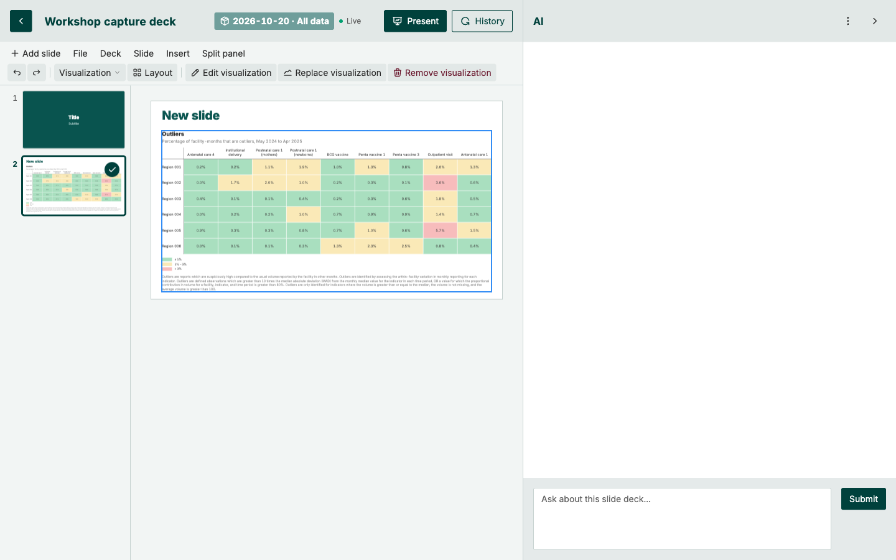
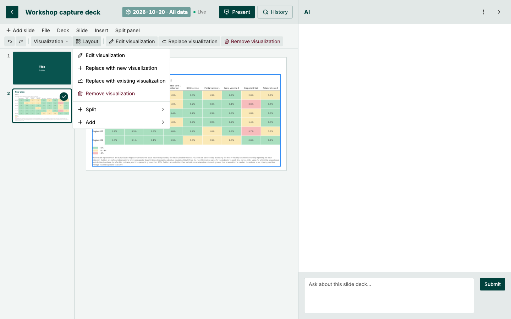

Criar apresentação → Adicionar manual → Adicionar IA → Editar & finalizar

# Editar e finalizar os seus diapositivos

<strong>Atividade</strong> · <strong>Apresentações</strong> · <strong>~20 min</strong>

<aside class="p1-sidebar">

Antes de começar

- ☐ A sua apresentação tem pelo menos um diapositivo de conteúdo com um gráfico e algum texto
- ☐ O facilitador mostrou a demonstração do editor no ecrã

Porque é importante

A IA gera o conteúdo. O esquema quase sempre precisa de ajustes: texto apertado, um gráfico a precisar de mais espaço, um diapositivo cheio de blocos. O editor serve para corrigir isso, um diapositivo de cada vez.

</aside>

## Os três sítios onde edita

Um diapositivo é um cabeçalho mais **blocos**. Tudo o que altera acontece num destes três sítios:

- **A barra de ferramentas do bloco**, que aparece acima do diapositivo quando clica num bloco: o seu tipo (**Texto**, **Visualização**, **Imagem**), a **Disposição**, e as ações desse tipo (**Editar texto**; **Editar**, **Substituir** ou **Remover visualização**).
- **O menu Diapositivo** na barra superior: o tipo de diapositivo (Capa, Secção, Conteúdo) e os logótipos da capa.
- **O menu Inserir**: novos diapositivos, e os elementos de texto do diapositivo atual (cabeçalho, subcabeçalho, data, rodapé).

---

## Disposição: dividir, adicionar, mover, remover

Selecione um bloco e clique em **Disposição**. Para um bloco de visualização, o menu é:

| Ação | O que faz |
|------|-----------|
| **Editar visualização** | Abre o gráfico no editor de visualizações, no diapositivo. |
| **Substituir por nova visualização** | Constrói outro gráfico a partir da caixa de diálogo de métrica e predefinição, neste bloco. |
| **Substituir por visualização existente** | Troca-o por uma cópia de outro gráfico guardado. |
| **Remover visualização** | Esvazia o bloco e mantém o bloco. |
| **Dividir ▸** | Divide este bloco em dois, lado a lado ou um acima do outro. |
| **Adicionar ▸** | Acrescenta um novo bloco junto a este: à esquerda, à direita, acima, abaixo. |

Um bloco de texto tem o mesmo **Dividir** e **Adicionar**, com **Editar texto** em vez das ações de visualização.

Dois blocos lado a lado, gráfico e texto, é o padrão FASTR. Se precisar de mais, isso é outro diapositivo.

---

## As quatro passagens por diapositivo

<h2 class="step-h">1Verificar a exatidão</h2>

Leia o diapositivo como se nunca o tivesse visto. O título corresponde ao que o gráfico mostra? O texto está correto? Marque tudo o que precisa de ser reescrito, por você ou pelo painel de IA à direita.

<h2 class="step-h">2Redimensionar e reorganizar</h2>

Arraste o separador entre dois blocos para dar mais espaço ao gráfico ou ao texto. O outro bloco acompanha. Use os botões de tamanho do texto na barra de ferramentas (**–** e **+**) antes de cortar palavras.

<h2 class="step-h">3Reestruturar se for preciso</h2>

Demasiado apertado: **Disposição → Adicionar** um bloco, ou passe o conteúdo em excesso para um novo diapositivo (**Adicionar diapositivo → Diapositivo de conteúdo**). Um bloco que não justifica o seu lugar: **Remover visualização**, ou apague o seu texto. Um gráfico demasiado detalhado: **Editar visualização** e simplifique-o ali.

<h2 class="step-h">4Terminar o cabeçalho e o rodapé</h2>

O menu **Inserir** lista os elementos de texto do diapositivo: cabeçalho, subcabeçalho, data, rodapé. Acrescente os que quiser e clique neles no diapositivo para os editar. O rodapé e os números de página de toda a apresentação ficam no menu **Apresentação** (ver *Definições da apresentação*).

---

## Ponto de verificação

Cada diapositivo deverá:

- Ter um título claro que corresponde ao gráfico
- Mostrar o gráfico num tamanho legível, alinhado com o seu texto
- Ter texto totalmente visível e revisto
- Trazer os elementos de cabeçalho que quer

## O que pode correr mal

- **Não aparece a barra de ferramentas do bloco.** Não selecionou nenhum bloco. Clique dentro do bloco no diapositivo, não na miniatura.
- **O separador não está visível.** Aparece depois de selecionar um bloco; o cursor muda quando passa sobre a linha entre dois blocos.
- **O gráfico continua apertado depois de redimensionar.** O próprio gráfico é demasiado detalhado. **Disposição → Editar visualização** e simplifique (menos indicadores, apresentação em grelha, período mais curto).
- **Desfazer.** As setas à esquerda da barra de ferramentas, ou Ctrl/Cmd+Z. As edições guardam-se em direto, por isso o **Histórico** no topo é o caminho de volta a uma versão anterior de toda a apresentação.
- **Ordem dos diapositivos.** Arraste as miniaturas na lista da esquerda.

## A seguir

O próximo documento trata das definições globais da apresentação: tema, logótipos, rodapé e números de página, antes de a apresentação ser partilhada.
