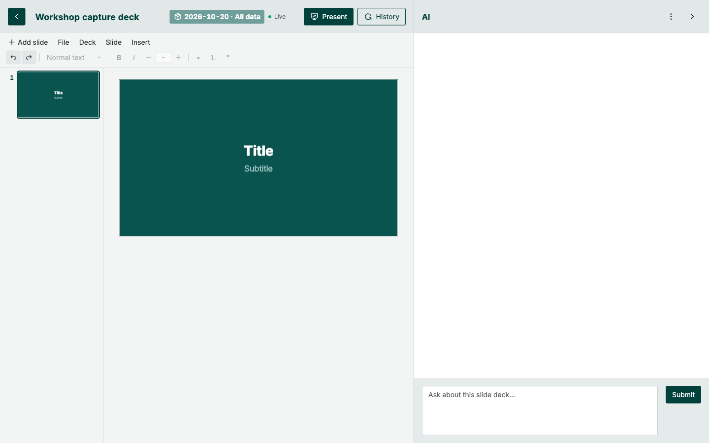
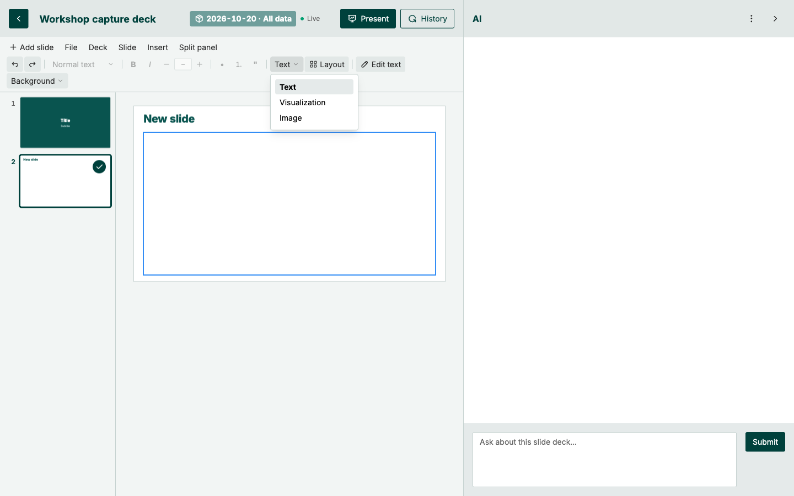
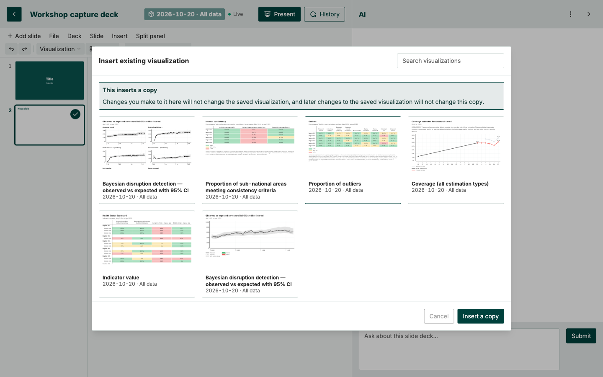

# Guia do facilitador — Apresentações

<strong>Guia do facilitador</strong> · <strong>Apresentações</strong> · <strong>4 atividades · ~60 min + demonstração</strong>

## Objetivo

As Apresentações ensinam os participantes a juntar aquilo que já construíram, gráficos e interpretações, numa apresentação. O módulo segue um arco construir-depois-polir: criar a apresentação, ver o editor demonstrado, adicionar gráficos de duas formas (manualmente e com a IA), e depois finalizar. O resultado é o objeto que os participantes irão mostrar aos decisores, por isso a fasquia é «pronto a apresentar», não apenas «terminado».

No final, cada participante deve ter uma apresentação de dois diapositivos polida, construída a partir dos seus próprios gráficos, que estaria disposto a mostrar a um diretor.

## A sessão num relance

| # | Atividade | Duração | Formato |
|---|-----------|---------|---------|
| — | Demonstração do passeio pelo editor | ~5 min | Conduzida pelo facilitador (apêndice) |
| 1 | Criar a sua primeira apresentação | ~10 min | Prática, individual |
| 2 | Adicionar uma visualização (manualmente) | ~15 min | Prática, individual |
| 3 | Adicionar uma visualização (com a IA) | ~15 min | Prática, individual |
| 4 | Editar e finalizar os seus diapositivos | ~20 min | Prática, individual |

---

## Conduzir a sessão

**Preparação.** Tenha numa pasta de demonstração uma apresentação com um diapositivo de conteúdo vazio e pelo menos uma visualização guardada, para que a demonstração do editor corra sem sobressaltos. Ponha o zoom do navegador a cerca de 100% para a interface ser legível no ecrã partilhado. Lembre-se de que as apresentações se guardam em direto e são partilhadas: demonstre na sua própria apresentação, não na de um participante.

**Como demonstrar.** A sequência é **contentor → demonstração → fazer (manual) → fazer (IA) → polir.** A atividade 1 cria a apresentação; depois conduza o passeio pelo editor (apêndice) ao vivo *antes* de os participantes tocarem no editor. Essa demonstração é a porta de entrada das atividades 2 e 3: sem ela, os participantes não encontram a barra de ferramentas do bloco. Siga o apêndice tal como está escrito; as fichas reexplicam o que mostrou, não ensinam por si sós.

**Agrupamento.** As quatro atividades são individuais. Junte os participantes em pares apenas para se ajudarem quando alguém ficar preso.

**Ritmo.** Proteja a demonstração e a atividade 4. Se o tempo faltar, deixe cair a atividade 3 (o caminho com IA para o mesmo resultado da atividade 2).

**A mensagem a transmitir.** Reutilizar, não recriar: os gráficos constroem-se uma vez como visualizações na página Produtos e inserem-se nos diapositivos como cópias. O editor de diapositivos serve para montar e polir.

---

## As atividades

### 1. Criar a sua primeira apresentação · ~10 min · prática

**O que acontece.** Os participantes criam a apresentação a partir da página Produtos (**Novo → Nova apresentação**: nome, pasta, e depois pacote e âmbito), aplicam o tema Predefinido no seletor que se abre, e acrescentam um **Diapositivo de conteúdo** com **Adicionar diapositivo**.

**Demonstrar.** Mostre o campo **Pasta** na caixa de diálogo e o seletor de temas, e os três tipos de diapositivo em **Adicionar diapositivo**, sublinhando que só o de **Conteúdo** aceita um gráfico e texto.

**Diga algo como.** *«Ponham a apresentação na vossa pasta, mantenham o tema Predefinido, e escolham Conteúdo: um diapositivo de capa ou de secção não tem onde pôr o gráfico.»*

**Como é um bom resultado.** Uma apresentação com nome, na pasta do participante, com um diapositivo de capa e um diapositivo de conteúdo vazio.

**Atenção a.**
- A apresentação criada na pasta errada (corrija com **Ficheiro → Nome e pasta…**).
- O seletor de temas tratado como um obstáculo: diga que é um só clique.

> **Conduza agora a demonstração do passeio pelo editor**, antes da atividade 2.

### 2. Adicionar uma visualização (manualmente) · ~15 min · prática

**O que acontece.** Os participantes selecionam o bloco vazio, mudam o seu tipo de **Texto** para **Visualização**, clicam em **Inserir visualização → Visualização existente…**, escolhem o seu gráfico e **Inserir uma cópia**, e depois usam **Disposição → Adicionar** para um bloco de texto ao lado.

**Demonstrar.** Coberto no apêndice (passos 2 e 3). Remeta os participantes para o que viram.

**Diga algo como.** *«Não estão a construir um gráfico aqui. Estão a escolher um que já guardaram, e o diapositivo recebe uma cópia dele.»*

**Como é um bom resultado.** Um diapositivo de conteúdo com um dos gráficos do próprio participante e uma linha de texto ao lado.

**Atenção a.**
- Clicar na miniatura em vez do bloco: a barra de ferramentas só aparece quando um bloco do diapositivo está selecionado.
- Um gráfico ausente do seletor: não foi guardado como visualização, ou está numa pasta que não podem ver.
- Esperar que o gráfico guardado atualize o diapositivo mais tarde: é uma cópia; **Substituir por visualização existente** é o que o renova.

---

### 3. Adicionar uma visualização (com a IA) · ~15 min · prática

**O que acontece.** A mesma tarefa por outro caminho: com a apresentação aberta, os participantes pedem ao painel de IA que acrescente um diapositivo com um gráfico que nomeiam, verificam o diapositivo, e corrigem-no na conversa.

**Demonstrar.** Um pedido ao vivo, para que os participantes vejam a IA listar os seus passos e o diapositivo aparecer. Mostre uma vez o **Histórico** como caminho de volta.

**Diga algo como.** *«A IA trabalha na apresentação que têm aberta, e o que ela faz é guardado à medida. Nomeiem o gráfico, verifiquem o diapositivo, e corrijam na conversa se for preciso.»*

**Como é um bom resultado.** Uma apresentação de dois diapositivos, com o segundo acrescentado através da IA.

**Atenção a.**
- Pedir a partir da página Produtos: a IA responde que não pode editar dali.
- Um pedido vago a devolver um gráfico parecido mas errado: nomeiem-no.

### 4. Editar e finalizar os seus diapositivos · ~20 min · prática

**O que acontece.** Uma passagem de polimento: quatro revisões por diapositivo (exatidão, redimensionar, reestruturar, cabeçalho e rodapé), com a barra de ferramentas do bloco e o menu **Disposição**.

**Demonstrar.** Mostre o separador entre dois blocos e um **Disposição → Adicionar**; depois uma pequena edição de texto face a uma reescrita entregue ao painel de IA.

**Diga algo como.** *«As pequenas correções fazem-nas aqui; as reescritas estruturais vão para a IA. A fasquia é esta: conseguiriam mostrar este diapositivo a um diretor sem pedir desculpa?»*

**Como é um bom resultado.** Todos os diapositivos revistos, gráficos e texto dimensionados para caber, e um título que enuncia a conclusão.

**Atenção a.**
- Um gráfico ainda apertado depois de redimensionar: simplifique-o com **Disposição → Editar visualização**, não encolhendo o texto.
- Participantes à procura de um botão Guardar: não existe. O **Histórico** é a rede de segurança.

## Para encerrar

No final, cada participante tem uma apresentação de dois diapositivos polida, construída a partir dos seus próprios gráficos. Mantenha-os numa única fasquia: cada diapositivo poderia ser mostrado a um diretor sem pedir desculpa.

---

## Apêndice — Guião da demonstração do passeio pelo editor

Um passeio ao vivo de cinco minutos pelo editor de apresentações. Os participantes acabaram de criar um diapositivo de conteúdo vazio; isto mostra-lhes como colocar nele um gráfico e texto antes de o repetirem na atividade 2. Mantenha o ritmo.

### Lista de preparação

- ☐ A sua própria apresentação aberta num **diapositivo de conteúdo vazio**
- ☐ Pelo menos uma visualização guardada numa pasta de demonstração
- ☐ Zoom do navegador a cerca de 100%
- ☐ Partilha de ecrã a funcionar, se à distância

### Passo 1: o editor

- **Fazer:** Aponte para a lista de diapositivos (esquerda), o diapositivo (centro), o painel de IA (direita), e a barra superior: **Adicionar diapositivo**, **Ficheiro**, **Apresentação**, **Diapositivo**, **Inserir**, **Apresentar**, **Histórico**, e a etiqueta **Em direto**.
- **Dizer:** *«Tudo se guarda enquanto trabalham; Em direto significa que os colegas também veem. Não há botão Guardar; o Histórico traz de volta versões anteriores.»*

### Passo 2: o bloco

- **Fazer:** Clique dentro do bloco vazio. Mostre a barra de ferramentas que aparece: a lista pendente **Texto**, **Disposição**, **Editar texto**. Abra a lista pendente e escolha **Visualização**.
- **Dizer:** *«Um diapositivo é feito de blocos. Clicam num e a barra de ferramentas aparece. Esta lista pendente diz o que o bloco contém: texto, uma visualização ou uma imagem.»*

---

### Passo 3: inserir um gráfico guardado

- **Fazer:** **Inserir visualização → Visualização existente…**, escolha um gráfico, **Inserir uma cópia**.
- **Dizer:** *«É assim que um gráfico guardado chega a um diapositivo, como cópia. Construíram-no uma vez na página Produtos; aqui apenas o colocam.»*

### Passo 4: gráfico e texto lado a lado

- **Fazer:** Com o bloco do gráfico selecionado, **Disposição → Adicionar → à direita**. Clique no novo bloco de texto e escreva uma conclusão de uma linha. Arraste o separador.
- **Dizer:** *«Dois blocos, gráfico e conclusão, é o padrão FASTR. Mais do que isso vai para o diapositivo seguinte.»*

### Passo 5: título e pronto

- **Fazer:** Clique no cabeçalho do diapositivo e escreva um título que enuncie a conclusão. Abra **Inserir** para mostrar o subcabeçalho, a data e o rodapé opcionais.
- **Dizer:** *«O título é a mensagem. E está pronto: não há nada para guardar.»*

---

### Perguntas frequentes

> **P: Posso desfazer?**
> R: Sim: as setas à esquerda da barra de ferramentas, ou Ctrl/Cmd+Z. O **Histórico** no topo restaura uma versão anterior completa.

> **P: Onde está o Guardar?**
> R: Não existe. As alterações são guardadas à medida que as faz e partilhadas em direto.

> **P: Posso reordenar os diapositivos?**
> R: Arraste as miniaturas na lista da esquerda.

### Plano de recurso

> Se a plataforma estiver indisponível, percorra as capturas de ecrã deste apêndice e descreva o padrão: selecionar o bloco, defini-lo como Visualização, inserir um gráfico existente, acrescentar um bloco de texto ao lado.
