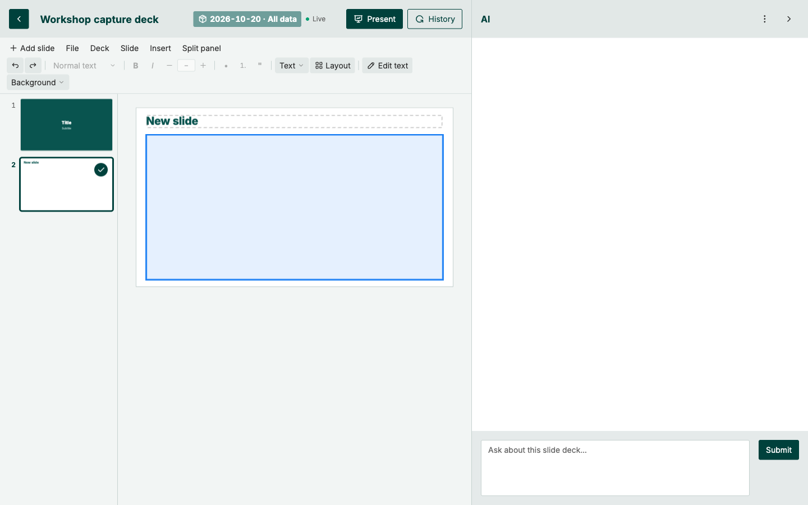

Criar apresentação → Adicionar manualmente → Adicionar com IA → Editar e finalizar → Formatar texto

# Formatar o texto dos seus diapositivos

<strong>Atividade</strong> · <strong>Apresentações</strong> · <strong>~10 min</strong>

<aside class="p1-sidebar">

Antes de começar

- ☐ Um diapositivo com um bloco de texto de interpretação, aberto no editor
- ☐ O texto tem pelo menos três frases (uma linha de título, o que se vê, o que significa)

Porque é importante

Um parágrafo compacto esconde a mensagem. Um título, algumas marcas e uma frase a negrito conduzem o leitor pela ordem que quer. A barra de ferramentas do editor faz tudo isso com cliques; não há símbolos para escrever.

</aside>

## O que vai fazer

Dar ao texto de um diapositivo um título, uma frase a negrito e uma lista com marcas, usando a barra de ferramentas.

<h2 class="step-h">1Abrir o editor de texto</h2>

Clique no bloco de texto do seu diapositivo. A barra de ferramentas aparece acima do diapositivo: um menu de estilos (**Texto normal**), **B** e **I**, listas com marcas e numeradas, um botão de citação e as setas de anular. Nada para guardar: a apresentação está **Ao vivo**.

---

<h2 class="step-h">2Título e destaque</h2>

1. Ponha o cursor na primeira linha, a que enuncia a constatação, e escolha um título no **menu de estilos**.
2. Selecione a única frase que transporta a mensagem e clique em **B**. Uma frase por diapositivo; uma segunda frase a negrito anula a primeira.
3. Se uma frase cita palavra por palavra um relatório ou uma norma, selecione-a e clique no botão de **citação**.

<h2 class="step-h">3Listas e espaço</h2>

1. Quando um parágrafo contém vários factos, ponha cada um na sua linha, selecione-os e clique no botão **lista com marcas**. Use a **lista numerada** para passos que se seguem por ordem.
2. Releia o diapositivo a dois metros, ou com **Apresentar**. Se o olhar não cai no título, depois na frase a negrito e depois na lista, mude uma coisa de cada vez com as setas de anular para comparar.

## Ponto de verificação

O seu diapositivo deve ter agora:

- Um título que nomeia a constatação, não o tema
- Marcas onde há uma lista, em vez de um único parágrafo
- Uma frase a negrito, duas no máximo

## O que pode correr mal

- **Aparecem símbolos escritos no diapositivo** (um `#` ou um `-` no início da linha). O editor não lê símbolos; apague-os e use a barra de ferramentas.
- **Está tudo a negrito.** Selecione só a frase, não o parágrafo, antes de clicar em B.
- **A lista tem uma única marca gigante.** Cada item precisa da sua própria linha antes de aplicar a lista.
- **Uma alteração de que se arrepende.** Setas de anular para os últimos passos; **Histórico** na barra do topo para restaurar uma versão anterior completa.

## A seguir

A atividade seguinte cobre as definições da apresentação: tema, logótipos, rodapé e partilha.
