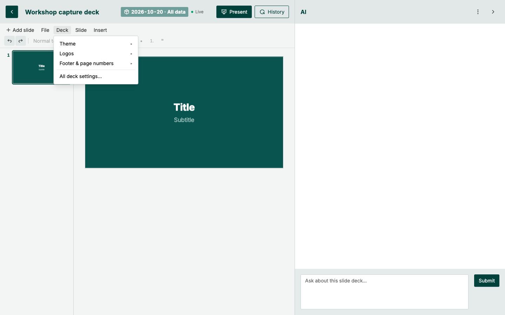
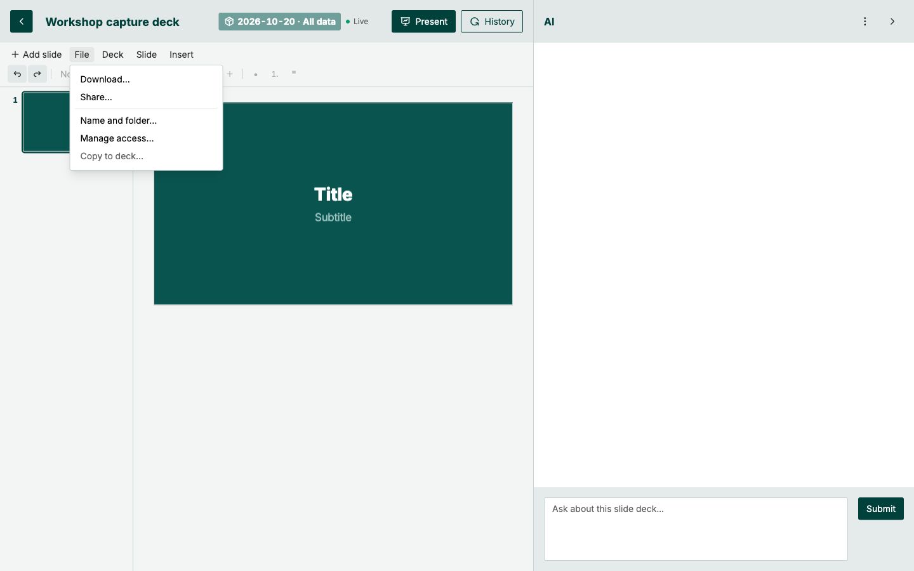

Criar apresentação → Adicionar manual → Adicionar IA → Editar & finalizar → Formatar texto → Definições

# Definições da apresentação: tema, logótipos, rodapé, partilha

<strong>Atividade</strong> · <strong>Apresentações</strong> · <strong>~10 min</strong>

<aside class="p1-sidebar">

Antes de começar

- ☐ A sua apresentação tem pelo menos um diapositivo de conteúdo terminado
- ☐ Qualquer logótipo personalizado que queira já está em **Recursos** (ver Pré-passo)

Porque é importante

Estas definições transformam um rascunho em algo partilhável: um aspeto consistente, os logótipos certos, um rodapé e números de página em todos os diapositivos de conteúdo, um nome que as pessoas encontram, e as pessoas certas a poder abri-la.

</aside>

## Pré-passo: os logótipos personalizados vivem em Recursos

Os logótipos personalizados não são carregados dentro de uma apresentação. Vivem em **Recursos**, uma biblioteca ao nível da instância que todas as apresentações e relatórios podem usar.

> **O carregamento em Recursos é para administradores.** Se não for administrador, peça ao seu facilitador que carregue os seus ficheiros de logótipo (PNG ou JPEG) antes de começar. Uma vez em Recursos, aparecem no seletor de logótipos da apresentação.

Os administradores chegam lá pela navegação lateral: **Recursos → Carregar recursos**. Recursos guarda também outros ficheiros partilhados (ficheiros de mapas GeoJSON, carregamentos CSV).

---

## Dois menus fazem tudo isto

Com a apresentação aberta, o menu **Apresentação** trata do aspeto; o menu **Ficheiro** trata do nome, da pasta, do acesso e da exportação.

<h2 class="step-h">1Apresentação → Tema</h2>

O tema define as cores, a tipografia e os elementos fixos de todos os diapositivos: Predefinido (verde GFF), Minimalista, Corporativo, Ministério, Executivo, entre outros. É o mesmo seletor que viu quando a apresentação foi criada. Escolha um e mantenha-o em toda a apresentação.

<h2 class="step-h">2Apresentação → Logótipos</h2>

Três espaços, cada um independente: a **capa**, o **cabeçalho dos diapositivos de conteúdo** e o **rodapé dos diapositivos de conteúdo**. Cada um oferece os logótipos FASTR integrados (a cores e em branco) e os logótipos personalizados carregados em Recursos. Diapositivo a diapositivo, o menu **Diapositivo** pode mostrar ou esconder os logótipos da capa.

<h2 class="step-h">3Apresentação → Rodapé e números de página</h2>

Uma linha curta de rodapé (país, período, autor) mostrada em todos os diapositivos de conteúdo, e um interruptor para os números de página. Os diapositivos de capa e de secção ignoram ambos.

**Apresentação → Todas as definições da apresentação…** abre o painel completo de definições, se quiser tudo num só ecrã.

---

<h2 class="step-h">4Ficheiro → Nome e pasta…</h2>

Muda o nome da apresentação e move-a para outra pasta. Clicar no título da apresentação no canto superior esquerdo também muda o nome. Use a convenção que a sua equipa combinou (país, período, tema, o seu nome).

<h2 class="step-h">5Ficheiro → Gerir acesso…</h2>

Quem pode abrir e editar esta apresentação: **Proprietário**, **Editor** ou **Leitor** por pessoa. Uma apresentação é visível para a equipa por predefinição; a linha na página Produtos mostra **Restrito** quando o acesso foi limitado. Para definir o acesso de uma pasta inteira de uma só vez, use **⋮ → Definir o acesso a tudo o que está nesta pasta…** na linha da pasta, na página Produtos.

<h2 class="step-h">6Ficheiro → Transferir… e Partilhar…</h2>

**Transferir…** exporta a apresentação (PDF, ou PPTX com os gráficos como imagens). **Partilhar…** dá uma ligação. **Copiar para apresentação…** copia os diapositivos selecionados para outra apresentação.

Não há nada para guardar: todas as definições se aplicam de imediato e ficam guardadas em direto.

---

## Ponto de verificação

A sua apresentação deverá:

- Usar um só tema em todos os diapositivos
- Mostrar os logótipos que pretende em cada espaço
- Trazer o rodapé e os números de página nos diapositivos de conteúdo
- Ter um nome que a sua equipa consiga encontrar, na sua pasta
- Estar aberta às pessoas que precisam dela, e só a essas

## O que pode correr mal

- **O logótipo personalizado não aparece no seletor.** O ficheiro ainda não está em Recursos. Peça a um administrador que o carregue, e volte a abrir o seletor de logótipos.
- **Rodapé na capa.** Não deveria estar lá; os diapositivos de capa e de secção ignoram o rodapé. Se aparecer, verifique o tipo do diapositivo no menu **Diapositivo**.
- **Um colega não consegue abrir a apresentação.** Não está em **Gerir acesso**, ou a pasta está restrita. Acrescente-o, ou fale com o proprietário da pasta.
- **A apresentação mostra números antigos.** Está ligada a um pacote de resultados mais antigo. Na página Produtos, **⋮ → Pacote de resultados e âmbito…** move-a para o pacote fixado.

## A seguir

A apresentação está pronta a partilhar. Transfira-a, ou envie a ligação.
