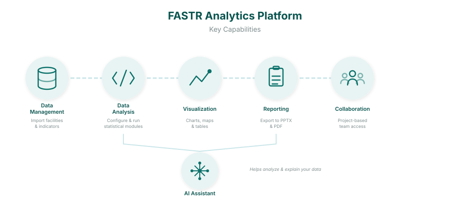
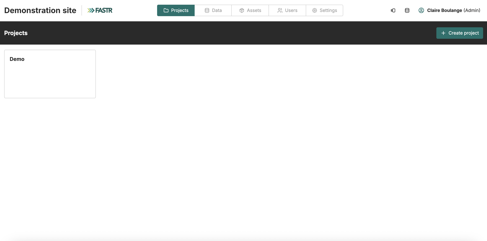
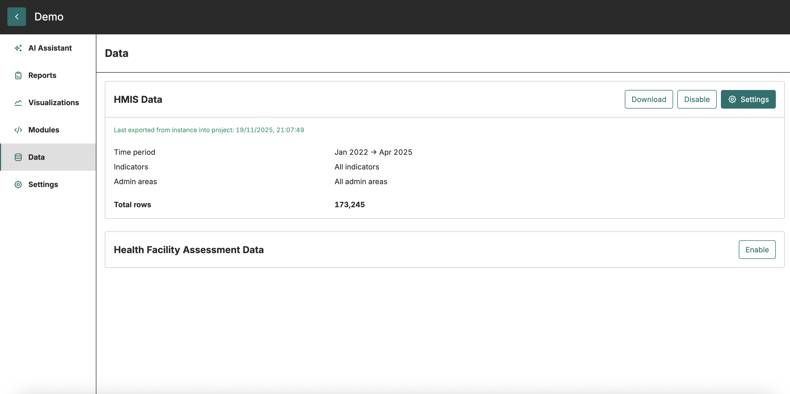
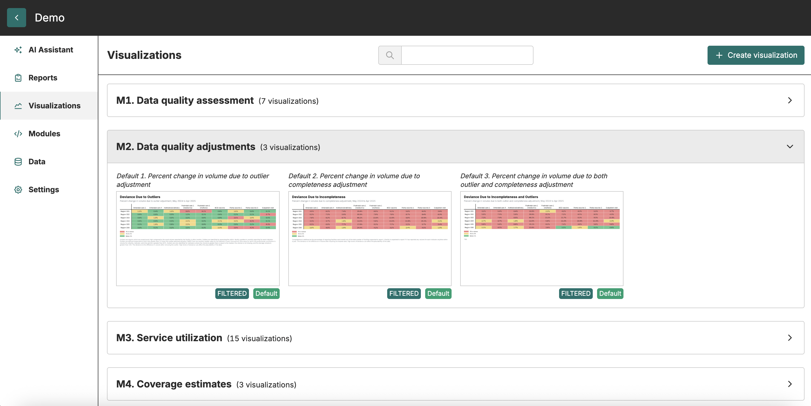
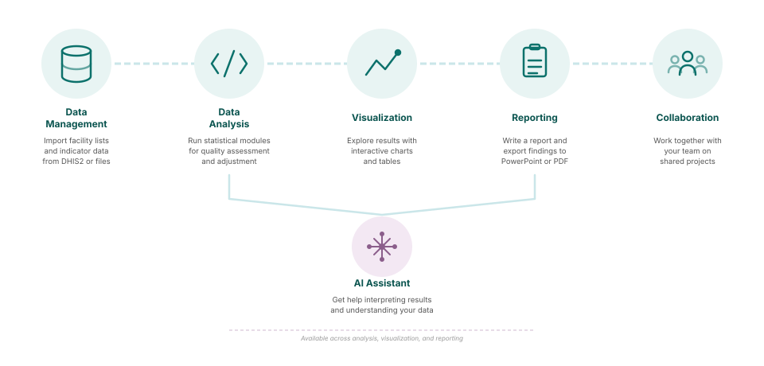
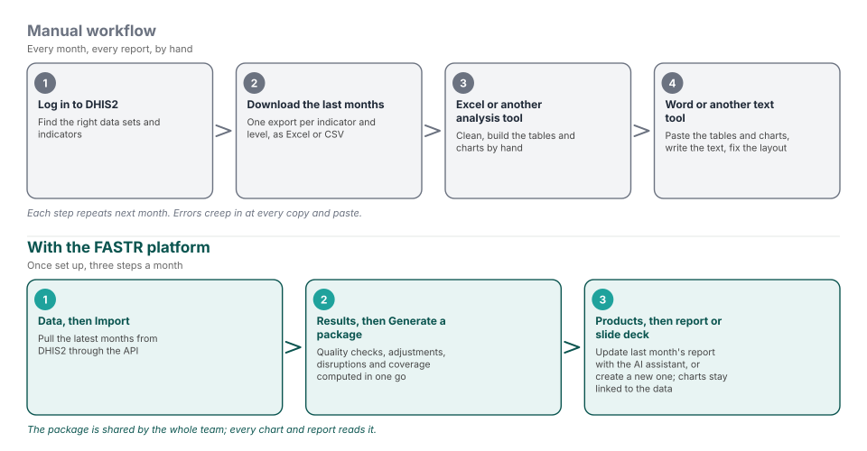
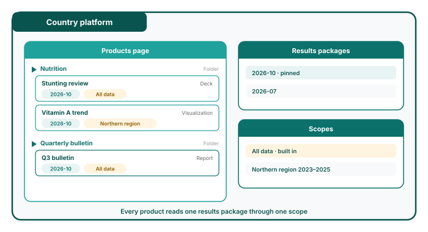

# The FASTR data analytics platform

## Overview

The FASTR analytics platform is a web-based tool designed to support data quality assessment, adjustment, and analysis for routine health data. It allows users to upload and analyze data from various sources, including DHIS2, with built-in statistical methods to generate an adjusted dataset and run priority analyses on selected indicators. The platform provides a user-friendly interface for running analyses and offers flexible options for visualizing and exporting results.

## Key capabilities

### Data management

The platform provides comprehensive data management functionality. Users can import and manage health facility structures, including administrative areas and individual facilities. The system supports data imports from Health Management Information Systems (HMIS) and Health Facility Assessments (HFA), enabling users to manage indicators from multiple sources while tracking dataset versions over time.

### Data analysis

Analytical capabilities are delivered through modules: data quality assessment, data quality adjustments, disruption detection, coverage denominators, coverage estimates and indicator values. An administrator chooses the modules and generates a **results package**, a versioned set of already-computed results for the whole instance. One package is pinned as the reference; a new month of data means a new package. Users never run analyses themselves: they read packages.

### AI assistant

An integrated AI assistant helps users understand and interpret their data. The assistant can explain module outputs, describe data trends and patterns, provide insights about visualizations, and help generate narrative content for reports. The assistant works inside an open product (a visualization, a slide deck or a report): it reads that product's data, updates its figures live, and drafts text. Users ask in natural language and receive contextual guidance on analysis and interpretation.

### Visualization

The platform offers robust visualization tools for presenting analytical results. Users can create charts, maps, and tables from processed data, with options to filter and disaggregate by multiple dimensions. Visualizations can be customized in appearance and styling and exported as images or data files for use in external applications.

### Sharing results

Everything a user makes is a **product** on one shared Products page: 

- **Visualizations** — a saved chart, map or table with its own filters and styling. Built once, kept in a folder, copied into decks and reports.
- **Slide decks** — slides that combine visualizations and text, designed for live meetings and workshops. Presented from the platform or downloaded.
- **Reports** — long-form narrative documents that combine written analysis with live figures, for stakeholders reading a document end-to-end.

For a quick look without creating anything, the **Explore** page shows every computed analysis as a table, a set of charts or a map.

### Collaboration

The whole country team works on one Products page, organized in folders. Every product saves itself as it is edited and the team sees changes live. Access is set per product, like a shared document: an owner, editors and viewers, plus a general access for everyone else in the instance. Access can also be set for everything in a folder at once.

## Who should use this application?

### Data analysts

Data analysts will find the platform valuable for analyzing health data trends, creating visualizations, and generating reports for decision-makers. The analytical modules and visualization tools are designed to support rigorous data analysis workflows.

### Health program managers

Health program managers can use the platform to monitor program performance, track key indicators, and share insights with their teams. The reporting functionality enables regular communication of results to support evidence-based program management.

### System administrators

System administrators are responsible for setting up the platform, managing users, importing data, and configuring the system to meet organizational needs. Administrative tools provide control over user access, data sources, and platform settings.

## How the application works

### Organization level (instance)

The **instance** is the country's workspace within the platform. Each instance contains all registered users, the shared administrative structure (administrative areas and health facilities), shared indicator definitions, the data sources (HMIS and HFA), the results packages computed from them, the scopes, and every product the team has made.

### Products, folders and scopes

Users work on the **Products** page: one list for the whole instance, organized in nestable **folders**, holding every visualization, slide deck and report. Each product reads one **results package** (which computation) through one **scope** (which part of the data: a region, a range of years, a set of modules or indicators). The built-in scope **All data** covers everything; named scopes are created once on the Scopes page and shared by the whole team.

### Data flow

The platform follows a structured data flow: **Data import → Results package → Products**. An administrator imports facility data at the instance level and generates a results package from it. Users then build products that read the package: a visualization shows one metric as a chart, map or table; slide decks and reports assemble visualizations with text. A scope on each product narrows what it shows. The Explore page sits beside this flow for a quick look at any computed result.

## Technical requirements

### Supported languages

The application currently supports English and French. Language settings can be configured at the instance level to meet the needs of different user communities.

### Browser requirements

The application is designed to work with modern web browsers. Chrome is recommended for optimal performance, though Firefox, Safari, and Edge are also supported. JavaScript must be enabled for full functionality.

## Basic concepts

Understanding these core concepts will help users work effectively with the application.

### Instance

An **instance** is the country's workspace within the platform. It is the top-level container for all users, the shared administrative structure, data sources, results packages, scopes and products. Each country operates within a single instance.

### Products and folders

A **product** is anything a user makes and keeps: a visualization, a slide deck or a report. All products live on the one Products page, in **folders** that can be nested (a country folder with one sub-folder per person, for example). Each product's row shows its type, its results package, its scope and when it was last updated. A product's menu lets you move it to a folder, duplicate it, change its package and scope, or manage who can open it.

### Results packages

A **results package** is a versioned set of computed results for the instance: an administrator chooses the modules, generates the package, and pins one as the reference. Packages are immutable; when new data is imported, a new package is generated and products are moved to it. Products read packages; nobody runs analyses inside a product.

### Scopes

A **scope** is a named view of the instance's data that a product reads through. Per data family (HMIS, HFA, ICEH) it can include everything or limit the geography to one region, the years, the modules and the indicators. The built-in scope **All data** limits nothing and cannot be edited or deleted. Users with unrestricted data access create scopes on the Scopes page; every approved user sees the list and picks one when creating a product or in Explore. A scope is independent of the results package: the package says which computation, the scope says which part of it is shown.

### Structure

The **structure** defines the hierarchical organization of administrative areas and health facilities within the platform.

**Administrative areas** represent geographic boundaries organized in up to four levels. Admin Area 1 represents the country boundaries. Admin Area 2 corresponds to the largest subnational units such as provinces or regions. Admin Area 3 encompasses mid-level units like districts or departments, while Admin Area 4 represents smaller units such as communes or sub-districts. Not all instances require all four administrative levels.

**Health facilities** are the healthcare service delivery points—including hospitals, clinics, and health posts—that are linked to administrative areas within the structure. Facilities may have additional attributes such as facility type (hospital, health center, or dispensary) and ownership category (public, private, or faith-based).

### Data sources

#### HMIS data

Health Management Information System (HMIS) data contains routine health service statistics collected from facilities. This includes service delivery indicators, disease surveillance data, and program performance metrics. HMIS data is typically reported on a monthly basis and forms the foundation for most routine health system analyses.

#### HFA data

Health Facility Assessment (HFA) data contains information about facility characteristics and capacity. This includes data on infrastructure availability, equipment and supplies, staffing levels, and service readiness. HFA data complements HMIS data by providing context about the facilities from which routine data is reported.

### Indicators

**Indicators** are measurable health metrics used within the platform. Three types exist:

- **Common indicators** are defined and shared across the instance for consistent measurement.
- **DHIS2 indicators** are imported from external DHIS2 systems and may follow different naming conventions or calculation methods.
- **Calculated indicators** are derived metrics that combine two values — typically a numerator indicator divided by a denominator (another indicator, or a population-based figure). For example, ANC1 visits divided by the target pregnant-women population gives an ANC1 coverage estimate. Calculated indicators can be displayed as a percent, a count, or a rate per 10,000, and they support traffic-light thresholds for quick performance review (e.g., green at or above 80%, yellow 70–79%, red below 70%).

Calculated indicators are computed at HMIS-import time, so changing a definition requires a re-import to take effect. Population-based denominators require a population CSV to be uploaded at the instance level before they can be used.

### Datasets and versions

A **dataset** is a collection of health data, either HMIS or HFA. Each time data is imported into the platform, a new version is created. This versioning system allows users to track changes over time, switch between versions if needed, and maintain a complete data history for audit and comparison purposes.

### Modules

**Modules** are the analytical methods built into the platform: data quality assessment, data quality adjustments, disruption detection, coverage denominators, coverage estimates, and indicator values. Each module takes a dataset or another module's outputs as input and produces result tables. Some modules depend on others, so coverage estimates need coverage denominators first.

Modules run when an administrator generates a results package, with the settings chosen at that time (**Module defaults** on the Results page). The platform shows modules by their label; in a product or in Explore, a user picks a module and one of its metrics.

### Visualizations

**Visualizations** are visual representations of data generated from module outputs. The platform supports three main visualization types: charts (including bar charts, line graphs, and pie charts), maps (geographic visualizations showing data across administrative areas), and tables (tabular data displays).

A visualization is built from a metric (a module's output) with a preset or a custom type: table, time series, bar chart, pie chart or map. It can be filtered to a subset (a time period, an area, an indicator) and disaggregated (one line, row, column or chart per area, indicator or facility type). Users can customize the appearance and styling, download the figure, and insert copies of it into slide decks and reports. A visualization is a product: it has a row on the Products page, saves itself as it is edited, and keeps a history of versions to restore from.

### Explore

**Explore** is the page for looking before building. It shows every analysis in a results package, module by module, as a table, a set of small charts over time, or a map, with filters for level, indicators and period. Nothing in Explore is saved or shared; when a view answers a question, the user builds it as a visualization. Explore replaces the dashboards of earlier versions.

### Slide decks

**Slide decks** are slides designed for live workshops or stakeholder meetings. Each slide holds blocks of text, visualizations or images, laid out with a theme chosen for the deck. Visualizations inserted in a deck are copies that stay linked to the data. Decks are presented from the platform or downloaded, and are best suited for findings that will be projected in a room while someone walks the audience through them.

### Reports

**Reports** are long-form narrative documents that combine written analysis with live figures from the platform. The editor works like a word processor: users write commentary, embed visualizations that update when the package changes, and add images, tables and page elements. Reports are downloaded or emailed for stakeholders reading a document end-to-end. Use a slide deck when the deliverable will be projected in a meeting; use a report when it will be read on a desk or in an inbox.

### Disaggregation

**Disaggregation** refers to the process of breaking down data by dimensions to identify patterns and variations. Data can be disaggregated by time period (monthly, quarterly, or yearly), by administrative area level, by facility type, by facility ownership, or by indicator categories. This capability supports more nuanced analysis and helps identify disparities across different dimensions.

### Users, permissions and access

Every account must be **approved** by an administrator before it can see anything. **Global administrators** manage the instance: users, data imports, results packages, and every product. Other users hold permissions set on the Users page: viewing or configuring users, viewing or configuring data.

Two further settings decide what a user sees. **Data access** is either unrestricted (all scopes) or restricted to a list of scopes granted by an administrator; a restricted user sees only the data those scopes cover, everywhere on the platform. **Product access** works like a shared document: each product has an owner, per-user grants as editor or viewer, and a general access for everyone else in the instance (restricted, anyone can view, or anyone can edit). Folders carry no access of their own, but access can be set for everything in a folder at once.

### Data quality scores

The platform automatically assesses data completeness and accuracy, generating quality scores that help users identify potential data issues. These scores support data quality review processes and help prioritize areas requiring attention.

!!! tip "User guide"
    For step-by-step tutorials on using the platform, see the [FASTR user guide](11_user_guide.md).

---

<!--
////////////////////////////////////////////////////////////////////
//                                                                //
//   _____ _     _____ ____  _____    ____ ___  _   _ _____ _   _ //
//  / ____| |   |_   _|  _ \| ____|  / ___/ _ \| \ | |_   _| \ | |//
//  | (___ | |     | | | | | | |__   | |  | | | |  \| | | | |  \| |//
//   \___ \| |     | | | | | |  __|  | |  | | | | . ` | | | | . ` |//
//   ____) | |___ _| |_| |_| | |____ | |__| |_| | |\  | | | | |\  |//
//  |_____/|_____|_____|____/|______| \____\___/|_| \_| |_| |_| \_|//
//                                                                //
//            Edit workshop slides below this line                //
//                                                                //
////////////////////////////////////////////////////////////////////
-->

<!-- SLIDE:m3_1 -->
## FASTR analytics platform

The **FASTR analytics platform** is a web-based tool designed to support data quality assessment, adjustment, and analysis for routine health data.

It allows users to upload and analyze data from various sources, including DHIS2, with built-in statistical methods to generate an adjusted dataset and run priority analyses on selected indicators.

The platform provides a user-friendly interface for running analyses and offers flexible options for visualizing and exporting results.

  

<!-- /SLIDE -->

<!-- SLIDE:m3_1b -->
## Platform capabilities

**Data Management** — Import facility lists and indicator data from DHIS2 or files

**Data Analysis** — Run statistical modules for quality assessment and adjustment

**Visualization** — Look at any result in Explore, then build charts, maps and tables

**Sharing results** — Slide decks and narrative reports, with figures that stay linked to the data

**Collaboration** — One Products page for the team, folders, and access per product

**AI Assistant** — Get help interpreting results and understanding your data

<!-- /SLIDE -->

<!-- SLIDE:m3_1c -->
## From data to report: by hand and with FASTR

By hand, every monthly report is rebuilt from a DHIS2 export. With FASTR, a report is **linked to a results package**: it picks one when created, and a new month means switching it to the new package. Every chart refreshes; the AI assistant rewrites the text.

<!--
PRESENTER NOTES:
- The four grey steps are what most teams do today; ask the room how long one report takes.
- The three green steps are the platform flow: Data → Import, Results → Generate a results package, Products → report. Only the first two need an administrator.
- Charts in a FASTR report stay linked to the package, so updating the report is a package change, not a rebuild.
-->
<!-- /SLIDE -->

<!-- SLIDE:m3_2a -->
## Country Instance

Each country has its own **instance** of the FASTR analytics platform.

An instance contains:

- All registered users and their accounts
- The shared administrative structure (regions, districts, facilities)
- Indicator definitions, data sources and the results packages computed from them
- The scopes, and every product the team has made

**Think of an instance as your country's dedicated workspace.**
<!-- /SLIDE -->

<!-- SLIDE:m3_2b -->
## Users, permissions and access

**Approval first.** A new account sees nothing until an administrator approves it.

**Global administrators** manage users, data, results packages, and own every product. Other users hold permissions set on the Users page (view or configure users, view or configure data).

**Data access**: unrestricted, or limited to the scopes an administrator grants. A restricted user sees only that data, everywhere.

**Product access**, like a shared document: an owner, editors, viewers, and a general access for everyone else (restricted / anyone can view / anyone can edit). Set in **Manage access**, per product or for a whole folder.
<!-- /SLIDE -->

<!-- SLIDE:m3_2c -->
## Products, folders and scopes

One **Products** page for the country: every visualization, slide deck and report, in **folders**.

Each product reads one **results package** (which computation) through one **scope** (which part of the data).

**Key questions when setting up:**

- Which package is pinned?
- Which scopes does the team need?
- Who may open or edit what?

<!-- /SLIDE -->

---

**Contact**: <fastr@worldbank.org>
