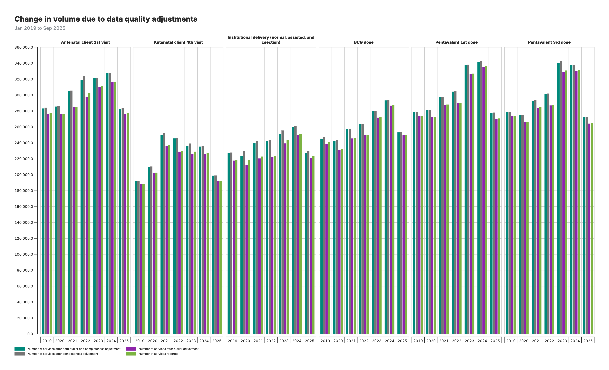
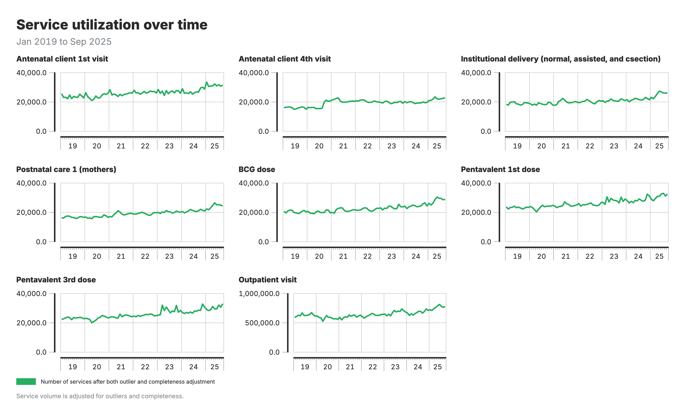
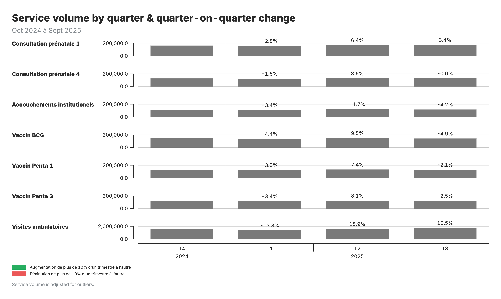
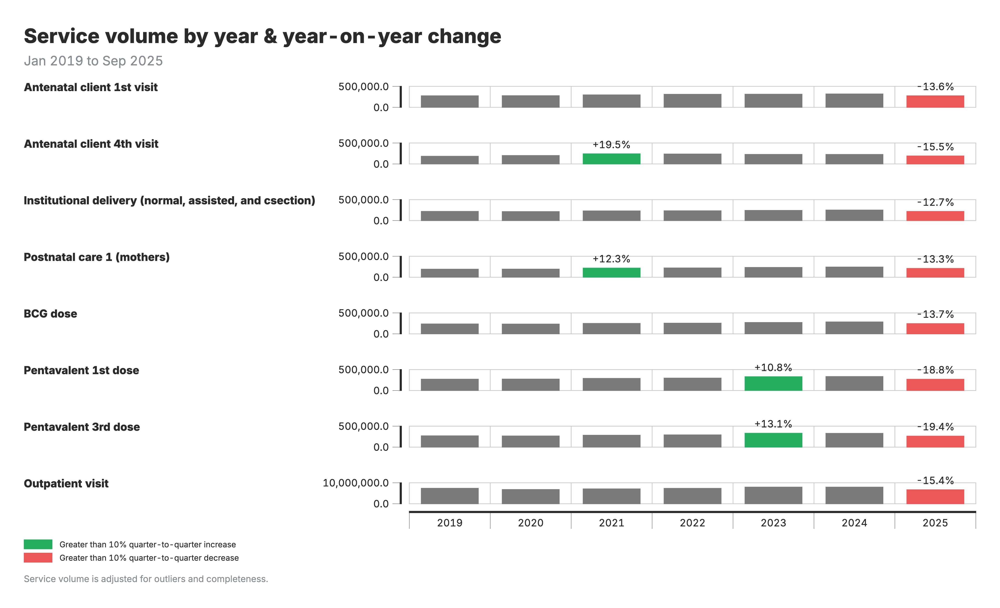
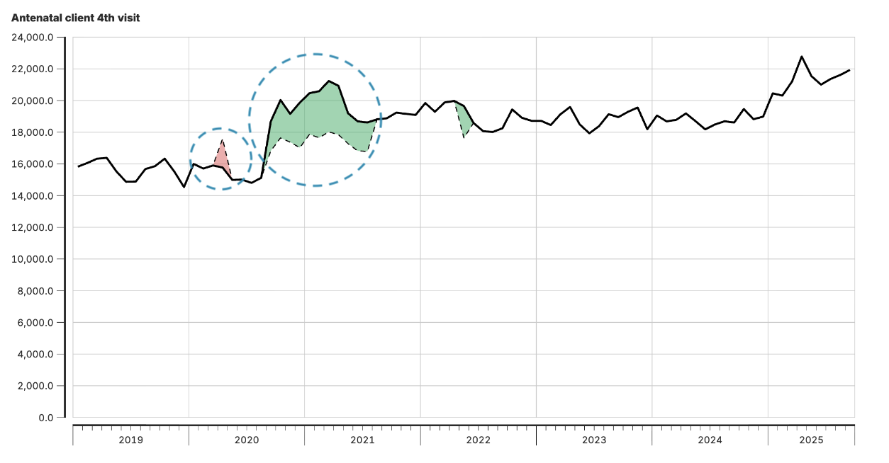
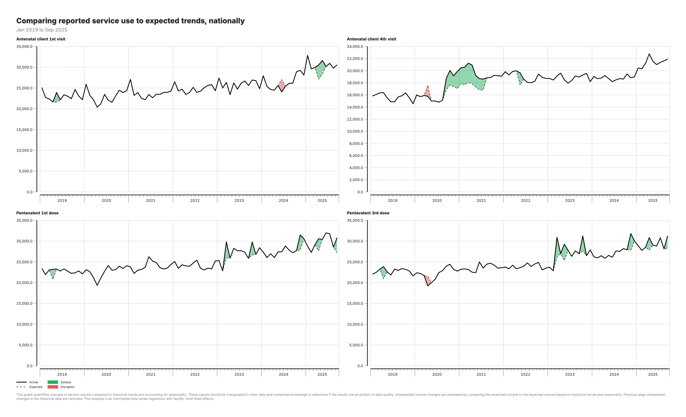

# Service utilization analysis

## Background and purpose

### Objective of the module

Service utilization analysis describes how much of each health service is delivered over time: how many antenatal visits, deliveries, vaccinations or consultations are recorded each month, how those volumes change from one year to the next and from one quarter to the next, and how much the data quality adjustments change the picture.

It answers the first question a program asks of its routine data: are more or fewer people using the service than before, and where? It does not say whether a change is unusual given trend and seasonality. That question is answered by the [Disruption detection module](06b_disruption_detection.md), which models each facility's expected volume and flags the months that fall outside it.

### Analytical rationale

Raw monthly counts are hard to read directly. Volumes rise and fall with the season, a facility that stops reporting pulls the total down, and an outlier can double a district's figure for a month. Service utilization analysis therefore works on the adjusted data produced by the Data quality adjustment module and presents it in three ways that are easy to compare: annual totals with the change from the previous year, quarterly totals with the change from the previous quarter, and the same volumes under each adjustment scenario so that the effect of the adjustments is visible.

Because the analysis is descriptive, its reading depends on the direction of the indicator. More deliveries in facilities is good; more stillbirths is not. Indicator directionality is recorded so that increases and decreases are colored consistently.

### Key points

| Component | Details |
|-----------|---------|
| **Inputs** | Adjusted service volumes from the Data quality adjustment module (M2): unadjusted, outlier-adjusted, completeness-adjusted, and both Indicator values from the Indicator values module (M12) for calculated indicators |
| **Outputs** | Monthly and annual service volumes by indicator and area Year-over-year change Quarter-on-quarter change Volume under each adjustment scenario |
| **Purpose** | Describe and compare service volumes over time and across areas, as the starting point for interpretation and for disruption detection |

---

## Analytical workflow

### Overview of analytical steps

1. **Start from adjusted data.** The Data quality adjustment module produces one monthly count per facility and indicator under four scenarios: no adjustment, outliers adjusted, completeness adjusted, and both. The service utilization views aggregate these counts to the chosen geographic level.

2. **Compare years.** Annual totals are computed per indicator and area, and the change from the previous year is expressed as a percentage.

3. **Compare quarters.** Quarterly totals are compared with the previous quarter in the same way, which captures more recent shifts than the annual view.

4. **Flag large changes.** Changes beyond ±10 % are highlighted for follow-up. A flag is a prompt to investigate, not a conclusion: the change may be a real program effect, a data quality problem, or an expected event such as a campaign.

5. **Show the effect of adjustments.** The same volumes are displayed under each adjustment scenario so that users can see how much of a change is due to the data corrections rather than to service delivery.

### Key decision points

**Which count to display**

The outlier-adjusted count is the usual choice for reporting. The completeness-adjusted counts estimate what the volume would have been if every facility had reported, which is useful for planning but should be labeled as an estimate. Showing the unadjusted count alongside makes the size of the correction explicit.

**Geographic level**

National and provincial totals are stable enough to read month by month. District totals are noisier, especially for low-volume indicators, where a small absolute change becomes a large percentage. Cross-check district changes against the provincial trend before acting on them.

**Indicator directionality**

For most RMNCAH-N service indicators an increase is favorable. For a few, such as stillbirths or maternal deaths, an increase is unfavorable and the color coding is inverted. The direction is set per indicator in the indicator manager.

### Analysis outputs and visualization

**1. Change in service volume**

Bar chart of annual service volumes by area and indicator, annotated with the year-on-year percent change.

**2. Number of services reported**

Monthly volumes over time, by indicator and area, from the adjusted data.

**3. Quarter-on-quarter change**

Heatmap comparing each quarter with the previous one, with changes beyond ±10 % flagged.

**4. Volume change due to data quality adjustments**

Grouped bar chart comparing service volumes across the four adjustment scenarios.

**Interpretation guide**

- **Bars and annotations** (output 1): annual volumes, with the percent change between consecutive years.
- **Heatmap cells** (output 3): the percent change for each area and quarter; flagged cells exceed the ±10 % threshold in either direction.
- **Four bars per year** (output 4): one per adjustment scenario; compare heights to see how much the adjustments change the reported volume.

---

## Detailed reference

### Change metrics

**Year-over-year change** compares a period with the same period one year earlier:

$$
\text{YoY change (\%)} = \frac{\text{this year} - \text{last year}}{\text{last year}} \times 100
$$

**Quarter-on-quarter change** compares a quarter with the previous quarter:

$$
\text{QoQ change (\%)} = \frac{\text{current quarter} - \text{previous quarter}}{\text{previous quarter}} \times 100
$$

Both are computed per indicator and geographic area. Changes beyond ±10 % are flagged. The threshold is a presentation setting on the chart and can be changed per visualization.

### Interpretation

- A flagged change asks a question; the answer comes from context. Check for campaigns, stock-outs, strikes, policy changes, and reporting problems in the same months.
- Compare the flagged change under the different adjustment scenarios. A change that disappears once completeness is adjusted was a reporting change, not a service change.
- For low-volume indicators and small areas, read the absolute change next to the percentage.
- Sustained movements over several periods carry more weight than a single flagged quarter.
- The last months of a series are provisional, because late reports arrive after the package is generated.

---

<!--
////////////////////////////////////////////////////////////////////
//                                                                //
//   _____ _     _____ ____  _____    ____ ___  _   _ _____ _   _ //
//  / ____| |   |_   _|  _ \| ____|  / ___/ _ \| \ | |_   _| \ | |//
//  | (___ | |     | | | | | | |__   | |  | | | |  \| | | | |  \| |//
//   \___ \| |     | | | | | |  __|  | |  | | | | . ` | | | | . ` |//
//   ____) | |___ _| |_| |_| | |____ | |__| |_| | |\  | | | | |\  |//
//  |_____/|_____|_____|____/|______| \____\___/|_| \_| |_| |_| \_|//
//                                                                //
//            Edit workshop slides below this line                //
//                                                                //
////////////////////////////////////////////////////////////////////
-->

<!-- SLIDE:m6_0 -->
## From adjusted data to analysis

Module 2 produced the adjusted dataset — outliers replaced, gaps imputed. Module 3 is where that work pays off.

Within Module 3, users can analyze **either the adjusted or the unadjusted data**, depending on the question. Adjusted data tells you about underlying patterns; unadjusted data tells you what was actually reported.

The next slides cover two views of service delivery:

- **Service utilization** — volumes over time, quarter-on-quarter and year-on-year comparisons
- **Disruption detection** — a statistical model that flags when actual volumes deviate from what the facility's history would predict

Coverage estimation, which divides services by a target population, comes after.
<!-- /SLIDE -->

<!-- SLIDE:m6_1 -->
## Service utilization analysis

Service utilization analysis measures changes in health service volumes over time. By comparing service delivery across consecutive years, this analysis identifies increases or decreases in utilization patterns across regions and indicators.

The primary metric is **year-over-year percent change**, which quantifies shifts in service delivery between consecutive years. The formula calculates the difference between current and previous year volumes, expressed as a percentage of the previous year. Changes exceeding ±10% are flagged for review, as these typically represent meaningful shifts in service delivery rather than normal variation.
<!-- /SLIDE -->

<!-- SLIDE:m6_1c -->
## Service utilization output

**What you see:** Line chart showing absolute service volumes over time by indicator.

**What it shows:** Count of services delivered each month/quarter.

**Interpretation:** Look for overall trends (increasing/decreasing) and sudden drops or spikes that may need investigation.

<!-- /SLIDE -->

<!-- SLIDE:m6_1d -->
## Quarter-on-quarter change

**What you see:** Heatmap comparing current quarter to the previous quarter, with changes >±10% flagged.

**Formula:** QoQ change % = (current quarter – previous quarter) / previous quarter × 100

**Interpretation:** Flagged changes require follow-up — is this a real program change, data issue, or expected event?

<!-- /SLIDE -->

<!-- SLIDE:m6_1e -->
<!-- _class: output -->
## Year-over-year change output

**What you see:** Heatmap comparing current period to same period last year, with changes >±10% flagged.

**Formula:** YoY change % = (this year - last year) / last year × 100

**Interpretation:** Flagged changes require follow-up — is this a real program change, data issue, or expected event?

<!-- /SLIDE -->

<!-- SLIDE:m6_1f -->
## Indicator directionality

A flagged change only becomes a finding once you know which direction you want the indicator to move.

- **Service-use indicators** (ANC visits, skilled birth attendance, immunisations) should **rise** as systems strengthen.
- **Morbidity and mortality indicators** (maternal deaths, severe malnutrition, disease incidence) should **fall**.
- **Range indicators** sit between two thresholds. The C-section rate is the canonical case — too low means under-access, too high means over-medicalisation.

A 15% rise in postnatal care is good news; the same rise in maternal deaths is not. Always check the direction before reading the signal.
<!-- /SLIDE -->

<!-- SLIDE:m6_2 -->
## Service disruptions and surpluses detection

The FASTR approach to detecting service disruptions and surpluses uses **interrupted time series (ITS) regression** with facility-level fixed effects. This statistical framework allows for more meaningful interpretation and comparison of count data across subnational areas, enabling insights that raw data alone cannot provide.

By focusing on meaningful changes and trends rather than raw numbers, this approach supports more accurate and comparable analysis. Previous large and unexpected changes in historical data are removed to establish a clean baseline. Unexpected volume changes are then estimated by comparing observed volumes to expected volumes based on historical trends and seasonality.
<!-- /SLIDE -->

<!-- SLIDE:m6_2b -->
<!-- _class: output -->
## How disruption detection works

The analysis proceeds through four steps. First, we **use past data to set expectations** by examining several years of historical data to understand the typical pattern for each month, accounting for regular seasonal changes.

Second, we **spot unusual changes** by comparing current service volumes to these expectations. Volumes that are much higher or lower than expected are flagged as unusual changes requiring investigation.

Third, we **handle past disruptions** by adjusting historical data to remove previous large, unexpected changes. This ensures that one-off events do not skew our understanding of what constitutes "normal" service delivery.

Fourth, we **detect disruptions over time** by examining trends to identify clear shifts in health service use over several months, distinguishing between temporary fluctuations and sustained changes.

<!--
PRESENTER NOTES:
1. Using past data to set expectations: We start by looking at the past few years of health service data to understand the typical pattern for each month. For example, if we see that certain services usually have higher or lower volumes during particular months, we use that pattern to help set "normal" expectations for each month going forward. This step helps us account for regular seasonal changes, like an increase in flu-related visits during winter months.
2. Spotting unusual changes: Once we know what "normal" looks like, we can compare current service volumes to those expectations. If we see that the number of people using a particular health service is much higher or lower than expected, we flag it as an unusual change. This could be due to factors like an epidemic, a natural disaster, or even changes in healthcare policy.
3. Handling past disruptions: To keep our analysis accurate, we adjust our historical data by removing previous big, unexpected changes. This makes sure that one-off events from the past don't skew our understanding of what's "normal" today.
4. Detecting disruptions over time: Finally, we look at trends over time to see if there are clear shifts in health service use. For example, if there's a drop in routine vaccinations over several months, we can identify that as a longer-term disruption. By monitoring these trends, we get a better sense of whether changes are just seasonal or might be due to larger, lasting issues that need attention.
-->
<!-- /SLIDE -->

<!-- SLIDE:m6_2d -->
<!-- _class: output -->
## Service disruption output

**What you see:** Chart comparing actual service volume to model-predicted expected volume, accounting for seasonality.

**What it shows:** Deviations from expected — disruptions (below) or surpluses (above).

**Interpretation:** Consider external factors: COVID, strikes, stockouts, campaigns. Persistent deviations warrant program investigation.

<!-- /SLIDE -->

<!-- SLIDE:m6_5a -->
## Service utilization module: Configuration parameters

**Note:** These parameters apply only to the disruption analysis. Year-over-year service utilization analysis does not require configuration.

| Parameter | Description |
|-----------|-------------|
| **Count variable for modeling** | Adjusted count used to compute expected values |
| **Count variable for visualization** | Adjusted count plotted as actual observed |
| **Run district-level model** | Regressions at admin area 3. Yes = detailed; No = faster |
| **Run admin area 4 analysis** | Finest-level analysis. Slow on large datasets |
| **MAD threshold** | MADs flagging sharp deviations. Default 1.5; higher = less sensitive |
| **Smoothing window (k)** | Months in the rolling median (odd). Default 7 |
| **Dip threshold** | Flag if actual < X × expected. Default 0.9 (≥10% drop); 0.8 = big drops only |
| **Difference % threshold** | Flag where actual differs from expected by > X%. Default 10 |

<!--
PRESENTER NOTES:
- These parameters control sensitivity of disruption detection
- MAD threshold: lower = more sensitive (more flags), higher = more conservative
- Smoothing window: larger = smoother trends, smaller = captures rapid changes
- Dip threshold: 0.9 means flag if <90% of expected (10% drop)
- District-level analysis is optional - increases computation time significantly
- Count variable selection: use "both" for most analyses (outlier + completeness adjusted)
- Parameters can be tuned based on country context and data quality
-->
<!-- /SLIDE -->

<!-- ═══════════════════════════════════════════════════════════════════════════
     CONDENSED SLIDES: Methods + Interpretation Combined
═══════════════════════════════════════════════════════════════════════════ -->

<!-- SLIDE:m6_s00 -->
## Data analysis

Three things FASTR does with your data:

1. **Service utilization** — how many services were delivered, how that changed quarter-on-quarter and year-on-year, and what direction "good" means for each indicator.
2. **Disruption detection** — separating real drops in service from normal seasonal variation by learning the expected rhythm of each indicator.
3. **Coverage** — combining the numerator (HMIS volume) with a defensible denominator (target population) to estimate the share of people who needed a service and received it.

Each sub-topic ends with the FASTR outputs you'll see in the platform, and how to read them.
<!-- /SLIDE -->

<!-- SLIDE:m6_s0b -->
## What is service utilization?

Service utilization measures **how many health services are being delivered** — antenatal visits, vaccinations, deliveries, outpatient consultations — by who, where, and over time.

Tracking it tells you whether the system is meeting demand. A rising trend may show better access; a falling one may signal a stockout, a strike, a shock, or a real drop in need.

FASTR computes service utilization from HMIS data, broken down by indicator, geography and time period. The outputs that follow show the volume itself, how it has changed quarter-on-quarter and year-on-year, and which direction is good news for each indicator.
<!-- /SLIDE -->

<!-- SLIDE:m6_s2 -->
## Service utilization: detecting changes

Service volumes naturally go up and down — more malaria cases in the rainy season, for example. How do you tell a **normal variation** from a **real disruption**?

**FASTR learns the normal rhythm** of each indicator in each area:
- Long-term trend (are services growing or shrinking?)
- Seasonality (which months are usually higher?)

Then it compares **observed volumes** to **expected volumes**:

- **Below** expected → potential disruption (stockout? strike? conflict?)
- **Above** expected → unusual increase (vaccination campaign? new program?)

The module measures **how many services were lost or gained** and over what period.
<!-- /SLIDE -->

<!-- SLIDE:m6_s1 -->
## Service utilization analysis

Service utilization analysis tracks how many health services are being delivered over time, identifying trends, anomalies, and comparisons across areas.

**What you see:** Line chart showing absolute service volumes over time by indicator.

**What it shows:** Count of services delivered each month/quarter.

**Interpretation:** Look for overall trends (increasing/decreasing) and sudden drops or spikes that may need investigation.

<!-- /SLIDE -->

<!-- SLIDE:m6_s1b -->
<!-- _class: output -->
## Year-over-year change output

**What you see:** Heatmap comparing current period to same period last year, with changes >±10% flagged.

**Formula:** YoY change % = (this year - last year) / last year × 100

**Interpretation:** Flagged changes require follow-up - is this a real program change, data issue, or expected event?

<!--
PRESENTER NOTES:
- Condensed version combining service trends and YoY comparison
- First chart shows absolute volumes - identify overall patterns
- Second chart shows relative changes - easier to compare across indicators
- YoY changes >±10% are flagged - but threshold is configurable
- For flagged changes, ask: data quality issue, real program change, or external event?
- These outputs don't require population denominators - useful when denominators uncertain
-->
<!-- /SLIDE -->

<!-- SLIDE:m6_s0c -->
## Indicator directionality

A flagged change only becomes a finding once you know which direction you want the indicator to move.

- **Service-use indicators** (ANC visits, skilled birth attendance, immunisations) should **rise** as systems strengthen.
- **Morbidity and mortality indicators** (maternal deaths, severe malnutrition, disease incidence) should **fall**.
- **Range indicators** sit between two thresholds. The C-section rate is the canonical case — too low means under-access, too high means over-medicalisation.

A 15% rise in postnatal care is good news; the same rise in maternal deaths is not. Always check the direction before reading the signal.
<!-- /SLIDE -->

<!-- SLIDE:m6_s1a -->
## Quarter-on-quarter change

**What you see:** Heatmap comparing current quarter to the previous quarter, with changes >±10% flagged.

**Formula:** QoQ change % = (current quarter – previous quarter) / previous quarter × 100

**Interpretation:** Flagged changes require follow-up — is this a real program change, data issue, or expected event?

<!--
PRESENTER NOTES:
- QoQ changes >±10% are flagged — but threshold is configurable
- For flagged changes, ask: data quality issue, real program change, or external event?
- These outputs don't require population denominators — useful when denominators uncertain
- Complementary to the year-over-year view: captures more recent changes
-->
<!-- /SLIDE -->

<!-- SLIDE:m6_s2b -->
<!-- _class: output -->
## Service disruption output

**What you see:** Chart comparing actual service volume to model-predicted expected volume, accounting for seasonality.

**What it shows:** Deviations from expected - disruptions (below) or surpluses (above).

**Interpretation:** Consider external factors: COVID, strikes, stockouts, campaigns. Persistent deviations warrant program investigation.

<!--
PRESENTER NOTES:
- Condensed version focusing on disruption detection methodology
- Key insight: raw counts hard to interpret without context
- Statistical model provides "expected" baseline accounting for seasonality
- Disruption = sustained deviation below expected, not just a single bad month
- When interpreting disruptions, consider external factors: COVID, strikes, etc.
- Persistent deviations warrant deeper investigation into causes
- Can run at national, provincial, or district level depending on data quality
-->
<!-- /SLIDE -->
