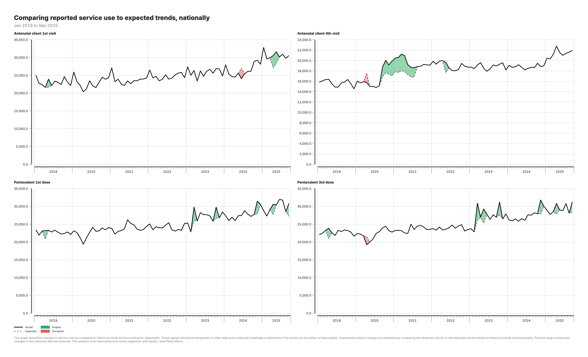
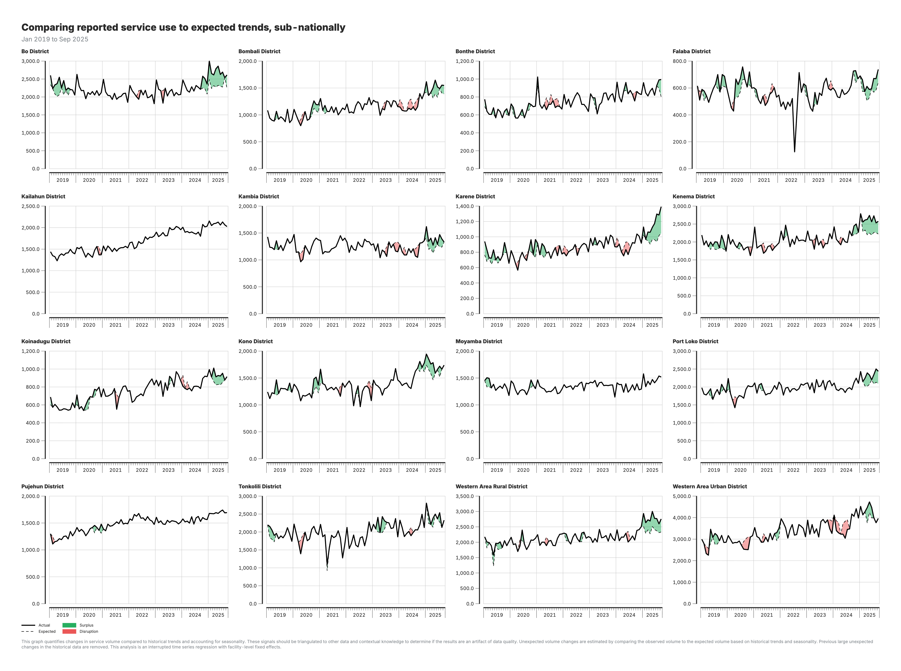

# Disruption detection

## Background and purpose

### Objective of the module

The Disruption detection module identifies months in which the volume of a health service was unusually low or unusually high compared with what the facilities that reported that month would normally deliver. It replaces the control-chart and panel-regression approach of the earlier Service utilization module (M3), which has been retired from the platform.

The module fits a two-part Bayesian model to facility-level monthly data. One part models whether each facility reports in a given month. The other part models how much service a facility delivers when it does report. Keeping these two questions separate is the central idea: a drop in the national total can come from facilities going silent, from facilities delivering less, or from both, and only the second is a service disruption.

For every indicator, month and geographic area, the module produces an observed volume, an expected volume, a 95 % credible interval around that expectation, and a flag when the observed volume falls outside the interval.

### Analytical rationale

Aggregated service volumes move for many reasons: seasonality, long-term trend, facilities opening or closing, facilities that stop submitting reports for a few months, and genuine changes in service delivery. Earlier approaches modeled the aggregated series directly, so a month in which a tenth of facilities failed to report looked the same as a month in which every facility delivered a tenth less.

Modeling at facility level resolves this. The expected volume for a month is built only from the facilities that actually reported that month, so observed and expected are compared on the same set of facilities. A reporting gap does not create a false disruption, and a true decline among reporting facilities is not hidden by the arrival of a new reporter.

Facility-level modeling also handles heterogeneity. A facility random effect lets each facility have its own baseline level, so a large hospital and a small health post are each compared with their own history rather than with a national average.

### Key points

| Component | Details |
|-----------|---------|
| **Inputs** | Facility-level adjusted volumes from the Data quality adjustment module (`M2_adjusted_data.csv`)<br>Raw HMIS (`hmis_ISO3.csv`), only to attach administrative levels to facilities |
| **Outputs** | `M11_disruptions_analysis_admin_area_1.csv` to `_4.csv`: observed, expected, 95 % credible bounds, reporting and service gaps, and deficit/surplus flags by indicator, month and area |
| **Purpose** | Detect real changes in service delivery among reporting facilities, separately from changes in reporting completeness |
| **Prerequisite** | Data quality adjustment module (M2) |
| **Method** | Two-part Bayesian latent-intensity model (Bernoulli reporting model and negative binomial service model) fitted with INLA |

The model was developed by Mustapha Wasseja and integrated into the platform as module `m011`.

---

## Analytical workflow

### Overview of analytical steps

The module runs once per indicator at facility level, then aggregates the results to each administrative level. No separate model is fitted per province or district.

1. **Load the adjusted data.** Facility-level monthly counts come from the Data quality adjustment module. The count used is either the unadjusted count or the count adjusted for outliers. Completeness-imputed counts are deliberately refused: this module models reporting gaps itself, so it must see them in the data.

2. **Build the facility-by-month grid.** For each indicator, every facility is paired with every month in the period. A cell is marked as reported when a value is present and as not reported otherwise. Months before a facility's first-ever report are dropped by default, so a facility that opened partway through the period is not counted as silent before it existed.

3. **Apply the zero policy.** Some HMIS instances store an explicit zero when a facility reported no activity; others auto-fill zero when nothing was submitted. A configurable rule decides which zeros are real reports and which are reclassified as missing.

4. **Fit the reporting model (Part 1).** A Bernoulli model on the full grid estimates, for each facility and month, the probability that the facility reports. The model includes a linear time trend, Fourier seasonality terms and a facility random effect.

5. **Fit the service model (Part 2).** A negative binomial model on the reporting cells only estimates the latent service intensity for each facility and month, with the same trend, seasonality and facility effect.

6. **Aggregate to administrative levels.** For each area and month, the expected volume is the sum of the modeled intensities over the facilities that reported that month. The observed volume is the sum of their reported values. The 95 % credible interval is built from the same facilities.

7. **Flag deviations.** A month is flagged as a deficit when the observed volume is below the lower bound of the interval and as a surplus when it is above the upper bound.

8. **Decompose the gap.** Two further expectations are computed over all facilities, reporting or not, to split the shortfall against a full-reporting counterfactual into a reporting part and a service part.

9. **Write outputs.** One file per administrative level, rewritten after every indicator so that a failure late in a long run loses nothing already computed.

### Key decision points

**Count variable**

The default is the outlier-adjusted count. The unadjusted count is available for instances where the outlier adjustment is not trusted. Counts imputed for completeness are not offered because they fill in the gaps the module exists to model.

**Seasonality terms**

Seasonality is represented by pairs of sine and cosine terms. The default of two pairs captures an annual and a semi-annual cycle. Indicators with sharp campaign spikes, such as vitamin A supplementation, may need three or four pairs.

**Zero policy**

Five settings are available. `all` treats every zero as a real report of zero activity and is the default. `none` treats every zero as missing. `auto` keeps a zero as real only when the facility submitted at least one other indicator that month, and `strict` additionally requires that other indicator to be greater than zero, for systems that auto-fill zeros across all indicators at once. `detect` chooses among `all`, `auto` and `strict` from the share and pattern of zeros in the data.

**New and closed facilities**

Pre-launch months are excluded by default. A grace window for presumed closure can also be set: grid months more than N months after a facility's last-ever report are dropped, while the first N silent months still count as non-reporting so that a genuine reporting collapse remains visible. This is off by default because trailing silence is ambiguous.

**Credible intervals at fine levels**

By default the interval for an area is the sum of the facility-level interval bounds. This is fast and slightly conservative, and it becomes approximate at district level and below. Joint posterior draws give properly calibrated intervals at every level, at roughly ten times the run time and a much larger memory footprint.

### Analysis outputs and visualization

The platform provides one metric per level for the national and admin area 2 outputs, each with a preset chart:

| Metric | Output file | Chart |
|--------|-------------|-------|
| Bayesian disruption detection, national | `M11_disruptions_analysis_admin_area_1.csv` | Disruptions chart with 95 % credible band, one panel per indicator |
| Bayesian disruption detection, admin area 2 | `M11_disruptions_analysis_admin_area_2.csv` | Same chart, indicators in rows and areas in columns |

The chart shows the observed volume as a solid black line and the expected volume as a dashed black line, over a grey band for the 95 % credible interval. Where the observed line rises above the band the area between them is shaded green; where it falls below the band it is shaded red. For indicators where an increase is unfavorable the two colors are swapped.

The admin area 3 and admin area 4 files are produced but have no built-in metric; they can be queried through custom visualizations and the AI assistant.

---

## Detailed reference

### Configuration parameters

Parameters are set in **Results → Module defaults** and apply to every results package generated afterward.

| Parameter | Options | Default | Purpose |
|-----------|---------|---------|---------|
| `SELECTEDCOUNT` | `count_final_none`, `count_final_outliers` | `count_final_outliers` | Count variable to model. Completeness-imputed counts are rejected. |
| `FOURIER_K` | integer | `2` | Number of sine/cosine pairs for seasonality. Raise to 3 or 4 for campaign-style indicators. |
| `USE_POSTERIOR_DRAWS` | yes / no | no | Joint posterior draws (500 samples) for calibrated subnational credible intervals. Slower and memory-heavy on large countries. |
| `ZEROS_REAL` | `all`, `detect`, `auto`, `strict`, `none` | `all` | How explicit zeros are treated. |
| `EXCLUDE_PRELAUNCH` | yes / no | yes | Drop grid months before a facility's first-ever report. |
| `POSTCLOSURE_GRACE` | integer months | `0` (off) | Drop grid months more than N months after a facility's last-ever report. |

### Input specifications

**`M2_adjusted_data.csv`** (from the Data quality adjustment module): one row per facility, indicator and month, with the adjusted count columns. Only the key columns and the selected count column are read, because the file can exceed 80 million rows.

**`hmis_ISO3.csv`**: used only to look up the administrative levels of each facility. The module detects the deepest `admin_area_N` column present and produces rollups up to that level.

### Output specifications

Four files share the same columns, with one or more area columns in front:

| Column | Meaning |
|--------|---------|
| `admin_area_1` … `admin_area_4` | Area identifiers for the level of the file |
| `indicator_common_id` | Indicator |
| `period_id` | Month, as YYYYMM |
| `observed` | Sum of reported values over facilities that reported that month |
| `expected` | Sum of the modeled service intensity over the same facilities |
| `ppi_lwr`, `ppi_upr` | Lower and upper bounds of the 95 % credible interval of `expected` |
| `expected_full` | Sum of the modeled intensity over all facilities in the area, reporting or not |
| `expected_as` | Sum of intensity weighted by the probability of reporting, over all facilities |
| `gap_reporting` | `expected_full − expected_as`: shortfall attributable to non-reporting |
| `gap_service` | `expected_as − observed`: shortfall attributable to service change |
| `flag_deficit` | 1 when `observed < ppi_lwr` |
| `flag_surplus` | 1 when `observed > ppi_upr` |
| `mean_p` | Mean modeled probability of reporting across facilities in the area |
| `n_facilities` | Number of facilities that reported that month |

Levels that do not exist in the country's data receive an empty file with the same columns.

### Statistical model

Let $f$ index facilities and $t$ index months.

**Part 1, reporting.** Whether facility $f$ reports in month $t$ is modeled as

$$
\text{reported}_{f,t} \sim \text{Bernoulli}(p_{f,t}), \qquad
\text{logit}(p_{f,t}) = \alpha + \beta\, z_t + \sum_{k=1}^{K}\left(a_k \sin\tfrac{2\pi k m_t}{12} + b_k \cos\tfrac{2\pi k m_t}{12}\right) + u_f
$$

where $z_t$ is the standardized time index, $m_t$ the calendar month, $K$ the number of Fourier pairs, and $u_f$ an independent facility random effect.

**Part 2, service.** For the cells where a report exists, the count is modeled as

$$
y_{f,t} \sim \text{NegBin}(\mu_{f,t}, \phi), \qquad
\log(\mu_{f,t}) = \alpha' + \beta' z_t + \sum_{k=1}^{K}\left(a'_k \sin\tfrac{2\pi k m_t}{12} + b'_k \cos\tfrac{2\pi k m_t}{12}\right) + v_f
$$

with its own facility random effect $v_f$ and an overdispersion parameter $\phi$. The negative binomial family accommodates the extra-Poisson variation typical of facility counts.

**Priors and fitting.** Both facility random effects use a penalized-complexity prior on their precision, with $P(\sigma > 1) = 0.01$. Both models are fitted with integrated nested Laplace approximation (INLA), which gives posterior marginals without Markov chain Monte Carlo sampling and makes a per-facility model feasible on tens of thousands of facilities.

**Expected baseline and interval.** For an area $A$ and month $t$, with $R_{A,t}$ the set of facilities in $A$ that reported in $t$:

$$
\text{expected}_{A,t} = \sum_{f \in R_{A,t}} \tilde\mu_{f,t}
$$

where $\tilde\mu_{f,t}$ is the posterior median of $\mu_{f,t}$. The default interval sums the facility-level 2.5 % and 97.5 % quantiles over the same set. With joint posterior draws, 500 samples of $\mu$ are summed within each area and month and the 2.5 % and 97.5 % quantiles of those sums are taken instead.

**Gap decomposition.** For every grid cell, including non-reporting months, a predicted intensity $\hat\mu_{f,t}$ is rebuilt from the fixed effects and the facility effect. Then

$$
\text{expected\_full}_{A,t} = \sum_{f \in A} \hat\mu_{f,t}, \qquad
\text{expected\_as}_{A,t} = \sum_{f \in A} \tilde p_{f,t}\,\hat\mu_{f,t}
$$

and the two gaps follow as defined in the output table. The flags are always computed against `expected`, never against these counterfactuals.

### Interpretation

- A month with `flag_deficit = 1` is a real decline in service delivery among the facilities that reported, after allowing for trend, seasonality and facility differences. It is not explained by facilities going silent.
- A month with `flag_surplus = 1` is a real increase, for example a campaign or a catch-up.
- A month inside the band is within expected variation and should not be read as a signal, even if the raw total moved.
- A large `gap_reporting` next to a small `gap_service` means the shortfall in the raw total is mostly missing reports, a data quality issue rather than a service one.
- `mean_p` tracks reporting completeness as the model sees it and typically sits between 60 % and 95 %.

The last months of the series deserve caution for a different reason: late reports arrive after the analysis is run, so the most recent observed values can be revised upward in a later package.

### Usage notes

- **Run time and memory.** Each indicator fits two models at facility level. On a large network a run takes several hours. The default marginal-sum interval is the practical choice for routine packages; joint draws are better reserved for a targeted analysis of a few indicators.
- **Robustness.** An indicator that fails to converge or has degenerate data is skipped with a message in the generation log, and the run continues. Outputs are flushed after every indicator.
- **Choosing the zero policy.** Look at the share of zeros in the adjusted data and at whether all-zero facility-months span many indicators at once. If zeros are rare, `all` is right. If the system fills zeros wholesale, use `strict` or let `detect` choose.
- **Relation to the data quality modules.** Because the module models reporting itself, it must be fed counts that still contain the reporting gaps. Running it on completeness-imputed counts would make every month look fully reported and remove the information Part 1 needs.

### Further reading

- Rue, H., Martino, S. and Chopin, N. (2009). Approximate Bayesian inference for latent Gaussian models by using integrated nested Laplace approximations. *Journal of the Royal Statistical Society: Series B*, 71(2), 319–392.
- Simpson, D., Rue, H., Riebler, A., Martins, T. G. and Sørbye, S. H. (2017). Penalising model component complexity: a principled, practical approach to constructing priors. *Statistical Science*, 32(1), 1–28.

---

## Earlier approach: control charts and panel regression (retired module M3)

Until 2026 disruption detection ran in the Service utilization module (M3), which modeled aggregated volumes with statistical process control and panel regression. The module has been retired from the platform and replaced by the Bayesian module described above. Its method is kept here for reference, because country reports produced before the change cite it and because its outputs are still readable in older results packages.

??? "How the earlier model worked"

    ### Overview of analytical steps

    The module operates in two sequential parts, each with a distinct purpose:

    **Part 1: Control chart analysis** - Identifies unusual patterns in service volumes

    1. **Prepare the data**: Load health service data, remove previously identified outliers, aggregate to the appropriate geographic level, and fill in missing months using interpolation.

    2. **Model expected patterns**: For each combination of health indicator and geographic area, use robust statistical methods to estimate what service volumes should look like based on historical trends and seasonal patterns (e.g., accounting for predictable increases in malaria cases during rainy season).

    3. **Detect deviations**: Compare actual service volumes to expected patterns and identify significant deviations using multiple detection rules:
       - **Sharp disruptions**: Single months with extreme deviations
       - **Sustained drops**: Gradual declines over several months
       - **Sustained dips**: Periods consistently below expected levels
       - **Sustained rises**: Periods consistently above expected levels
       - **Missing data patterns**: Gaps in reporting that may signal problems

    4. **Flag disrupted periods**: Mark months where any disruption pattern is detected, ensuring recent months are always flagged for review.

    **Part 2: Disruption analysis** - Quantifies the impact of identified disruptions

    5. **Apply regression models**: Use panel regression at multiple geographic levels (national, provincial, district) to estimate how much service volumes changed during flagged disruption periods, controlling for trends and seasonality.

    6. **Calculate shortfalls and surpluses**: Compare predicted volumes to actual volumes to quantify the magnitude of disruptions in absolute numbers and percentages.

    7. **Generate outputs**: Create summary files showing disruption impacts at each geographic level, ready for visualization and reporting.

    ### Workflow diagram

    <iframe src="../resources/diagrams/mod3_workflow.html" width="100%" height="800" style="border: 1px solid #ccc; border-radius: 4px;" title="Module 3 Interactive Workflow"></iframe>

    ### Key decision points

    **Geographic level of analysis**

    The module supports disruption analysis at multiple geographic scales. Users may limit analysis to national and provincial levels, which is computationally faster and suitable for routine monitoring, or extend the analysis to district and ward levels to obtain more granular information for targeted investigation and response.

    **Control chart level selection**

    The level at which control charts are calculated determines where statistical modeling is performed. This is configured through two flags and follows the FASTR convention in which higher administrative level numbers correspond to smaller geographic units.

    - **Default configuration (both flags set to FALSE)**  
      Control charts are calculated at an intermediate subnational level (**admin_area_2**). Service volumes are aggregated to this level, and trend estimation, control limit calculation, and disruption detection are performed for each geography–indicator combination. This option is the most computationally efficient and is suitable for routine monitoring.

    - **RUN_DISTRICT_MODEL = TRUE**  
      Control charts are calculated at a finer subnational level (**admin_area_3**). Service volumes are aggregated to smaller geographic units, allowing detection of localized disruptions that may be masked at higher levels of aggregation. This option is more computationally intensive but provides greater spatial resolution.

    - **RUN_ADMIN_AREA_4_ANALYSIS = TRUE**  
      Control charts are calculated at the most granular geographic level available (**admin_area_4**). This enables identification of highly localized or facility-level disruptions. It is the most resource-intensive option and is typically used for targeted or diagnostic analysis.

    The selected control chart level determines where statistical modeling is conducted, including trend estimation, control limit calculation, and disruption flagging. Regardless of the level at which control charts are calculated, disruption results are aggregated and reported at all available geographic levels (national and subnational).


    **Sensitivity settings**

    The module uses configurable statistical thresholds to define what constitutes a disruption. More sensitive settings (lower thresholds) flag smaller deviations from expected patterns and are suitable for early warning purposes. More conservative settings (higher thresholds) restrict detection to larger deviations and are useful for focusing on major disruptions.

    **Treatment of reporting completeness**

    The module accepts alternative versions of service counts produced by Module 2, allowing users to choose whether to analyze raw reported volumes or volumes adjusted for reporting completeness. This provides flexibility to align disruption analysis with different data quality assumptions.

??? "Data processing and outputs"


    **Input transformation**

    The module begins with facility-level monthly service counts (for example, deliveries reported by each facility). These data are aggregated to the selected geographic level. Observations identified as outliers in Module 1 are excluded to prevent anomalous values from influencing trend estimation and control limits.

    **Pattern estimation and detection**

    Using robust statistical methods, the module estimates expected service utilization patterns for each indicator and geographic unit based on historical data, accounting for long-term trends and seasonality. Months in which observed service volumes deviate significantly from these expected patterns are flagged as potential disruptions.

    **Quantification of disruption impacts**

    For periods identified as disrupted, regression-based models are used to estimate counterfactual service volumes—representing expected utilization in the absence of disruption. Differences between predicted and observed volumes are calculated to quantify service shortfalls or surpluses.

    **Output structure**

    The final outputs report disruption metrics at multiple geographic levels, from national summaries to detailed local results. The original reported data are preserved, with additional fields providing expected values, disruption flags, and quantified impacts.

??? "Actual vs expected charts"

    **2. Actual vs expected services (national)**

    Line chart comparing observed service volumes against model predictions at the national level.

    

    **3. Actual vs expected services (subnational)**

    Line charts by region comparing observed volumes to expected patterns.

    

    For the actual vs expected charts (outputs 2–3):

    - **Black line**: Actual (observed) service volumes
    - **Red shaded areas**: Shortfall periods (actual below expected)
    - **Green shaded areas**: Surplus periods (actual above expected)


### Configuration parameters

??? "Core analysis parameters"

    | Parameter | Default | Type | Description | Tuning Guidance |
    |-----------|---------|------|-------------|-----------------|
    | `COUNTRY_ISO3` | "ISO3" | String | Three-letter country code | Set to your country code (e.g., "RWA", "UGA", "ZMB") |
    | `SELECTEDCOUNT` | "count_final_outliers" | String | Data column used for regression modeling | Options: `count_final_none`, `count_final_outliers`, `count_final_completeness`, `count_final_both` |
    | `VISUALIZATIONCOUNT` | "count_final_outliers" | String | Data column used for visualization | Same options as `SELECTEDCOUNT`; can differ if you want to model on one and plot another |

??? "Control chart parameters"

    | Parameter | Default | Type | Description | Tuning Guidance |
    |-----------|---------|------|-------------|-----------------|
    | `SMOOTH_K` | 7 | Integer (odd) | Rolling median window size in months | Larger values = smoother trends, less sensitivity. Must be odd number (e.g., 5, 7, 9, 11) |
    | `MADS_THRESHOLD` | 1.5 | Numeric | MAD units threshold for sharp disruptions | Lower = more sensitive (e.g., 1.0), higher = more conservative (e.g., 2.0) |
    | `DIP_THRESHOLD` | 0.90 | Numeric | Proportion threshold for sustained dips | 0.90 = flag if below 90% of expected (10% drop). Use 0.80 for 20% drop threshold |
    | `DIFFPERCENT` | 10 | Numeric | Percentage threshold for plotting disruptions | If actual differs from predicted by >10%, use predicted value in visualizations |

    **Note**: `RISE_THRESHOLD` is automatically calculated as `1 / DIP_THRESHOLD` (default: ~1.11) to mirror dip detection symmetrically.

??? "Geographic analysis parameters"

    | Parameter | Default | Type | Description | Tuning Guidance |
    |-----------|---------|------|-------------|-----------------|
    | `CONTROL_CHART_LEVEL` | Auto-set | String | Geographic level for control charts | Automatically set based on `RUN_DISTRICT_MODEL` and `RUN_ADMIN_AREA_4_ANALYSIS` |
    | `RUN_DISTRICT_MODEL` | FALSE | Logical | Whether to run admin_area_3 regressions | Set TRUE for district-level analysis (increases runtime) |
    | `RUN_ADMIN_AREA_4_ANALYSIS` | FALSE | Logical | Whether to run admin_area_4 analysis | Set TRUE for finest-level analysis (very slow for large datasets) |

??? "Data source parameters"

    | Parameter | Default | Type | Description |
    |-----------|---------|------|-------------|
    | `PROJECT_DATA_HMIS` | "hmis_ISO3.csv" | String | Filename for raw HMIS data |

??? "Parameter selection guide"

    **For high-sensitivity analysis** (detecting smaller disruptions):
    - `MADS_THRESHOLD = 1.0`
    - `DIP_THRESHOLD = 0.95` (5% drop)
    - `SMOOTH_K = 5` (less smoothing)

    **For conservative analysis** (only major disruptions):
    - `MADS_THRESHOLD = 2.0`
    - `DIP_THRESHOLD = 0.80` (20% drop)
    - `SMOOTH_K = 9` or `11` (more smoothing)

    **For faster runtime**:
    - `RUN_DISTRICT_MODEL = FALSE`
    - `RUN_ADMIN_AREA_4_ANALYSIS = FALSE`
    - `CONTROL_CHART_LEVEL = "admin_area_2"`

### Input/output specifications

??? "Input requirements"

    #### Primary Inputs

    1. **`M2_adjusted_data.csv`** (main data source)
       - Output from Module 2 (Data Quality Adjustments)
       - Contains adjusted service counts with different completeness assumptions
       - Required columns: `facility_id`, `indicator_common_id`, `period_id`, `count_final_none`, `count_final_outliers`, `count_final_completeness`, `count_final_both`

    2. **`M1_output_outliers.csv`**
       - Output from Module 1 (Data Quality Assessment)
       - Contains `outlier_flag` to identify and exclude anomalous data points
       - Required columns: `facility_id`, `indicator_common_id`, `period_id`, `outlier_flag`

    3. **`hmis_ISO3.csv`** (used only for geographic lookup)
       - Raw HMIS file used solely to extract facility_id → admin_area_1 mapping
       - Required because M2_adjusted_data.csv does not include admin_area_1
       - Required columns: `facility_id`, `admin_area_1`

    #### Data Requirements

    - **Temporal coverage**: Minimum 12 months of data for seasonal modeling
    - **Data completeness**: Missing months are filled using interpolation
    - **Geographic completeness**: Data at specified administrative levels
    - **Count data**: Non-negative integer counts (predictions are bounded at zero)

    ### Outputs

    #### 1. Control Chart Results

    **`M3_chartout.csv`**

    **Purpose**: Contains flagged disruptions from the control chart analysis

    **Columns**:

    - `admin_area_*`: Geographic identifier (level depends on `CONTROL_CHART_LEVEL`)
    - `indicator_common_id`: Health service indicator code
    - `period_id`: Time period in YYYYMM format
    - `tagged`: Binary flag (1 = disruption detected, 0 = normal)

    **Use**: Identifies which months require further investigation for each indicator-geography combination

    **`M3_service_utilization.csv`**

    **Purpose**: Pass-through copy of adjusted data for visualization

    **Source**: Direct copy of `M2_adjusted_data.csv`

    **Use**: Provides baseline data for plotting actual service volumes

    **`M3_memory_log.txt`**

    **Purpose**: Tracks memory usage throughout execution

    **Use**: Diagnostics for performance optimization and troubleshooting

    #### 2. Disruption Analysis Results

    **`M3_disruptions_analysis_admin_area_1.csv`** (National level - always generated)

    **Columns**:

    - `admin_area_1`: Country name
    - `indicator_common_id`: Health service indicator
    - `period_id`: Time period (YYYYMM)
    - `count_sum`: Actual service volume (sum across all facilities)
    - `count_expect_sum`: Expected service volume (sum of predictions)
    - `count_expected_if_above_diff_threshold`: Value for plotting (expected if |difference| > DIFFPERCENT, otherwise actual)

    **`M3_disruptions_analysis_admin_area_2.csv`** (Province level - always generated)

    **Additional column**: `admin_area_2` (province/region name)

    **Same structure**: As admin_area_1 file but disaggregated by province

    **`M3_disruptions_analysis_admin_area_3.csv`** (District level - conditional)

    **Generated when**: `RUN_DISTRICT_MODEL = TRUE`

    **Additional columns**: `admin_area_2`, `admin_area_3`

    **Same structure**: As above but disaggregated by district

    **`M3_disruptions_analysis_admin_area_4.csv`** (Ward level - conditional)

    **Generated when**: `RUN_ADMIN_AREA_4_ANALYSIS = TRUE`

    **Additional columns**: `admin_area_2`, `admin_area_3`, `admin_area_4`

    **Warning**: Very large file size for countries with many wards

    #### 3. Shortfall/Surplus Summary Files

    **`M3_all_indicators_shortfalls_admin_area_*.csv`** (one for each geographic level)

    **Purpose**: Pre-calculated shortfall and surplus metrics for reporting

    **Common columns**:

    - Geographic identifier(s): `admin_area_*`
    - `indicator_common_id`: Health service indicator
    - `period_id`: Time period (YYYYMM)
    - `count_sum`: Actual service volume
    - `count_expect_sum`: Expected service volume
    - `shortfall_absolute`: Absolute number of missing services (if negative disruption)
    - `shortfall_percent`: Percentage shortfall relative to expected
    - `surplus_absolute`: Absolute number of excess services (if positive disruption)
    - `surplus_percent`: Percentage surplus relative to expected

    **Note**: If optional geographic levels are disabled, empty placeholder files are created for compatibility with downstream processes.

    #### Temporary Files (Automatically Cleaned)

    During execution, the module creates temporary batch files for memory management:
    - `M3_temp_controlchart_batch_*.csv`
    - `M3_temp_indicator_batch_*.csv`
    - `M3_temp_province_batch_*.csv`
    - `M3_temp_district_batch_*.csv`
    - `M3_temp_admin4_batch_*.csv`

    These are automatically deleted upon successful completion. If the script crashes, these files may remain and will be cleaned up on the next run.

### Key functions documentation

??? "`robust_control_chart(panel_data, selected_count)`"

    **Purpose**: Identifies anomalies in service utilization using robust regression and MAD-based control limits.

    **Inputs**:

    - `panel_data`: Time series data for a specific indicator-geography combination
    - `selected_count`: Column name containing service volume counts to analyze

    **Process**:

    1. Fits a robust linear model (using `MASS::rlm()`) with seasonal controls and time trends
    2. Applies rolling median smoothing to predicted values to reduce noise
    3. Calculates residuals and standardizes them using Median Absolute Deviation (MAD)
    4. Applies rule-based tagging logic to identify different disruption types
    5. Flags recent months automatically to ensure timely detection

    **Outputs**:

    - `count_predict`: Predicted service volume from robust regression
    - `count_smooth`: Smoothed predictions using rolling median
    - `residual`: Difference between actual and smoothed values
    - `robust_control`: Standardized residual (residual/MAD)
    - `tagged`: Binary flag (1 = disruption detected, 0 = normal variation)
    - Additional flags: `tag_sharp`, `tag_sustained`, `tag_sustained_dip`, `tag_sustained_rise`, `tag_missing`

    **Key features**:

    - Handles missing data gracefully with interpolation
    - Uses robust regression to minimize influence of outliers
    - Employs multiple disruption detection rules for different patterns
    - Ensures non-negative predictions (counts cannot be negative)

    ### Panel Regression Models

    The disruption analysis uses panel regression models (`fixest::feols()`) at multiple geographic levels. Separate regressions are run for each geographic unit at each level, with clustered standard errors to account for within-area correlation.

    **Country-wide Model** (Admin Area 1):

    ```r
    count ~ date + factor(month) + tagged
    ```

    Single regression across all facilities, with standard errors clustered at district level (`admin_area_3`) when more than one district is available; otherwise unclustered.

    **Province-level Models** (Admin Area 2):

    ```r
    count ~ date + factor(month) + tagged
    ```

    Separate regression run for each province, with standard errors clustered at district level when more than one district is available; otherwise unclustered.

    **District-level Models** (Admin Area 3 - optional):

    ```r
    count ~ date + factor(month) + tagged
    ```

    Separate regression run for each district (minimum 10 observations required), with standard errors clustered at ward level (`admin_area_4`) when more than one ward is available; otherwise unclustered.

    **Ward-level Models** (Admin Area 4 - optional):

    ```r
    count ~ date + factor(month) + tagged
    ```

    Separate regression run for each ward/finest unit (minimum 8 observations required, no clustering).

    ### Supporting Functions

    **`mem_usage(msg)`**: Tracks and logs memory consumption throughout execution

    **Data processing**:

    - Batch processing with disk-based temporary files for memory efficiency
    - Efficient data.table operations for large datasets
    - Progressive aggregation and merging strategies

### Statistical methods & algorithms

??? "Control chart analysis"

    Service volumes are aggregated at the specified geographic level (configurable via `CONTROL_CHART_LEVEL`). The pipeline removes outliers (`outlier_flag == 1`), fills in missing months, and filters low-volume months (<50% of global mean volume).

    A robust regression model estimates expected service volumes per indicator × geographic area (`panelvar`). A centered rolling median is applied to smooth the predicted values. Residuals (actual - smoothed) are standardized using MAD. Disruptions are identified using a rule-based tagging system.

    #### Disruption Detection Rules

    Each rule is controlled by user-defined parameters, allowing customization of the sensitivity and behavior of the detection logic:

    **Sharp disruptions**: Flags a single month when the standardized residual (residual divided by MAD) exceeds a threshold:

    $$ \left| \frac{\text{residual}}{\text{MAD}} \right| \geq \text{MADS_THRESHOLD} $$

    - **Parameter:** `MADS_THRESHOLD` (default: `1.5`)
    - Lower values make the detection more sensitive to sudden spikes or dips.

    **Sustained drops**: Flags a sustained drop if:

    - Three consecutive months show mild deviations (standardized residual ≥ 1 but < `MADS_THRESHOLD`), and
    - The current month has a standardized residual ≥ 1.5 (hardcoded threshold).

    This captures slower, compounding declines.

    **Sustained dips**: Flags periods where the actual volume falls consistently below a defined proportion of expected volume (smoothed prediction):

    $$ \text{count_original} < \text{DIP_THRESHOLD} \times \text{count_smooth} $$

    - **Parameter:** `DIP_THRESHOLD` (default: `0.90`)
    - Users can adjust this to detect deeper or shallower dips (e.g., `0.80` for a 20% drop).

    **Sustained rises**: Symmetric to dips, flags periods of consistent overperformance:

    $$ \text{count_original} > \text{RISE_THRESHOLD} \times \text{count_smooth} $$

    - **Parameter:** `RISE_THRESHOLD` (default: `1 / DIP_THRESHOLD`, e.g., `1.11`)
    - Users can adjust this to detect upward surges in volume.

    **Missing data**: Flags when 2 or more of the past 3 months have missing (`NA`) or zero service volume.

    - **Fixed rule**.

    **Recent tail override**: Automatically flags all months in the last 6 months of data to ensure recent trends are reviewed, even if model-based tagging is not conclusive.

    - **Fixed rule**.

    **Final flag**: A month is assigned `tagged = 1` if **any** of the following conditions are met:

    - `tag_sharp == 1`
    - `tag_sustained == 1`
    - `tag_sustained_dip == 1`
    - `tag_sustained_rise == 1`
    - `tag_missing == 1`
    - It falls within the most recent 6 months (`last_6_months == 1`)

    ### Robust Regression Model

    **Model fitting**:

    If ≥12 observations and >12 unique dates:

    $$Y_{it} = \beta_0 + \sum \gamma_m \cdot \text{month}_m + \beta_1 \cdot \text{date} + \epsilon_{it}$$

    If only ≥12 observations:

    $$Y_{it} = \beta_0 + \beta_1 \cdot \text{date} + \epsilon_{it}$$

    If insufficient data: use the median of observed values.

    **Apply rolling median smoothing to predictions**:

    $$ \text{count_smooth}_{it} = \text{Median}(\text{count_predict}_{t-k}, \dots, \text{count_predict}_t, \dots, \text{count\_predict}_{t+k}) $$

    - **Parameter:** `SMOOTH_K` (default: 7, must be odd)
    - Larger `SMOOTH_K` smooths more; smaller retains more variation.

    **Calculate residuals**:

    $$ \text{residual}_{it} = \text{count_original}_{it} - \text{count_smooth}_{it} $$

    **Standardize residuals using MAD**:

    $$ \text{robust_control}_{it} = \text{residual}_{it} / \text{MAD}_i $$

    ### Disruption Analysis Regression Models

    Once anomalies are identified and saved in `M3_chartout.csv`, the disruption analysis quantifies their impact using regression models. These models estimate how much service utilization changed during the flagged disruption periods by adjusting for long-term trends and seasonal variations.

    For each indicator, we estimate:

    $$ Y_{it} = \beta_0 + \beta_1 \cdot \text{date} + \sum_{m=1}^{12} \gamma_m \cdot \text{month}_m + \beta_2 \cdot \text{tagged} + \epsilon_{it} $$

    where:
    - $Y_{it}$ is the observed service volume,
    - $\text{date}$ captures time trends,
    - $\text{month}_m$ controls for seasonality,
    - $\text{tagged}$ is the disruption dummy (from the control chart analysis),
    - $\epsilon_{it}$ is the error term.

    The coefficient on `tagged` ($\beta_2$) measures the relative change in service utilization during flagged disruptions. Separate regressions are run at the national, province and district levels to assess the impact across different geographic scales.

    #### Country-wide Regression

    The country-wide regression estimates how service utilization changes at the national level when a disruption occurs. Instead of analyzing individual provinces or districts separately, this model considers the entire country's data in a single regression. Errors are clustered at the lowest available geographic level (`lowest_geo_level`), typically districts.

    **Model specification:**

    $$Y_{it} = \beta_0 + \beta_1 \cdot \text{date} + \sum_{m=1}^{12} \gamma_m \cdot \text{month} + \beta_2 \cdot \text{tagged} + \epsilon_{it}$$

    Where:
    - $Y_{it}$ = volume (e.g., number of deliveries)
    - $\text{date}$ = time trend
    - $\text{month}_m$ = controls for seasonality (factor variable)
    - $\text{tagged}$ = dummy for disruption period
    - $\epsilon_{it}$ = error term, clustered at the district level (`admin_area_3`)

    #### Province-level Regression

    The province-level disruption regression estimates how service utilization changes at the province level when a disruption occurs. Unlike the country-wide model, this approach runs separate regressions for each province to capture regional variations.

    **Model specification** (run separately for each province):

    $$Y_{it} = \beta_0 + \beta_1 \cdot \text{date} + \sum_{m=1}^{12} \gamma_m \cdot \text{month} + \beta_2 \cdot \text{tagged} + \epsilon_{it}$$

    Where:
    - $Y_{it}$ = volume (e.g., number of deliveries)
    - $\text{date}$ = time trend
    - $\text{month}_m$ = controls for seasonality (factor variable)
    - $\text{tagged}$ = dummy for disruption period
    - $\epsilon_{it}$ = error term, clustered at the district level

    #### District-level Regression

    The district-level disruption regression estimates how service utilization changes at the district level when a disruption occurs. This approach runs separate regressions for each district to capture localized variations.

    **Model specification** (run separately for each district):

    $$Y_{it} = \beta_0 + \beta_1 \cdot \text{date} + \sum_{m=1}^{12} \gamma_m \cdot \text{month} + \beta_2 \cdot \text{tagged} + \epsilon_{it}$$

    Where:
    - $Y_{it}$ = volume (e.g., number of deliveries)
    - $\text{date}$ = time trend
    - $\text{month}_m$ = controls for seasonality (factor variable)
    - $\text{tagged}$ = dummy for disruption period
    - $\epsilon_{it}$ = error term, clustered at the ward level (`admin_area_4`) if multiple clusters available

    #### Regression Outputs

    Each regression level produces the following outputs:

    **Expected values (`expect_admin_area_*`)**: Predicted service volume adjusted for seasonality and trends.

    **Disruption effect (`b_admin_area_*`)**: Estimated relative change during disruptions:

    $$ b_{\text{admin_area_*}} = -\frac{\text{diff mean}}{\text{predict mean}} $$

    **Trend coefficient (`b_trend_admin_area_*`)**: Reflects long-term trend.

    - Positive = increasing service use
    - Negative = declining service use
    - Near zero = stable trend

    **P-value (`p_admin_area_*`)**: Measures statistical significance of the disruption effect.

    - Lower values = stronger evidence of true disruption

    ### Statistical Methods Used

    **Robust regression (`MASS::rlm`)**:

    - Uses iteratively reweighted least squares (IRLS)
    - Minimizes influence of outliers and extreme values
    - More resistant to model misspecification than ordinary least squares
    - Default: Huber weighting with maximum 100 iterations

    **MAD (Median Absolute Deviation)**:

    - Robust measure of scale/variability
    - Formula: `MAD = median(|x - median(x)|)`
    - More resistant to outliers than standard deviation
    - Used to standardize residuals for anomaly detection

    **Panel regression (`fixest::feols`)**:

    - Fixed-effects estimation with clustered standard errors
    - Accounts for within-group correlation in errors
    - More efficient than traditional panel regression packages
    - Handles unbalanced panels gracefully

    **Geographic clustering**:

    - Regressions use clustered standard errors at the lowest available geographic level
    - This accounts for within-area correlation in service delivery patterns
    - Example: Country-wide model clusters by district, province model clusters by district
    - Prevents underestimation of standard errors and false positives

### Detailed analysis steps

??? "Part 1: Control chart analysis"

    #### Step 1: Prepare the Data

    - Load adjusted service volumes from `M2_adjusted_data.csv`.
    - Load outlier flags from `M1_output_outliers.csv`.
    - Load raw HMIS only to extract `facility_id → admin_area_1` lookup (then discard).
    - Merge outlier flags into adjusted data by facility × indicator × month.
    - Remove rows flagged as outliers (`outlier_flag == 1`).
    - Create a `date` variable from `period_id` and extract `year` and `month`.
    - Create a unique `panelvar` for each geographic area-indicator combination.
    - Aggregate data to the specified geographic level by summing `count_model` (based on `SELECTEDCOUNT`) by date.
    - Fill in missing months within each panel to ensure continuity.
    - Fill missing metadata using forward and backward fill.

    #### Step 2: Filter Out Low-Volume Months

    - Compute the global mean service volume for each `panelvar`.
    - If `count_original` is <50% of the global mean, drop the value by setting it to `NA`.

    #### Step 3: Apply Regression and Smoothing

    Estimate expected service volume using robust regression, then smooth the predicted trend.

    - Fit robust regression (`rlm`) for each panel using one of three model specifications based on data availability.
    - Apply rolling median smoothing to predictions using window size `SMOOTH_K`.
    - If smoothing is not possible (e.g., at series edges), fallback to model predictions.
    - Calculate residuals: actual - smoothed
    - Standardize residuals using MAD

    This standardized control variable is used to detect anomalies in Step 4.

    #### Step 4: Tag Disruptions

    Apply rule-based tagging to identify potential disruptions. Each rule is governed by user-defined parameters that can be tuned for sensitivity:

    - **Sharp disruptions**: Tag if `|robust_control| ≥ MADS_THRESHOLD`
    - **Sustained drops**: Tag if 3 consecutive months have mild deviations (residual ≥ 1 but < MADS_THRESHOLD) and current month has residual ≥ 1.5
    - **Sustained dips**: Tag entire sequence if `count_original < DIP_THRESHOLD × count_smooth` for 3+ months
    - **Sustained rises**: Tag entire sequence if `count_original > RISE_THRESHOLD × count_smooth` for 3+ months
    - **Missing data**: Tag if 2+ of past 3 months are missing or zero
    - **Recent tail override**: Automatically tag all months in last 6 months of data

    A month is assigned `tagged = 1` if any of the above conditions are met. Tagged records are saved in `M3_chartout.csv` and passed to the disruption analysis.

??? "Part 2: Disruption analysis"

    #### Step 1: Data Preparation

    - The `M3_chartout` dataset is merged with the main dataset to integrate the `tagged` variable, which identifies flagged disruptions.
    - The lowest available geographic level (`lowest_geo_level`) is identified for clustering, based on the highest-resolution `admin_area_*` column available.

    #### Step 2: National-Level Regression

    For each `indicator_common_id`, estimate the national-level model with errors clustered at district level.

    - A panel regression model is applied at the country-wide level, estimating the expected service volume (`expect_admin_area_1`) for each indicator.
    - The model controls for long-term trends and seasonal patterns in service utilization.
    - When a disruption (`tagged = 1`) is identified, predicted service volumes are adjusted by removing the estimated disruption effect to isolate its impact.
    
    #### Step 3: Intermediate Subnational-Level Regression

    For each `indicator_common_id` × `admin_area_2` combination, subnational models are estimated, with standard errors clustered at a lower administrative level.

    - A fixed-effects panel regression model is applied at an intermediate subnational level, estimating expected service volumes (`expect_admin_area_2`) while accounting for time-invariant geographic characteristics.
    - The model controls for historical trends and seasonality.
    - When a disruption is identified, predicted volumes are adjusted to isolate the disruption effect.

    #### Step 4: Fine Subnational-Level Regression (if `RUN_DISTRICT_MODEL = TRUE`)

    For each `indicator_common_id` × `admin_area_3` combination, subnational models are estimated, with standard errors clustered at the ward level (`admin_area_4`) when more than one ward is available.

    - A fixed-effects panel regression model is applied at a fine subnational level, estimating expected service volumes (`expect_admin_area_3`).
    - Panels with fewer than 10 observations are skipped.
    - The model controls for historical trends and seasonality.
    - When a disruption is identified, predicted volumes are adjusted to isolate the disruption effect.

    #### Step 5: Ward-Level Regression (if `RUN_ADMIN_AREA_4_ANALYSIS = TRUE`)

    For each `indicator_common_id` × `admin_area_4` combination, ward-level models are estimated without clustering.

    - A panel regression model is applied at the finest geographic level, estimating expected service volumes (`expect_admin_area_4`).
    - Panels with fewer than 8 observations are skipped.
    - The model controls for historical trends and seasonality.
    - When a disruption is identified, predicted volumes are adjusted to isolate the disruption effect.

    #### Step 6: Prepare Outputs for Visualization

    Once expected values have been calculated for each level (country, province, district), the pipeline compares predicted and actual values to assess the magnitude of disruption.

    For each month and indicator, the pipeline calculates:

    - **Absolute and percentage difference** between predicted and actual values:

    $$ \text{diff_percent} = 100 \times \frac{\text{predicted} - \text{actual}}{\text{predicted}} $$

    - A configurable threshold parameter `DIFFPERCENT` (default: `10`) is used to determine when a disruption is significant.

        If the percentage difference exceeds ±10%, the expected (predicted) value is retained and used for plotting and summary statistics. Otherwise, the actual observed value is used.

        This ensures that minor fluctuations do not lead to artificial disruptions in the visualization, while meaningful deviations are preserved.

    - The final adjusted value for plotting is stored in a field such as `count_expected_if_above_diff_threshold`.

        This value reflects either:
        - The predicted count (if deviation > threshold), or
        - The actual count (if within acceptable range).

    This logic is applied consistently across all admin levels. These adjusted values are then exported as part of the final output files for each level.


### Code examples

??? "Example 1: Running the module with default settings"

    ```r
    # Set working directory
    setwd("/path/to/module/directory")

    # Load required libraries
    library(data.table)
    library(lubridate)
    library(zoo)
    library(MASS)
    library(fixest)
    library(stringr)
    library(dplyr)
    library(tidyr)

    # Configure country
    COUNTRY_ISO3 <- "SLE"
    PROJECT_DATA_HMIS <- "hmis_SLE.csv"

    # Use default settings (admin_area_2 level analysis)
    RUN_DISTRICT_MODEL <- FALSE
    RUN_ADMIN_AREA_4_ANALYSIS <- FALSE

    # Run the module
    source("03_module_service_utilization.R")
    ```

    With default settings, the module runs control chart analysis at admin_area_2 level and produces disruption estimates for national and regional levels.

??? "Example 2: Adjusting disruption detection sensitivity"

    ```r
    # Make disruption detection more sensitive (lower thresholds)
    MADS_THRESHOLD <- 1.0        # Flag at 1 MAD (default: 1.5)
    DIP_THRESHOLD <- 0.95        # Flag if <95% of expected (default: 0.90)
    SMOOTH_K <- 5                # Smaller smoothing window (default: 7)

    # Make disruption detection less sensitive (higher thresholds)
    MADS_THRESHOLD <- 2.0        # Flag only at 2 MADs
    DIP_THRESHOLD <- 0.80        # Flag only if <80% of expected
    SMOOTH_K <- 9                # Larger smoothing window

    source("03_module_service_utilization.R")
    ```

    **Use case**: Adjust sensitivity based on data quality. Noisier data may require less sensitive thresholds to avoid false positives.

??? "Example 3: Running district-level analysis"

    ```r
    # Enable district-level analysis (slower but more detailed)
    RUN_DISTRICT_MODEL <- TRUE
    RUN_ADMIN_AREA_4_ANALYSIS <- FALSE

    source("03_module_service_utilization.R")
    ```

    **Use case**: When district-level disruption patterns are needed for sub-national program planning.

    **Note**: District-level analysis increases runtime substantially. For large countries, consider running overnight.

??? "Example 4: Selecting adjustment scenario for analysis"

    ```r
    # Use unadjusted data for sensitivity analysis
    SELECTEDCOUNT <- "count_final_none"
    VISUALIZATIONCOUNT <- "count_final_none"

    # Use outlier-adjusted only
    SELECTEDCOUNT <- "count_final_outliers"
    VISUALIZATIONCOUNT <- "count_final_outliers"

    # Use fully adjusted data (default)
    SELECTEDCOUNT <- "count_final_both"
    VISUALIZATIONCOUNT <- "count_final_both"

    source("03_module_service_utilization.R")
    ```

    **Use case**: Compare disruption estimates across different data quality adjustment scenarios.

??? "Example 5: Memory optimization for large datasets"

    ```r
    # Reduce batch sizes for memory-constrained environments
    BATCH_SIZE_CC <- 50      # Control chart batches (default: 100)
    BATCH_SIZE_IND <- 3      # Indicator batches (default: 5)
    BATCH_SIZE_PROV <- 10    # Province batches (default: 20)
    BATCH_SIZE_DIST <- 10    # District batches (default: 15)

    # Disable memory-intensive analyses
    RUN_DISTRICT_MODEL <- FALSE
    RUN_ADMIN_AREA_4_ANALYSIS <- FALSE

    source("03_module_service_utilization.R")
    ```

    **Use case**: Running on machines with limited RAM (<8GB).

??? "Example 6: Programmatic use of outputs"

    ```r
    # Load disruption analysis outputs
    disruptions_national <- read.csv("M3_disruptions_analysis_admin_area_1.csv")
    shortfalls_national <- read.csv("M3_all_indicators_shortfalls_admin_area_1.csv")

    # Calculate total service shortfall by indicator
    annual_shortfalls <- shortfalls_national %>%
      mutate(year = period_id %/% 100) %>%
      group_by(indicator_common_id, year) %>%
      summarise(
        total_expected = sum(count_expect_sum, na.rm = TRUE),
        total_actual = sum(count_sum, na.rm = TRUE),
        total_shortfall = sum(shortfall_absolute, na.rm = TRUE),
        avg_shortfall_pct = mean(shortfall_percent, na.rm = TRUE),
        .groups = "drop"
      )

    # Identify months with largest disruptions
    worst_months <- shortfalls_national %>%
      filter(shortfall_percent > 10) %>%
      arrange(desc(shortfall_percent)) %>%
      head(20)

    # Load control chart results for detailed analysis
    control_chart <- read.csv("M3_chartout.csv")

    # Count tagged periods by indicator
    tagged_summary <- control_chart %>%
      group_by(indicator_common_id) %>%
      summarise(
        total_periods = n(),
        tagged_periods = sum(tagged, na.rm = TRUE),
        pct_tagged = 100 * tagged_periods / total_periods,
        .groups = "drop"
      )
    ```


### Troubleshooting

??? "Common issues and solutions"

    #### Issue: Script crashes with "out of memory" error

    **Solutions**:

    - Reduce batch sizes (e.g., `BATCH_SIZE_IND <- 3`)
    - Set `RUN_DISTRICT_MODEL <- FALSE`
    - Set `RUN_ADMIN_AREA_4_ANALYSIS <- FALSE`
    - Close other applications
    - Run on machine with more RAM

    ---

    #### Issue: Warning "model failed to converge"

    **Explanation**: Robust regression didn't fully converge within 100 iterations

    **Impact**: Usually minimal - partial convergence often sufficient

    **Solutions**:

    - Check data quality for that panel
    - Increase `maxit` parameter in `rlm()` call (line 229, 247)
    - Generally safe to ignore if only a few panels affected

    ---

    #### Issue: Many empty rows in output files

    **Explanation**: Insufficient data for certain indicator-geography combinations

    **Solutions**:

    - Expected behavior for sparse indicators
    - Filter outputs to non-missing values
    - Consider aggregating to higher geographic level

    ---

    #### Issue: All recent months flagged as disruptions

    **Explanation**: Automatic flagging of last 6 months

    **Purpose**: Ensures recent trends reviewed even without strong statistical evidence

    **Solutions**:

    - Expected behavior, not a bug
    - Review recent months manually
    - Adjust `last_6_months` logic if needed (line 333)

    ---

    #### Issue: `tagged` variable dropped from regression

    **Message**: Variable automatically set to 0

    **Explanation**: No variation in `tagged` within that panel (all 0 or all 1)

    **Solutions**:

    - Expected in panels with no disruptions or constant disruption
    - Not an error - disruption effect correctly set to 0

    ---

    #### Issue: Temporary files remain after run

    **Cause**: Script crashed before cleanup

    **Solutions**:

    - Delete manually: `M3_temp_*.csv`
    - Or re-run script (automatic cleanup at start)

    ---

    #### Issue: Very different results at different geographic levels

    **Explanation**: Different geographic aggregation captures different patterns

    **Example**: National trend may be stable while some districts have large disruptions

    **Solutions**:

    - Expected behavior - not a bug
    - Use appropriate level for your research question
    - Cross-check patterns across levels for robustness

### Usage notes

??? "Interpretation guidelines"

    **Disruption effects (b_admin_area_*)**:

    - Negative values indicate service volume shortfalls during disrupted periods
    - Positive values indicate service volume surpluses during disrupted periods
    - Values closer to zero indicate smaller disruption impacts

    **P-values (p_admin_area_*)**:

    - Values < 0.05 suggest statistically significant disruptions
    - Values > 0.05 may indicate normal variation rather than true disruptions

    **Trend coefficients (b_trend_admin_area_*)**:

    - Positive values indicate increasing service utilization over time
    - Negative values indicate declining service utilization over time
    - Values near zero indicate stable utilization patterns

??? "Choosing which outputs to review"

    **For quick overviews**:

    - Start with year-over-year heatmaps to identify areas/indicators with notable changes
    - Use control charts for indicators with suspected disruptions
    - Focus on high-volume indicators where patterns are more reliable

    **For subnational analysis**:

    - Province-level provides reliable patterns with sufficient data volume
    - District-level useful for identifying local issues but patterns may be noisier
    - Cross-check district patterns against provincial trends for consistency

    **For time-based analysis**:

    - Recent periods (last 6 months) may show preliminary patterns that could change
    - Look for sustained changes (3+ consecutive months) rather than single-month spikes
    - Consider known events (policy changes, campaigns, strikes) when interpreting

??? "Limitations"

    **Statistical limitations**:

    - Disruption detection works best with 2+ years of historical data
    - Low-volume indicators may show high percentage changes from small absolute changes
    - Seasonal patterns require at least 12 months of data to model accurately

    **Interpretation caveats**:

    - Detected disruptions require contextual investigation (not all are problematic)
    - Positive disruptions (surpluses) may reflect campaigns, catch-up, or data issues
    - Geographic patterns affected by facility distribution and reporting rates

    **Data requirements**:

    - Results depend on quality of completeness and outlier adjustments from earlier modules
    - Missing geographic identifiers will reduce coverage of subnational analysis
