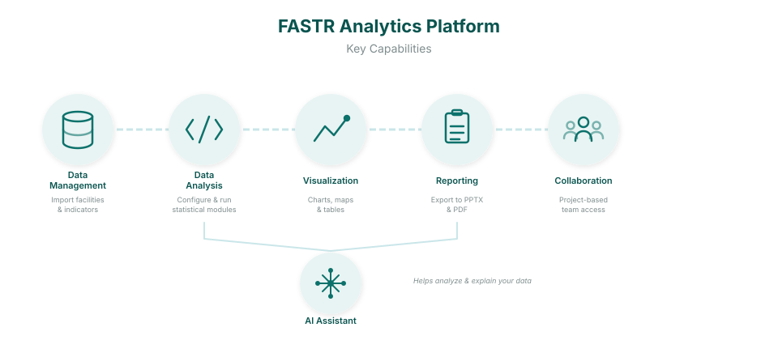

<!-- REVIEWED -->
<!-- Révisé à la main le 2026-11-15 pour la plateforme 2.x ; ne pas écraser par la traduction automatique -->

# La plateforme d'analyse de données FASTR

## Présentation

La plateforme d'analyse FASTR est un outil en ligne conçu pour faciliter l'évaluation de la qualité, l'ajustement et l'analyse des données de santé courantes. Elle permet aux utilisateurs de télécharger et d'analyser des données provenant de diverses sources, notamment DHIS2, à l'aide de méthodes statistiques intégrées afin de générer un ensemble de données ajustées et d'effectuer des analyses prioritaires sur des indicateurs sélectionnés. La plateforme offre une interface conviviale pour effectuer des analyses et propose des options flexibles pour visualiser et exporter les résultats.

## Principales fonctionnalités

### Gestion des données

La plateforme offre des fonctionnalités complètes de gestion des données. Les utilisateurs peuvent importer et gérer les structures des établissements de santé, y compris les zones administratives et les établissements individuels. Le système prend en charge l’importation de données provenant des systèmes d’information de gestion de la santé (SIGS) et des évaluations des établissements de santé (EES), permettant ainsi aux utilisateurs de gérer des indicateurs provenant de multiples sources tout en assurant le suivi des versions des ensembles de données au fil du temps.

### Analyse des données

Les capacités d'analyse sont fournies par des modules : évaluation de la qualité des données, ajustements de la qualité des données, détection des perturbations, dénominateurs de couverture, estimations de couverture et valeurs des indicateurs. Un administrateur choisit les modules et génère un **paquet de résultats**, un ensemble versionné de résultats déjà calculés pour toute l'instance. Un paquet est épinglé comme référence ; un nouveau mois de données donne un nouveau paquet. Les utilisateurs n'exécutent jamais d'analyses eux-mêmes : ils lisent des paquets.

### Assistant IA

Un assistant IA intégré aide les utilisateurs à comprendre et à interpréter leurs données. L'assistant peut expliquer les résultats des modules, décrire les tendances et les schémas des données, fournir des informations sur les visualisations et aider à générer du contenu narratif pour les rapports. L'assistant fonctionne dans un produit ouvert (une visualisation, une présentation ou un rapport) : il lit les données de ce produit, met ses figures à jour en direct et rédige du texte. Les utilisateurs posent leurs questions en langage naturel et reçoivent des conseils contextuels sur l'analyse et l'interprétation.

### Visualisation

La plateforme offre des outils de visualisation robustes pour présenter les résultats analytiques. Les utilisateurs peuvent créer des graphiques, des cartes et des tableaux à partir des données traitées, avec des options permettant de filtrer et de désagréger les données selon plusieurs dimensions. L'apparence et le style des visualisations peuvent être personnalisés, et celles-ci peuvent être exportées sous forme d'images ou de fichiers de données pour être utilisées dans des applications externes.

### Partage des résultats

Tout ce qu'un utilisateur crée est un **produit** sur une seule page Produits partagée :

- **Visualisations** — un graphique, une carte ou un tableau enregistré, avec ses propres filtres et son style. Construit une fois, rangé dans un dossier, copié dans les présentations et les rapports.
- **Présentations** — des diapositives qui combinent visualisations et texte, conçues pour les réunions et les ateliers en direct. Présentées depuis la plateforme ou téléchargées.
- **Rapports** — des documents narratifs détaillés combinant une analyse écrite et des figures en direct, pour les parties prenantes qui lisent un document de bout en bout.

Pour un coup d'œil rapide sans rien créer, la page **Explorer** montre chaque analyse calculée sous forme de tableau, de série de graphiques ou de carte.

### Collaboration

Toute l'équipe du pays travaille sur une seule page Produits, organisée en dossiers. Chaque produit s'enregistre tout seul pendant qu'on le modifie et l'équipe voit les changements en direct. L'accès se règle par produit, comme pour un document partagé : un propriétaire, des éditeurs et des lecteurs, plus un accès général pour tous les autres membres de l'instance. L'accès peut aussi être réglé d'un coup pour tout le contenu d'un dossier.

## À qui s'adresse cette application ?

### Analystes de données

Les analystes de données trouveront cette plateforme utile pour analyser les tendances des données de santé, créer des visualisations et générer des rapports destinés aux décideurs. Les modules d'analyse et les outils de visualisation sont conçus pour prendre en charge des workflows d'analyse de données rigoureux.

### Responsables de programmes de santé

Les responsables de programmes de santé peuvent utiliser la plateforme pour surveiller les performances des programmes, suivre les indicateurs clés et partager des informations avec leurs équipes. La fonctionnalité de reporting permet une communication régulière des résultats afin de soutenir une gestion des programmes fondée sur des données factuelles.

### Administrateurs système

Les administrateurs système sont chargés de mettre en place la plateforme, de gérer les utilisateurs, d’importer des données et de configurer le système pour répondre aux besoins de l’organisation. Les outils d’administration permettent de contrôler l’accès des utilisateurs, les sources de données et les paramètres de la plateforme.

## Fonctionnement de l’application

### Niveau organisationnel (instance)

L'**instance** est l'espace de travail du pays au sein de la plateforme. Chaque instance contient tous les utilisateurs enregistrés, la structure administrative partagée (zones administratives et établissements de santé), les définitions d'indicateurs partagées, les sources de données (SIGS et HFA), les paquets de résultats calculés à partir d'elles, les portées, et chaque produit créé par l'équipe.

### Produits, dossiers et portées

Les utilisateurs travaillent sur la page **Produits** : une seule liste pour toute l'instance, organisée en **dossiers** imbriquables, qui contient chaque visualisation, présentation et rapport. Chaque produit lit un **paquet de résultats** (quel calcul) à travers une **portée** (quelle partie des données : une région, une plage d'années, un ensemble de modules ou d'indicateurs). La portée intégrée **Toutes les données** couvre tout ; les portées nommées sont créées une fois sur la page Portées et partagées par toute l'équipe.

### Flux de données

La plateforme suit un flux de données structuré : **Importation des données → Paquet de résultats → Produits**. Un administrateur importe les données des établissements au niveau de l'instance et en génère un paquet de résultats. Les utilisateurs construisent ensuite des produits qui lisent le paquet : une visualisation montre une métrique sous forme de graphique, de carte ou de tableau ; les présentations et les rapports assemblent des visualisations et du texte. Une portée sur chaque produit restreint ce qu'il montre. La page Explorer se tient à côté de ce flux, pour un coup d'œil rapide à n'importe quel résultat calculé.

## Configuration technique requise

### Langues prises en charge

L'application prend actuellement en charge l'anglais et le français. Les paramètres linguistiques peuvent être configurés au niveau de l'instance afin de répondre aux besoins des différentes communautés d'utilisateurs.

### Configuration requise pour le navigateur

L'application est conçue pour fonctionner avec les navigateurs web modernes. Chrome est recommandé pour des performances optimales, bien que Firefox, Safari et Edge soient également pris en charge. JavaScript doit être activé pour bénéficier de toutes les fonctionnalités.

## Concepts de base

La compréhension de ces concepts fondamentaux aidera les utilisateurs à travailler efficacement avec l'application.

### Instance

Une **instance** est l'espace de travail du pays au sein de la plateforme. C'est le conteneur de niveau supérieur pour tous les utilisateurs, la structure administrative partagée, les sources de données, les paquets de résultats, les portées et les produits. Chaque pays opère au sein d'une seule instance.

### Produits et dossiers

Un **produit** est tout ce qu'un utilisateur crée et conserve : une visualisation, une présentation ou un rapport. Tous les produits vivent sur la seule page Produits, dans des **dossiers** qui peuvent être imbriqués (un dossier pays avec un sous-dossier par personne, par exemple). La ligne de chaque produit indique son type, son paquet de résultats, sa portée et sa date de dernière modification. Le menu d'un produit permet de le déplacer dans un dossier, de le dupliquer, de changer son paquet et sa portée, ou de gérer qui peut l'ouvrir.

### Paquets de résultats

Un **paquet de résultats** est un ensemble versionné de résultats calculés pour l'instance : un administrateur choisit les modules, génère le paquet et en épingle un comme référence. Les paquets sont immuables ; quand de nouvelles données sont importées, un nouveau paquet est généré et les produits y sont déplacés. Les produits lisent des paquets ; personne n'exécute d'analyse dans un produit.

### Portées

Une **portée** est une vue nommée des données de l'instance à travers laquelle un produit lit. Par famille de données (SIGS, HFA, ICEH), elle peut tout inclure ou limiter la géographie à une région, les années, les modules et les indicateurs. La portée intégrée **Toutes les données** ne limite rien et ne peut être ni modifiée ni supprimée. Les utilisateurs ayant un accès non restreint aux données créent les portées sur la page Portées ; tout utilisateur approuvé voit la liste et en choisit une en créant un produit ou dans Explorer. Une portée est indépendante du paquet de résultats : le paquet dit quel calcul, la portée dit quelle partie en est montrée.

### Structure

La **structure** définit l'organisation hiérarchique des zones administratives et des établissements de santé au sein de la plateforme.

Les **zones administratives** représentent des limites géographiques organisées en quatre niveaux maximum. La zone administrative 1 représente les frontières nationales. La zone administrative 2 correspond aux plus grandes unités infranationales telles que les provinces ou les régions. La zone administrative 3 englobe les unités de niveau intermédiaire comme les districts ou les départements, tandis que la zone administrative 4 représente les unités plus petites telles que les communes ou les sous-districts. Toutes les instances ne nécessitent pas les quatre niveaux administratifs.

Les **établissements de santé** sont les points de prestation de soins de santé — notamment les hôpitaux, les cliniques et les postes de santé — qui sont liés aux zones administratives au sein de la structure. Les établissements peuvent présenter des attributs supplémentaires tels que le type d’établissement (hôpital, centre de santé ou dispensaire) et la catégorie de propriété (public, privé ou confessionnel).

### Sources de données

#### Données SIGS

Les données du Système d'information sur la gestion de la santé (SIGS) contiennent des statistiques de routine sur les services de santé collectées auprès des établissements. Cela inclut des indicateurs de prestation de services, des données de surveillance des maladies et des mesures de performance des programmes. Les données SIGS sont généralement communiquées sur une base mensuelle et constituent le fondement de la plupart des analyses de routine du système de santé.

#### Données HFA

Les données de l'évaluation des établissements de santé (HFA) contiennent des informations sur les caractéristiques et la capacité des établissements. Cela inclut des données sur la disponibilité des infrastructures, les équipements et les fournitures, les effectifs et l'état de préparation des services. Les données HFA complètent les données SIGS en fournissant un contexte sur les établissements à partir desquels les données de routine sont communiquées.

### Indicateurs

Les **indicateurs** sont des mesures de santé quantifiables utilisées au sein de la plateforme. Il en existe trois types :

- Les **indicateurs communs** sont définis et partagés à l’échelle de l’instance pour garantir la cohérence des mesures.
- Les **indicateurs DHIS2** sont importés depuis des systèmes DHIS2 externes et peuvent suivre des conventions de nommage ou des méthodes de calcul différentes.
- Les **indicateurs calculés** sont des mesures dérivées qui combinent deux valeurs — généralement un indicateur numérateur divisé par un dénominateur (un autre indicateur ou un chiffre basé sur la population). Par exemple, le nombre de consultations prénatales de premier trimestre (CPN1) divisé par la population cible de femmes enceintes donne une estimation de la couverture CPN1. Les indicateurs calculés peuvent être affichés sous forme de pourcentage, de nombre ou de taux pour 10 000, et ils prennent en charge des seuils de type « feu tricolore » pour une évaluation rapide des performances (par exemple, vert à 80 % ou plus, jaune entre 70 et 79 %, rouge en dessous de 70 %).

Les indicateurs calculés sont calculés au moment de l'importation SIGS ; par conséquent, la modification d'une définition nécessite une réimportation pour prendre effet. Les dénominateurs basés sur la population nécessitent le téléchargement d’un fichier CSV de population au niveau de l’instance avant de pouvoir être utilisés.

### Ensembles de données et versions

Un **ensemble de données** est un recueil de données de santé, qu'il s'agisse de données SIGS ou HFA. Chaque fois que des données sont importées dans la plateforme, une nouvelle version est créée. Ce système de gestion des versions permet aux utilisateurs de suivre les modifications au fil du temps, de basculer entre les versions si nécessaire et de conserver un historique complet des données à des fins d'audit et de comparaison.

### Modules

Les **modules** sont les méthodes d'analyse intégrées à la plateforme : évaluation de la qualité des données, ajustements de la qualité des données, détection des perturbations, dénominateurs de couverture, estimations de couverture et valeurs des indicateurs. Chaque module prend en entrée un ensemble de données ou les résultats d'un autre module et produit des tableaux de résultats. Certains modules dépendent d'autres : les estimations de couverture ont d'abord besoin des dénominateurs de couverture.

Les modules s'exécutent quand un administrateur génère un paquet de résultats, avec les réglages choisis à ce moment-là (**Paramètres par défaut des modules** sur la page Résultats). La plateforme affiche les modules par leur libellé ; dans un produit ou dans Explorer, l'utilisateur choisit un module puis l'une de ses métriques.

### Visualisations

Les **visualisations** sont des représentations visuelles des données générées à partir des résultats des modules. La plateforme prend en charge trois principaux types de visualisation : les graphiques (notamment les histogrammes, les graphiques linéaires et les diagrammes circulaires), les cartes (visualisations géographiques présentant les données par zone administrative) et les tableaux (affichages de données sous forme de tableaux).

Une visualisation se construit à partir d'une métrique (le résultat d'un module) avec un préréglage ou un type personnalisé : tableau, série temporelle, graphique en barres, camembert ou carte. Elle peut être filtrée sur un sous-ensemble (une période, une zone, un indicateur) et désagrégée (une ligne, une rangée, une colonne ou un graphique par zone, indicateur ou type d'établissement). Les utilisateurs peuvent personnaliser l'apparence et le style, télécharger la figure et en insérer des copies dans les présentations et les rapports. Une visualisation est un produit : elle a une ligne sur la page Produits, s'enregistre toute seule pendant qu'on la modifie et conserve un historique de versions à restaurer.

### Explorer

**Explorer** est la page pour regarder avant de construire. Elle montre chaque analyse d'un paquet de résultats, module par module, sous forme de tableau, de série de petits graphiques dans le temps ou de carte, avec des filtres par niveau, indicateurs et période. Rien dans Explorer n'est enregistré ni partagé ; quand une vue répond à une question, l'utilisateur la construit comme visualisation. Explorer remplace les tableaux de bord des versions précédentes.

### Présentations

Les **présentations** sont des diapositives conçues pour des ateliers en direct ou des réunions avec les parties prenantes. Chaque diapositive contient des blocs de texte, de visualisations ou d'images, mis en page selon un thème choisi pour la présentation. Les visualisations insérées dans une présentation sont des copies qui restent liées aux données. Les présentations se présentent depuis la plateforme ou se téléchargent, et conviennent aux résultats qui seront projetés dans une salle pendant qu'une personne les commente devant l'auditoire.

### Rapports

Les **rapports** sont des documents narratifs détaillés qui combinent une analyse écrite avec des figures en direct provenant de la plateforme. L'éditeur fonctionne comme un traitement de texte : les utilisateurs rédigent des commentaires, intègrent des visualisations qui se mettent à jour quand le paquet change, et ajoutent des images, des tableaux et des éléments de page. Les rapports se téléchargent ou s'envoient par e-mail pour les parties prenantes qui lisent un document de bout en bout. Utilisez une présentation lorsque le document sera projeté lors d'une réunion ; utilisez un rapport lorsqu'il sera lu sur un bureau ou dans une boîte de réception.

### Désagrégation

**La désagrégation** désigne le processus consistant à décomposer les données par dimensions afin d’identifier des tendances et des variations. Les données peuvent être désagrégées par période (mensuelle, trimestrielle ou annuelle), par niveau de zone administrative, par type d’établissement, par propriété de l’établissement ou par catégories d’indicateurs. Cette fonctionnalité permet une analyse plus nuancée et aide à identifier les disparités entre les différentes dimensions.

### Utilisateurs, autorisations et accès

Chaque compte doit être **approuvé** par un administrateur avant de voir quoi que ce soit. Les **administrateurs globaux** gèrent l'instance : les utilisateurs, les importations de données, les paquets de résultats et chaque produit. Les autres utilisateurs détiennent des autorisations réglées sur la page Utilisateurs : consulter ou configurer les utilisateurs, consulter ou configurer les données.

Deux autres réglages décident de ce qu'un utilisateur voit. L'**accès aux données** est soit non restreint (toutes les portées), soit limité à une liste de portées accordées par un administrateur ; un utilisateur restreint ne voit que les données couvertes par ces portées, partout sur la plateforme. L'**accès aux produits** fonctionne comme pour un document partagé : chaque produit a un propriétaire, des droits par utilisateur comme éditeur ou lecteur, et un accès général pour tous les autres membres de l'instance (restreint, tout le monde peut consulter, ou tout le monde peut modifier). Les dossiers n'ont pas d'accès propre, mais l'accès peut être réglé d'un coup pour tout leur contenu.

### Scores de qualité des données

La plateforme évalue automatiquement l'exhaustivité et l'exactitude des données, générant des scores de qualité qui aident les utilisateurs à identifier les problèmes potentiels liés aux données. Ces scores facilitent les processus de contrôle de la qualité des données et aident à hiérarchiser les domaines nécessitant une attention particulière.

!!! conseil « Guide de l'utilisateur »
    Pour des tutoriels étape par étape sur l'utilisation de la plateforme, consultez le [guide de l'utilisateur FASTR](11_user_guide.md).

---

<!--
////////////////////////////////////////////////////////////////////
// //
//   _____ _     _____ ____  _____    ____ ___  _   _ _____ _   _ //
//  / ____| |   |_   _|  _ \| ____|  / ___/ _ \| \ | |_   _| \ | |//
//  | (___ | |     | | | | | | |__   | |  | | | |  \| | | | |  \| |//
//   \___ \| |     | | | | | |  __|  | |  | | | | . ` | | | | . ` |//
//   ____) | |___ _| |_| |_| | |____ | |__| |_| | |\  | | | | |\  |//
//  |_____/|_____|_____|____/|______| \____\___/|_| \_| |_| |_| \_|//
// //
// Modifier les diapositives de l'atelier sous cette ligne //
// //
////////////////////////////////////////////////////////////////////
-->

<!-- SLIDE:m3_1 -->
## Plateforme d'analyse FASTR

La **plateforme d'analyse FASTR** est un outil en ligne conçu pour faciliter l'évaluation de la qualité, l'ajustement et l'analyse des données de santé courantes.

Elle permet aux utilisateurs de télécharger et d'analyser des données provenant de diverses sources, y compris DHIS2, grâce à des méthodes statistiques intégrées permettant de générer un ensemble de données ajustées et d'effectuer des analyses prioritaires sur des indicateurs sélectionnés.

La plateforme offre une interface conviviale pour effectuer des analyses et propose des options flexibles pour visualiser et exporter les résultats.

  

<!-- /SLIDE -->

<!-- SLIDE:m3_1b -->
## Capacités de la plateforme

**Gestion des données** — Importez établissements et indicateurs depuis DHIS2 ou des fichiers

**Analyse des données** — Des modules statistiques, calculés en paquets de résultats

**Visualisation** — Explorer pour regarder, puis graphiques, cartes et tableaux

**Partage des résultats** — Présentations et rapports, figures liées aux données

**Collaboration** — Une page Produits pour l'équipe, des dossiers, un accès par produit

**Assistant IA** — Une aide pour interpréter les résultats et comprendre vos données

<!-- /SLIDE -->

<!-- SLIDE:m3_1c -->
## Des données au rapport : à la main et avec FASTR

À la main, chaque rapport mensuel est reconstruit à partir d'un export DHIS2. Avec FASTR, un rapport est **lié à un paquet de résultats** : il en choisit un à sa création, et un nouveau mois revient à le faire passer sur le nouveau paquet. Tous les graphiques se mettent à jour ; l'assistant IA réécrit le texte.

<!--
PRESENTER NOTES:
- Les quatre étapes grises sont ce que la plupart des équipes font aujourd'hui ; demandez à la salle combien de temps prend un rapport.
- Les trois étapes vertes sont le circuit de la plateforme : Données → Importer, Résultats → Générer un paquet de résultats, Produits → rapport. Seules les deux premières demandent un administrateur.
- Les graphiques d'un rapport FASTR restent liés au paquet : mettre à jour le rapport, c'est changer de paquet, pas tout reconstruire.
-->
<!-- /SLIDE -->

<!-- SLIDE:m3_2a -->
## Instance nationale

Chaque pays dispose de sa propre **instance** de la plateforme d'analyse FASTR.

Une instance contient :

- Tous les utilisateurs enregistrés et leurs comptes
- La structure administrative partagée (régions, districts, établissements)
- Les définitions des indicateurs, les sources de données et les paquets de résultats calculés à partir d'elles
- Les portées, et chaque produit créé par l'équipe

**Considérez une instance comme l'espace de travail dédié à votre pays.**
<!-- /SLIDE -->

<!-- SLIDE:m3_2b -->
## Utilisateurs, autorisations et accès

**L'approbation d'abord.** Un nouveau compte ne voit rien tant qu'un administrateur ne l'a pas approuvé.

Les **administrateurs globaux** gèrent les utilisateurs, les données, les paquets de résultats, et sont propriétaires de chaque produit. Les autres utilisateurs détiennent des autorisations réglées sur la page Utilisateurs (consulter ou configurer les utilisateurs, consulter ou configurer les données).

**Accès aux données** : non restreint, ou limité aux portées accordées par un administrateur. Un utilisateur restreint ne voit que ces données, partout.

**Accès aux produits**, comme pour un document partagé : un propriétaire, des éditeurs, des lecteurs, et un accès général pour tous les autres (restreint / tout le monde peut consulter / tout le monde peut modifier). Réglé dans **Gérer l'accès**, par produit ou pour tout un dossier.
<!-- /SLIDE -->

<!-- SLIDE:m3_2c -->
## Produits, dossiers et portées

Une seule page **Produits** pour le pays : chaque visualisation, présentation et rapport, rangés en **dossiers**.

Chaque produit lit un **paquet de résultats** (quel calcul) à travers une **portée** (quelle partie des données).

**Questions clés lors de la configuration :**

- Quel paquet est épinglé ?
- De quelles portées l'équipe a-t-elle besoin ?
- Qui peut ouvrir ou modifier quoi ?

<!-- /SLIDE -->

---

**Contact** : <FASTR@worldbank.org>
