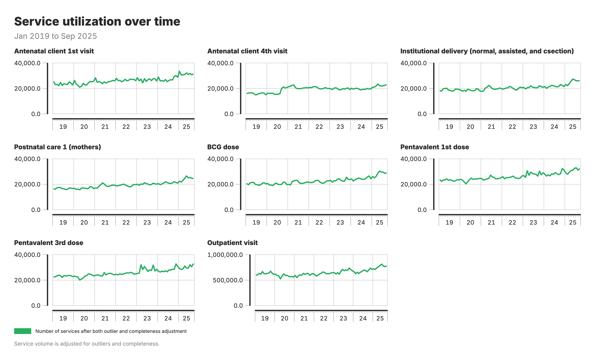
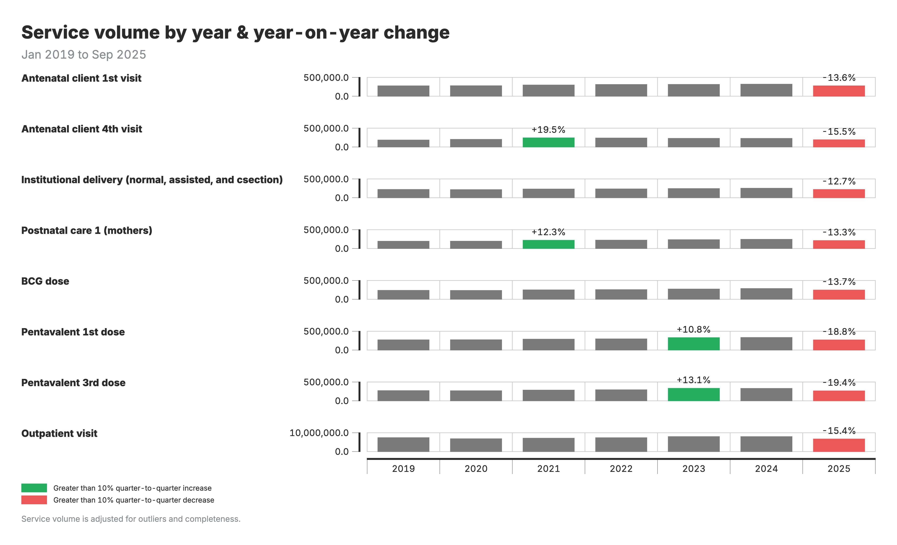

<!-- AUTO-TRANSLATED from 06a_service_utilization.md -->
<!-- Add REVIEWED marker after human review to protect from overwrite -->

# Analyse de l'utilisation des services

## Contexte et objectif

### Objectif du module

L'analyse de l'utilisation des services décrit la quantité de chaque service de santé délivrée au fil du temps : combien de consultations prénatales, d'accouchements, de vaccinations ou de consultations sont enregistrés chaque mois, comment ces volumes évoluent d'une année à l'autre et d'un trimestre à l'autre, et dans quelle mesure les ajustements de qualité des données changent le tableau.

Elle répond à la première question qu'un programme pose à ses données de routine : les gens utilisent-ils le service plus ou moins qu'avant, et où ? Elle ne dit pas si un changement est inhabituel compte tenu de la tendance et de la saisonnalité. À cette question répond le [module de détection des perturbations](06b_disruption_detection.md), qui modélise le volume attendu de chaque établissement et signale les mois qui en sortent.

### Raison d'être de l'analyse

Les comptages mensuels bruts sont difficiles à lire directement. Les volumes montent et descendent avec la saison, un établissement qui cesse de rapporter tire le total vers le bas, et une valeur aberrante peut doubler le chiffre d'un district pour un mois. L'analyse de l'utilisation des services travaille donc sur les données ajustées produites par le module d'ajustement de la qualité des données et les présente de trois façons faciles à comparer : les totaux annuels avec la variation par rapport à l'année précédente, les totaux trimestriels avec la variation par rapport au trimestre précédent, et les mêmes volumes selon chaque scénario d'ajustement, pour rendre visible l'effet des ajustements.

Comme l'analyse est descriptive, sa lecture dépend du sens de l'indicateur. Plus d'accouchements en établissement, c'est bien ; plus de mort-nés, non. La directionnalité de chaque indicateur est enregistrée pour que les hausses et les baisses soient colorées de façon cohérente.

### Points clés

| Composante | Détails |
|-----------|---------|
| **Entrées** | Volumes de services ajustés du module Ajustements de la qualité des données : sans ajustement, ajustés pour les valeurs aberrantes, ajustés pour la complétude, et les deux Valeurs d'indicateurs du module Valeurs des indicateurs pour les indicateurs calculés |
| **Sorties** | Volumes de services mensuels et annuels par indicateur et par zone Variation d'une année sur l'autre Variation d'un trimestre sur l'autre Volume selon chaque scénario d'ajustement |
| **Objectif** | Décrire et comparer les volumes de services dans le temps et entre zones, comme point de départ de l'interprétation et de la détection des perturbations |

---

## Flux de travail analytique

### Aperçu des étapes analytiques

1. **Partir des données ajustées.** Le module d'ajustement de la qualité des données produit un comptage mensuel par établissement et par indicateur selon quatre scénarios : sans ajustement, valeurs aberrantes ajustées, complétude ajustée, et les deux. Les vues d'utilisation des services agrègent ces comptages au niveau géographique choisi.

2. **Comparer les années.** Les totaux annuels sont calculés par indicateur et par zone, et la variation par rapport à l'année précédente est exprimée en pourcentage.

3. **Comparer les trimestres.** Les totaux trimestriels sont comparés au trimestre précédent de la même manière, ce qui capte des évolutions plus récentes que la vue annuelle.

4. **Signaler les grandes variations.** Les variations au-delà de ±10 % sont mises en évidence pour suivi. Un signalement est une invitation à vérifier, pas une conclusion : la variation peut être un vrai effet du programme, un problème de qualité des données ou un événement attendu comme une campagne.

5. **Montrer l'effet des ajustements.** Les mêmes volumes sont affichés selon chaque scénario d'ajustement, pour voir quelle part d'une variation tient aux corrections des données plutôt qu'à la prestation de services.

### Points de décision clés

**Quel comptage afficher**

Le comptage ajusté pour les valeurs aberrantes est le choix habituel pour les rapports. Les comptages ajustés pour la complétude estiment ce qu'aurait été le volume si tous les établissements avaient rapporté ; c'est utile pour la planification, mais à présenter comme une estimation. Afficher le comptage non ajusté à côté rend la taille de la correction explicite.

**Niveau géographique**

Les totaux nationaux et provinciaux sont assez stables pour être lus mois par mois. Les totaux de district sont plus bruités, surtout pour les indicateurs à faible volume, où un petit changement absolu devient un grand pourcentage. Vérifiez les variations de district contre la tendance provinciale avant d'agir.

**Directionnalité des indicateurs**

Pour la plupart des indicateurs de services SRMNIA-N, une hausse est favorable. Pour quelques-uns, comme les mort-nés ou les décès maternels, une hausse est défavorable et le code couleur est inversé. Le sens est défini par indicateur dans le gestionnaire d'indicateurs.

### Résultats de l'analyse et visualisation

**1. Variation du volume de services**

Diagramme à barres des volumes annuels par zone et par indicateur, annoté avec la variation en pourcentage d'une année sur l'autre.

**2. Nombre de services rapportés**

Volumes mensuels dans le temps, par indicateur et par zone, à partir des données ajustées.

**3. Variation d'un trimestre sur l'autre**

Carte de chaleur comparant chaque trimestre au précédent, avec signalement des variations au-delà de ±10 %.

**4. Variation de volume due aux ajustements de qualité des données**

Diagramme à barres groupées comparant les volumes de services selon les quatre scénarios d'ajustement.

**Guide d'interprétation**

- **Barres et annotations** (sortie 1) : volumes annuels, avec la variation en pourcentage entre deux années consécutives.
- **Cellules de la carte de chaleur** (sortie 3) : la variation en pourcentage pour chaque zone et trimestre ; les cellules signalées dépassent le seuil de ±10 % dans un sens ou dans l'autre.
- **Quatre barres par année** (sortie 4) : une par scénario d'ajustement ; comparez les hauteurs pour voir de combien les ajustements modifient le volume rapporté.

---

## Référence détaillée

### Mesures de variation

**La variation d'une année sur l'autre** compare une période à la même période un an plus tôt :

$$
\text{Variation annuelle (\%)} = \frac{\text{cette année} - \text{année précédente}}{\text{année précédente}} \times 100
$$

**La variation d'un trimestre sur l'autre** compare un trimestre au trimestre précédent :

$$
\text{Variation trimestrielle (\%)} = \frac{\text{trimestre courant} - \text{trimestre précédent}}{\text{trimestre précédent}} \times 100
$$

Les deux sont calculées par indicateur et par zone géographique. Les variations au-delà de ±10 % sont signalées. Le seuil est un réglage de présentation du graphique et peut être modifié par visualisation.

### Interprétation

- Une variation signalée pose une question ; la réponse vient du contexte. Cherchez les campagnes, ruptures de stock, grèves, changements de politique et problèmes de rapportage sur les mêmes mois.
- Comparez la variation signalée selon les différents scénarios d'ajustement. Une variation qui disparaît une fois la complétude ajustée était un changement de rapportage, pas de service.
- Pour les indicateurs à faible volume et les petites zones, lisez la variation absolue à côté du pourcentage.
- Les mouvements soutenus sur plusieurs périodes pèsent plus qu'un seul trimestre signalé.
- Les derniers mois d'une série sont provisoires, car des rapports tardifs arrivent après la génération du paquet.

---

<!--
////////////////////////////////////////////////////////////////////
//                                                                //
//   _____ _     _____ ____  _____    ____ ___  _   _ _____ _   _ //
//  / ____| |   |_   _|  _ \| ____|  / ___/ _ \| \ | |_   _| \ | |//
//  | (___ | |     | | | | | | |__   | |  | | | |  \| | | | |  \| |//
//   \___ \| |     | | | | | |  __|  | |  | | | | . ` | | | | . ` |//
//   ____) | |___ _| |_| |_| | |____ | |__| |_| | |\  | | | | |\  |//
//  |_____/|_____|_____|____/|______| \____\___/|_| \_| |_| |_| \_|//
//                                                                //
//            Edit workshop slides below this line                //
//                                                                //
////////////////////////////////////////////////////////////////////
-->

<!-- SLIDE:m6_0 -->
## Des données ajustées à l'analyse

Le module Ajustements de la qualité des données a produit le jeu de données ajustées — valeurs aberrantes remplacées, lacunes comblées. L'analyse de l'utilisation des services est l'étape où ce travail porte ses fruits.

Dans les vues d'utilisation des services, les utilisateurs peuvent analyser **soit les données ajustées, soit les données non ajustées**, selon la question posée. Les données ajustées révèlent les tendances de fond ; les données non ajustées montrent ce qui a été effectivement rapporté.

Les diapositives suivantes couvrent deux regards sur la prestation de services :

- **Utilisation des services** — volumes au fil du temps, comparaisons trimestre-sur-trimestre et année-sur-année
- **Détection des perturbations** — un modèle statistique qui signale quand les volumes réels s'écartent de ce que l'historique de l'établissement laisserait prévoir

L'estimation de la couverture, qui rapporte les services à une population cible, vient ensuite.
<!-- /SLIDE -->

<!-- SLIDE:m6_1 -->
## Analyse de l'utilisation des services

L'analyse de l'utilisation des services mesure les changements dans les volumes de services de santé au fil du temps. En comparant la prestation de services sur des années consécutives, cette analyse identifie les augmentations ou les diminutions des schémas d'utilisation selon les régions et les indicateurs.

La mesure principale est le **pourcentage de variation d'une année sur l'autre**, qui quantifie les changements dans la prestation de services entre deux années consécutives. La formule calcule la différence entre les volumes de l'année en cours et de l'année précédente, exprimée en pourcentage de l'année précédente. Les changements dépassant ±10% sont signalés pour examen, car ils représentent généralement des changements significatifs dans la prestation de services plutôt que des variations normales.
<!-- /SLIDE -->

<!-- SLIDE:m6_1c -->
## Sortie de l'utilisation des services

**Ce que vous voyez :** Graphique linéaire montrant les volumes de services absolus dans le temps par indicateur.

**Ce que cela représente :** Nombre de services délivrés chaque mois/trimestre.

**Interprétation :** Repérez les tendances globales (croissance/baisse) et les chutes ou pics soudains qui nécessitent une investigation.

<!-- /SLIDE -->

<!-- SLIDE:m6_1d -->
## Variation trimestre par trimestre

**Ce que vous voyez :** Carte de chaleur comparant le trimestre en cours au précédent, avec les variations >±10% signalées.

**Formule :** Variation TT % = (trimestre actuel – trimestre précédent) / trimestre précédent × 100

**Interprétation :** Les variations signalées appellent un suivi — s'agit-il d'un vrai changement programmatique, d'un problème de données ou d'un événement attendu ?

<!-- /SLIDE -->

<!-- SLIDE:m6_1e -->
<!-- _class: output -->
## Variation annuelle

**Ce que vous voyez :** Carte de chaleur comparant la période actuelle à la même période l'an dernier, avec les variations >±10% signalées.

**Formule :** Variation AA % = (cette année - l'an dernier) / l'an dernier × 100

**Interprétation :** Les variations signalées appellent un suivi — vrai changement programmatique, problème de données ou événement attendu ?

<!-- /SLIDE -->

<!-- SLIDE:m6_1f -->
## Directionnalité des indicateurs

Une variation signalée ne devient un constat qu'une fois la direction souhaitée connue.

- **Indicateurs d'utilisation de services** (visites CPN, accouchements assistés, vaccinations) doivent **augmenter** quand le système se renforce.
- **Indicateurs de morbidité et mortalité** (décès maternels, malnutrition sévère, incidence des maladies) doivent **diminuer**.
- **Indicateurs à plage** se situent entre deux seuils. Le taux de césarienne en est le cas typique — trop bas signifie sous-accès, trop élevé signifie sur-médicalisation.

Une hausse de 15% des soins postnatals est une bonne nouvelle ; la même hausse des décès maternels ne l'est pas. Vérifiez toujours la direction avant de lire le signal.
<!-- /SLIDE -->

<!-- SLIDE:m6_s00 -->
## Analyse des données

Trois choses que FASTR fait avec vos données :

1. **Utilisation des services** — combien de services ont été délivrés, comment cela a changé trimestre par trimestre et d'une année à l'autre, et quelle direction est « bonne » pour chaque indicateur.
2. **Détection des perturbations** — séparer les vraies baisses de services des variations saisonnières normales en apprenant le rythme attendu de chaque indicateur.
3. **Couverture** — combiner le numérateur (volumes SNIS) avec un dénominateur défendable (population cible) pour estimer la part des personnes qui avaient besoin d'un service et l'ont reçu.

Chaque sous-thème se termine par les sorties FASTR que vous verrez dans la plateforme, et comment les lire.
<!-- /SLIDE -->

<!-- SLIDE:m6_s0b -->
## Qu'est-ce que l'utilisation des services ?

L'utilisation des services mesure **combien de services de santé sont délivrés** — visites prénatales, vaccinations, accouchements, consultations externes — par qui, où, et dans le temps.

La suivre vous dit si le système répond à la demande. Une tendance à la hausse peut indiquer un meilleur accès ; une baisse peut signaler une rupture de stock, une grève, un choc, ou une vraie baisse du besoin.

FASTR calcule l'utilisation des services à partir des données SNIS, ventilées par indicateur, géographie et période. Les sorties qui suivent montrent le volume lui-même, comment il a varié trimestre par trimestre et d'une année à l'autre, et quelle direction est bonne pour chaque indicateur.
<!-- /SLIDE -->

<!-- SLIDE:m6_s2 -->
## Utilisation des services : détecter les changements

Les volumes de services montent et descendent naturellement — plus de cas de paludisme en saison des pluies, par exemple. Comment distinguer une **variation normale** d'une **vraie perturbation** ?

**FASTR apprend le rythme normal** de chaque indicateur dans chaque zone :
- Tendance à long terme (les services augmentent-ils ou diminuent-ils ?)
- Saisonnalité (quels mois sont habituellement plus élevés ?)

Puis il compare les **volumes observés** aux **volumes attendus** :

- **En dessous** de l'attendu → perturbation potentielle (rupture de stock ? grève ? conflit ?)
- **Au-dessus** de l'attendu → hausse inhabituelle (campagne de vaccination ? nouveau programme ?)

Le module mesure **combien de services ont été perdus ou gagnés** et sur quelle durée.
<!-- /SLIDE -->

<!-- SLIDE:m6_s1 -->
## Analyse de l'utilisation des services

L'analyse de l'utilisation des services suit le nombre de services de santé fournis au fil du temps, identifiant les tendances, les anomalies et les comparaisons entre les zones.

<!-- _class: output -->

**Ce que vous voyez :** Graphique linéaire montrant les volumes de services absolus au fil du temps par indicateur.

**Ce qu'il montre :** Comptage des services fournis chaque mois/trimestre.

**Interprétation :** Recherchez les tendances globales (augmentation/diminution) et les baisses ou pics soudains qui peuvent nécessiter une investigation.

<!-- /SLIDE -->

<!-- SLIDE:m6_s1b -->
<!-- _class: output -->
## Résultat de la variation d'une année sur l'autre

**Ce que vous voyez :** Heatmap comparant la période actuelle à la même période l'année dernière, avec les changements > ±10% signalés.

**Formule :** Changement annuel % = (cette année - année dernière) / année dernière × 100

**Interprétation :** Les changements signalés nécessitent un suivi - s'agit-il d'un vrai changement de programme, d'un problème de données ou d'un événement attendu ?

<!--
PRESENTER NOTES:
- Version condensée combinant les tendances de service et la comparaison annuelle
- Le premier graphique montre les volumes absolus - identifier les schémas globaux
- Le deuxième graphique montre les changements relatifs - plus facile à comparer entre les indicateurs
- Les changements annuels > ±10% sont signalés - mais le seuil est configurable
- Pour les changements signalés, demandez : problème de qualité des données, vrai changement de programme ou événement externe ?
- Ces résultats ne nécessitent pas de dénominateurs de population - utile quand les dénominateurs sont incertains
-->
<!-- /SLIDE -->

<!-- SLIDE:m6_s0c -->
## Directionnalité des indicateurs

Un changement signalé ne devient un résultat utile qu'une fois connue la direction dans laquelle l'indicateur doit évoluer.

- **Indicateurs d'utilisation des services** (CPN, accouchement assisté, vaccinations) : devraient **monter** quand les systèmes se renforcent.
- **Indicateurs de morbidité et de mortalité** (décès maternels, malnutrition sévère, incidence des maladies) : devraient **baisser**.
- **Indicateurs à plage** : se situent entre deux seuils. Le taux de césarienne en est l'exemple type — trop bas signale un manque d'accès, trop élevé signale une médicalisation excessive.

Une hausse de 15 % des consultations postnatales est une bonne nouvelle ; la même hausse pour les décès maternels ne l'est pas. Toujours vérifier la direction avant de lire le signal.
<!-- /SLIDE -->

<!-- SLIDE:m6_s1a -->
<!-- _class: output -->
## Variation trimestrielle

**Ce que vous voyez :** Heatmap comparant le trimestre en cours au trimestre précédent, avec les variations >±10 % signalées.

**Formule :** Variation trimestrielle % = (trimestre en cours – trimestre précédent) / trimestre précédent × 100

**Interprétation :** Les variations signalées nécessitent un suivi — s'agit-il d'un changement réel du programme, d'un problème de données ou d'un événement attendu ?

<!--
NOTES DU PRÉSENTATEUR :
- Les variations trimestrielles >±10 % sont signalées — mais le seuil est configurable
- Pour les variations signalées, demandez : problème de qualité des données, changement réel du programme ou événement externe ?
- Ces résultats ne nécessitent pas de dénominateurs de population — utile lorsque les dénominateurs sont incertains
- Complémentaire à la vue annuelle : capture les changements plus récents
-->
<!-- /SLIDE -->

