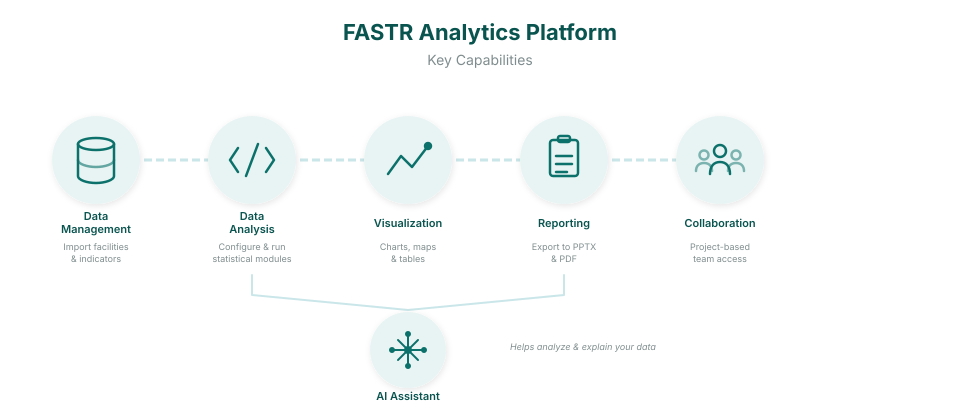

<!-- REVIEWED -->
<!-- Revisto à mão em 2026-11-15 para a plataforma 2.x; não substituir pela tradução automática -->

# A plataforma de análise de dados FASTR

## Visão geral

A plataforma de análise FASTR é uma ferramenta baseada na Web concebida para apoiar a avaliação da qualidade, o ajuste e a análise de dados de saúde de rotina. Permite aos utilizadores carregar e analisar dados de várias fontes, incluindo o DHIS2, com métodos estatísticos integrados para gerar um conjunto de dados ajustado e realizar análises prioritárias sobre indicadores selecionados. A plataforma oferece uma interface intuitiva para a realização de análises e disponibiliza opções flexíveis para a visualização e exportação de resultados.

## Principais capacidades

### Gestão de dados

A plataforma oferece funcionalidades abrangentes de gestão de dados. Os utilizadores podem importar e gerir estruturas de unidades de saúde, incluindo áreas administrativas e unidades individuais. O sistema suporta a importação de dados de Sistemas de Informação de Gestão de Saúde (HMIS) e Avaliações de Unidades de Saúde (HFA), permitindo aos utilizadores gerir indicadores de múltiplas fontes enquanto acompanham as versões dos conjuntos de dados ao longo do tempo.

### Análise de dados

As capacidades analíticas são fornecidas por módulos: avaliação da qualidade dos dados, ajustes da qualidade dos dados, deteção de perturbações, denominadores de cobertura, estimativas de cobertura e valores dos indicadores. Um administrador escolhe os módulos e gera um **pacote de resultados**, um conjunto versionado de resultados já calculados para toda a instância. Um pacote fica fixado como referência; um novo mês de dados dá um novo pacote. Os utilizadores nunca executam análises: leem pacotes.

### Assistente de IA

Um assistente de IA integrado ajuda os utilizadores a compreender e interpretar os seus dados. O assistente pode explicar os resultados dos módulos, descrever tendências e padrões de dados, fornecer insights sobre visualizações e ajudar a gerar conteúdo narrativo para relatórios. O assistente funciona dentro de um produto aberto (uma visualização, uma apresentação ou um relatório): lê os dados desse produto, atualiza as suas figuras ao vivo e redige texto. Os utilizadores perguntam em linguagem natural e recebem orientação contextual sobre análise e interpretação.

### Visualização

A plataforma oferece ferramentas de visualização robustas para apresentar resultados analíticos. Os utilizadores podem criar gráficos, mapas e tabelas a partir de dados processados, com opções para filtrar e desagregar por múltiplas dimensões. As visualizações podem ser personalizadas em termos de aparência e estilo e exportadas como imagens ou ficheiros de dados para utilização em aplicações externas.

### Partilha de resultados

Tudo o que um utilizador cria é um **produto** numa única página Produtos partilhada:

- **Visualizações** — um gráfico, mapa ou tabela guardado, com os seus próprios filtros e estilo. Construído uma vez, guardado numa pasta, copiado para apresentações e relatórios.
- **Apresentações** — diapositivos que combinam visualizações e texto, concebidos para reuniões e workshops ao vivo. Apresentados a partir da plataforma ou transferidos.
- **Relatórios** — documentos narrativos extensos que combinam análise escrita com figuras ao vivo, para quem lê um documento do início ao fim.

Para uma olhada rápida sem criar nada, a página **Explorar** mostra cada análise calculada como tabela, série de gráficos ou mapa.

### Colaboração

Toda a equipa do país trabalha numa única página Produtos, organizada em pastas. Cada produto guarda-se sozinho enquanto é editado e a equipa vê as alterações ao vivo. O acesso define-se por produto, como num documento partilhado: um proprietário, editores e visualizadores, mais um acesso geral para todos os outros membros da instância. O acesso também pode ser definido de uma vez para todo o conteúdo de uma pasta.

## Quem deve utilizar esta aplicação?

### Analistas de dados

Os analistas de dados irão considerar a plataforma valiosa para analisar tendências de dados de saúde, criar visualizações e gerar relatórios para os decisores. Os módulos analíticos e as ferramentas de visualização foram concebidos para apoiar fluxos de trabalho rigorosos de análise de dados.

### Gestores de programas de saúde

Os gestores de programas de saúde podem utilizar a plataforma para monitorizar o desempenho dos programas, acompanhar indicadores-chave e partilhar insights com as suas equipas. A funcionalidade de relatórios permite a comunicação regular de resultados para apoiar a gestão de programas baseada em evidências.

### Administradores de sistema

Os administradores de sistema são responsáveis pela configuração da plataforma, gestão de utilizadores, importação de dados e configuração do sistema para satisfazer as necessidades organizacionais. As ferramentas administrativas proporcionam controlo sobre o acesso dos utilizadores, as fontes de dados e as definições da plataforma.

## Como funciona a aplicação

### Nível da organização (instância)

A **instância** é o espaço de trabalho do país dentro da plataforma. Cada instância contém todos os utilizadores registados, a estrutura administrativa partilhada (áreas administrativas e unidades de saúde), definições de indicadores partilhadas, as fontes de dados (HMIS e HFA), os pacotes de resultados calculados a partir delas, os âmbitos e todos os produtos que a equipa criou.

### Produtos, pastas e âmbitos

Os utilizadores trabalham na página **Produtos**: uma única lista para toda a instância, organizada em **pastas** que podem ser aninhadas, com todas as visualizações, apresentações e relatórios. Cada produto lê um **pacote de resultados** (que cálculo) através de um **âmbito** (que parte dos dados: uma região, um intervalo de anos, um conjunto de módulos ou indicadores). O âmbito integrado **Todos os dados** cobre tudo; os âmbitos nomeados são criados uma vez na página Âmbitos e partilhados por toda a equipa.

### Fluxo de dados

A plataforma segue um fluxo de dados estruturado: **Importação de dados → Pacote de resultados → Produtos**. Um administrador importa os dados das unidades ao nível da instância e gera a partir deles um pacote de resultados. Os utilizadores constroem depois produtos que leem o pacote: uma visualização mostra uma métrica como gráfico, mapa ou tabela; apresentações e relatórios juntam visualizações e texto. Um âmbito em cada produto restringe o que ele mostra. A página Explorar fica ao lado deste fluxo, para uma olhada rápida a qualquer resultado calculado.

## Requisitos técnicos

### Idiomas suportados

A aplicação suporta atualmente inglês e francês. As definições de idioma podem ser configuradas ao nível da instância para satisfazer as necessidades de diferentes comunidades de utilizadores.

### Requisitos do navegador

A aplicação foi concebida para funcionar com navegadores web modernos. Recomenda-se o Chrome para um desempenho ideal, embora o Firefox, o Safari e o Edge também sejam suportados. O JavaScript deve estar ativado para uma funcionalidade completa.

## Conceitos básicos

Compreender estes conceitos fundamentais ajudará os utilizadores a trabalhar eficazmente com a aplicação.

### Instância

Uma **instância** é o espaço de trabalho do país dentro da plataforma. É o contentor de nível superior para todos os utilizadores, a estrutura administrativa partilhada, as fontes de dados, os pacotes de resultados, os âmbitos e os produtos. Cada país opera numa única instância.

### Produtos e pastas

Um **produto** é tudo o que um utilizador cria e guarda: uma visualização, uma apresentação ou um relatório. Todos os produtos vivem na única página Produtos, em **pastas** que podem ser aninhadas (uma pasta do país com uma subpasta por pessoa, por exemplo). A linha de cada produto mostra o tipo, o pacote de resultados, o âmbito e a data da última alteração. O menu de um produto permite movê-lo para uma pasta, duplicá-lo, mudar o pacote e o âmbito, ou gerir quem o pode abrir.

### Pacotes de resultados

Um **pacote de resultados** é um conjunto versionado de resultados calculados para a instância: um administrador escolhe os módulos, gera o pacote e fixa um como referência. Os pacotes são imutáveis; quando são importados dados novos, gera-se um novo pacote e os produtos são movidos para ele. Os produtos leem pacotes; ninguém executa análises dentro de um produto.

### Âmbitos

Um **âmbito** é uma vista nomeada dos dados da instância através da qual um produto lê. Por família de dados (HMIS, HFA, ICEH) pode incluir tudo ou limitar a geografia a uma região, os anos, os módulos e os indicadores. O âmbito integrado **Todos os dados** não limita nada e não pode ser editado nem eliminado. Os utilizadores com acesso não restrito aos dados criam âmbitos na página Âmbitos; todos os utilizadores aprovados veem a lista e escolhem um ao criar um produto ou no Explorar. Um âmbito é independente do pacote de resultados: o pacote diz que cálculo, o âmbito diz que parte dele é mostrada.

### Estrutura

A **estrutura** define a organização hierárquica das áreas administrativas e das instalações de saúde dentro da plataforma.

**As áreas administrativas** representam limites geográficos organizados em até quatro níveis. A Área Administrativa 1 representa as fronteiras do país. A Área Administrativa 2 corresponde às maiores unidades subnacionais, como províncias ou regiões. A Área Administrativa 3 abrange unidades de nível médio, como distritos ou departamentos, enquanto a Área Administrativa 4 representa unidades menores, como comunas ou subdistritos. Nem todas as instâncias requerem os quatro níveis administrativos.

**Unidades de saúde** são os pontos de prestação de serviços de saúde — incluindo hospitais, clínicas e postos de saúde — que estão ligados a áreas administrativas dentro da estrutura. As unidades podem ter atributos adicionais, tais como o tipo de unidade (hospital, centro de saúde ou dispensário) e a categoria de propriedade (pública, privada ou religiosa).

### Fontes de dados

#### Dados do HMIS

Os dados do Sistema de Informação de Gestão de Saúde (HMIS) contêm estatísticas de rotina dos serviços de saúde recolhidas nas unidades. Isto inclui indicadores de prestação de serviços, dados de vigilância de doenças e métricas de desempenho dos programas. Os dados do HMIS são normalmente reportados mensalmente e constituem a base para a maioria das análises de rotina do sistema de saúde.

#### Dados HFA

Os dados da Avaliação de Unidades de Saúde (HFA) contêm informações sobre as características e a capacidade das unidades. Isto inclui dados sobre a disponibilidade de infraestruturas, equipamento e consumíveis, níveis de pessoal e prontidão dos serviços. Os dados HFA complementam os dados HMIS, fornecendo contexto sobre as unidades a partir das quais os dados de rotina são reportados.

### Indicadores

**Os indicadores** são métricas de saúde mensuráveis utilizadas na plataforma. Existem três tipos:

- **Os indicadores comuns** são definidos e partilhados em toda a instância para uma medição consistente.
- **Os indicadores DHIS2** são importados de sistemas DHIS2 externos e podem seguir diferentes convenções de nomenclatura ou métodos de cálculo.
- **Os indicadores calculados** são métricas derivadas que combinam dois valores — tipicamente um indicador numerador dividido por um denominador (outro indicador ou um valor baseado na população). Por exemplo, as consultas de ANC1 divididas pela população-alvo de mulheres grávidas fornecem uma estimativa da cobertura de ANC1. Os indicadores calculados podem ser apresentados como uma percentagem, uma contagem ou uma taxa por 10 000, e suportam limiares de semáforo para uma análise rápida do desempenho (por exemplo, verde a partir de 80%, amarelo entre 70% e 79%, vermelho abaixo de 70%).

Os indicadores calculados são calculados no momento da importação do HMIS, pelo que a alteração de uma definição obriga a uma reimportação para ter efeito. Os denominadores baseados na população requerem que um ficheiro CSV da população seja carregado ao nível da instância antes de poderem ser utilizados.

### Conjuntos de dados e versões

Um **conjunto de dados** é uma coleção de dados de saúde, sejam eles HMIS ou HFA. Cada vez que os dados são importados para a plataforma, é criada uma nova versão. Este sistema de versões permite aos utilizadores acompanhar as alterações ao longo do tempo, alternar entre versões, se necessário, e manter um histórico completo dos dados para fins de auditoria e comparação.

### Módulos

**Módulos** são os métodos analíticos integrados na plataforma: avaliação da qualidade dos dados, ajustes da qualidade dos dados, deteção de perturbações, denominadores de cobertura, estimativas de cobertura e valores dos indicadores. Cada módulo recebe como entrada um conjunto de dados ou os resultados de outro módulo e produz tabelas de resultados. Alguns módulos dependem de outros: as estimativas de cobertura precisam primeiro dos denominadores de cobertura.

Os módulos executam-se quando um administrador gera um pacote de resultados, com as definições escolhidas nesse momento (**Predefinições dos módulos** na página Resultados). A plataforma mostra os módulos pelo seu rótulo; num produto ou no Explorar, o utilizador escolhe um módulo e uma das suas métricas.

### Visualizações

**Visualizações** são representações visuais de dados gerados a partir dos resultados dos módulos. A plataforma suporta três tipos principais de visualização: gráficos (incluindo gráficos de barras, gráficos de linhas e gráficos circulares), mapas (visualizações geográficas que mostram dados em áreas administrativas) e tabelas (apresentações de dados em tabelas).

Uma visualização constrói-se a partir de uma métrica (o resultado de um módulo) com uma predefinição ou um tipo personalizado: tabela, série temporal, gráfico de barras, gráfico circular ou mapa. Pode ser filtrada a um subconjunto (um período, uma área, um indicador) e desagregada (uma linha, uma fila, uma coluna ou um gráfico por área, indicador ou tipo de unidade). Os utilizadores podem personalizar a aparência e o estilo, transferir a figura e inserir cópias dela em apresentações e relatórios. Uma visualização é um produto: tem uma linha na página Produtos, guarda-se sozinha enquanto é editada e mantém um histórico de versões para restaurar.

### Explorar

**Explorar** é a página para olhar antes de construir. Mostra cada análise de um pacote de resultados, módulo a módulo, como tabela, série de pequenos gráficos ao longo do tempo ou mapa, com filtros por nível, indicadores e período. Nada no Explorar é guardado ou partilhado; quando uma vista responde a uma pergunta, o utilizador constrói-a como visualização. O Explorar substitui os painéis das versões anteriores.

### Apresentações

**Apresentações** são diapositivos concebidos para workshops ao vivo ou reuniões com partes interessadas. Cada diapositivo contém blocos de texto, visualizações ou imagens, dispostos segundo um tema escolhido para a apresentação. As visualizações inseridas numa apresentação são cópias que continuam ligadas aos dados. As apresentações apresentam-se a partir da plataforma ou transferem-se, e são as mais adequadas para resultados que serão projetados numa sala enquanto alguém os explica ao público.

### Relatórios

**Os relatórios** são documentos narrativos extensos que combinam análise escrita com figuras ao vivo da plataforma. O editor funciona como um processador de texto: os utilizadores escrevem comentários, incorporam visualizações que se atualizam quando o pacote muda e adicionam imagens, tabelas e elementos de página. Os relatórios transferem-se ou enviam-se por e-mail para quem lê um documento do início ao fim. Utilize uma apresentação quando o produto final for projetado numa reunião; utilize um relatório quando for lido numa secretária ou numa caixa de entrada.

### Desagregação

**Desagregação** refere-se ao processo de decompor os dados por dimensões para identificar padrões e variações. Os dados podem ser desagregados por período de tempo (mensal, trimestral ou anual), por nível de área administrativa, por tipo de instalação, por propriedade da instalação ou por categorias de indicadores. Esta capacidade permite uma análise mais matizada e ajuda a identificar disparidades entre diferentes dimensões.

### Utilizadores, permissões e acesso

Cada conta tem de ser **aprovada** por um administrador antes de ver o que quer que seja. Os **administradores globais** gerem a instância: utilizadores, importações de dados, pacotes de resultados e todos os produtos. Os outros utilizadores têm permissões definidas na página Utilizadores: ver ou configurar utilizadores, ver ou configurar dados.

Duas outras definições decidem o que um utilizador vê. O **acesso aos dados** é não restrito (todos os âmbitos) ou restrito a uma lista de âmbitos atribuídos por um administrador; um utilizador restrito vê apenas os dados cobertos por esses âmbitos, em toda a plataforma. O **acesso aos produtos** funciona como num documento partilhado: cada produto tem um proprietário, permissões por utilizador como editor ou visualizador, e um acesso geral para todos os outros membros da instância (restrito, qualquer pessoa pode ver, ou qualquer pessoa pode editar). As pastas não têm acesso próprio, mas o acesso pode ser definido de uma vez para todo o seu conteúdo.

### Pontuações de qualidade dos dados

A plataforma avalia automaticamente a integridade e a precisão dos dados, gerando pontuações de qualidade que ajudam os utilizadores a identificar potenciais problemas nos dados. Estas pontuações apoiam os processos de revisão da qualidade dos dados e ajudam a priorizar áreas que requerem atenção.

!!! dica "Guia do utilizador"
    Para tutoriais passo a passo sobre a utilização da plataforma, consulte o [Guia do utilizador do FASTR](11_user_guide.md).

---

<!--
////////////////////////////////////////////////////////////////////
// //
//   _____ _     _____ ____  _____    ____ ___  _   _ _____ _   _ //
//  / ____| |   |_   _|  _ \| ____|  / ___/ _ \| \ | |_   _| \ | |//
//  | (___ | |     | | | | | | |__   | |  | | | |  \| | | | |  \| |//
//   \___ \| |     | | | | | |  __|  | |  | | | | . ` | | | | . ` |//
//   ____) | |___ _| |_| |_| | |____ | |__| |_| | |\  | | | | |\  |//
//  |_____/|_____|_____|____/|______| \____\___/|_| \_| |_| |_| \_|//
// //
// Editar slides do workshop abaixo desta linha //
// //
////////////////////////////////////////////////////////////////////
-->

<!-- SLIDE:m3_1 -->
## Plataforma analítica FASTR

A **plataforma analítica FASTR** é uma ferramenta baseada na web concebida para apoiar a avaliação da qualidade, o ajuste e a análise de dados de saúde de rotina.

Permite aos utilizadores carregar e analisar dados de várias fontes, incluindo o DHIS2, com métodos estatísticos integrados para gerar um conjunto de dados ajustado e realizar análises prioritárias sobre indicadores selecionados.

A plataforma oferece uma interface intuitiva para a realização de análises e disponibiliza opções flexíveis para a visualização e exportação de resultados.

  

<!-- /SLIDE -->

<!-- SLIDE:m3_1b -->
## Capacidades da plataforma

**Gestão de dados** — Importe unidades e indicadores do DHIS2 ou de ficheiros

**Análise de dados** — Módulos estatísticos, calculados em pacotes de resultados

**Visualização** — Explorar para olhar, depois gráficos, mapas e tabelas

**Partilha de resultados** — Apresentações e relatórios, figuras ligadas aos dados

**Colaboração** — Uma única página Produtos para a equipa, pastas e acesso por produto

**Assistente de IA** — Ajuda para interpretar resultados e compreender os dados

<!-- /SLIDE -->

<!-- SLIDE:m3_2a -->
## Instância do país

Cada país tem a sua própria **instância** da plataforma de análise FASTR.

Uma instância contém:

- Todos os utilizadores registados e as suas contas
- A estrutura administrativa partilhada (regiões, distritos, instalações)
- Definições de indicadores, fontes de dados e os pacotes de resultados calculados a partir delas
- Os âmbitos e todos os produtos que a equipa criou

**Pense numa instância como o espaço de trabalho dedicado ao seu país.**
<!-- /SLIDE -->

<!-- SLIDE:m3_2b -->
## Utilizadores, permissões e acesso

**Primeiro a aprovação.** Uma conta nova não vê nada até um administrador a aprovar.

Os **administradores globais** gerem utilizadores, dados e pacotes de resultados, e são proprietários de todos os produtos. Os outros utilizadores têm permissões definidas na página Utilizadores (ver ou configurar utilizadores, ver ou configurar dados).

**Acesso aos dados**: não restrito, ou limitado aos âmbitos que um administrador atribui. Um utilizador restrito vê apenas esses dados, em todo o lado.

**Acesso aos produtos**, como num documento partilhado: um proprietário, editores, visualizadores e um acesso geral para todos os outros (restrito / qualquer pessoa pode ver / qualquer pessoa pode editar). Definido em **Gerir acesso**, por produto ou para uma pasta inteira.
<!-- /SLIDE -->

<!-- SLIDE:m3_2c -->
## Produtos, pastas e âmbitos

Uma única página **Produtos** para o país: todas as visualizações, apresentações e relatórios, em **pastas**.

Cada produto lê um **pacote de resultados** (que cálculo) através de um **âmbito** (que parte dos dados).

**Questões-chave ao configurar:**

- Que pacote está fixado?
- De que âmbitos a equipa precisa?
- Quem pode abrir ou editar o quê?

<!-- /SLIDE -->

---

**Contacto**: <fastr@worldbank.org>
