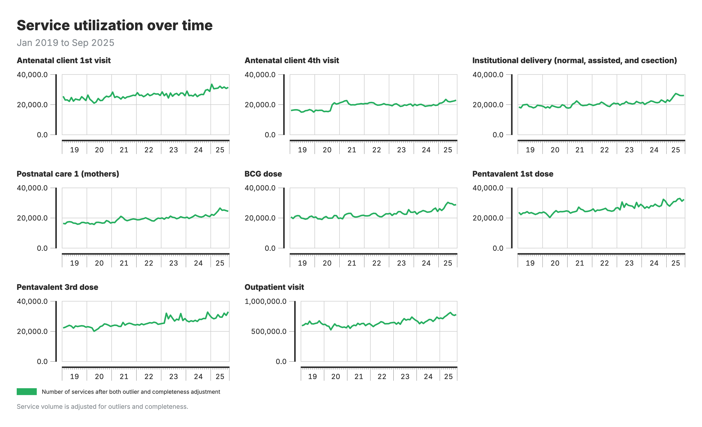
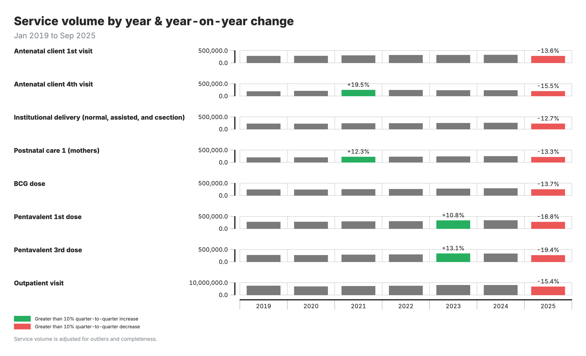

<!-- AUTO-TRANSLATED from 06a_service_utilization.md -->
<!-- Add REVIEWED marker after human review to protect from overwrite -->

# Análise da utilização dos serviços

## Contexto e objetivo

### Objetivo do módulo

A análise da utilização dos serviços descreve a quantidade de cada serviço de saúde prestado ao longo do tempo: quantas consultas pré-natais, partos, vacinações ou consultas são registadas todos os meses, como esses volumes variam de um ano para o outro e de um trimestre para o outro, e em que medida os ajustamentos na qualidade dos dados alteram o panorama.

Responde à primeira pergunta que um programa coloca aos seus dados de rotina: há mais ou menos pessoas a utilizar o serviço do que antes, e onde? Não indica se uma alteração é invulgar, tendo em conta a tendência e a sazonalidade. Essa questão é respondida pelo [Módulo de deteção de perturbações](06b_disruption_detection.md), que modela o volume esperado de cada unidade de saúde e assinala os meses que se desviam desse valor.

### Fundamento analítico

As contagens mensais brutas são difíceis de interpretar diretamente. Os volumes aumentam e diminuem com a estação do ano, uma instalação que deixa de comunicar dados faz baixar o total e um valor atípico pode duplicar o número de um distrito num determinado mês. A análise da utilização dos serviços baseia-se, portanto, nos dados ajustados produzidos pelo módulo de ajuste da qualidade dos dados e apresenta-os de três formas fáceis de comparar: totais anuais com a variação em relação ao ano anterior, totais trimestrais com a variação em relação ao trimestre anterior e os mesmos volumes em cada cenário de ajuste, para que o efeito dos ajustes seja visível.

Como a análise é descritiva, a sua interpretação depende da direção do indicador. Mais partos nas unidades de saúde são positivos; mais natimortos, não. A direcionalidade do indicador é registada para que os aumentos e as diminuições sejam destacados de forma consistente.

### Pontos-chave

| Componente | Detalhes |
|-----------|---------|
| **Entradas** | Volumes de serviços ajustados a partir do módulo de ajuste da qualidade dos dados (M2): não ajustados, ajustados em relação a valores atípicos, ajustados em termos de exaustividade e ambos Valores dos indicadores a partir do módulo de valores dos indicadores (M12) para indicadores calculados |
| **Resultados** | Volumes de serviços mensais e anuais por indicador e área Variação ano a ano Variação trimestre a trimestre Volume em cada cenário de ajuste |
| **Objetivo** | Descrever e comparar os volumes de serviços ao longo do tempo e entre áreas, como ponto de partida para a interpretação e para a deteção de perturbações |

---

## Fluxo de trabalho analítico

### Visão geral das etapas analíticas

1. **Partir dos dados ajustados.** O módulo de ajuste da qualidade dos dados produz uma contagem mensal por unidade e por indicador em quatro cenários: sem ajuste, valores atípicos ajustados, completude ajustada e ambos. As visualizações de utilização dos serviços agregam estas contagens ao nível geográfico escolhido.

2. **Comparar anos.** Os totais anuais são calculados por indicador e área, e a variação em relação ao ano anterior é expressa em percentagem.

3. **Comparar trimestres.** Os totais trimestrais são comparados com o trimestre anterior da mesma forma, o que permite captar alterações mais recentes do que a visualização anual.

4. **Assinalar grandes variações.** As variações superiores a ±10 % são destacadas para acompanhamento. Uma marcação é um aviso para investigar, não uma conclusão: a variação pode ser um efeito real do programa, um problema de qualidade dos dados ou um evento esperado, como uma campanha.

5. **Mostrar o efeito dos ajustamentos.** Os mesmos volumes são apresentados em cada cenário de ajustamento, para que os utilizadores possam ver em que medida uma variação se deve às correções dos dados e não à prestação do serviço.

### Pontos-chave de decisão

**Qual contagem apresentar**

A contagem ajustada em relação aos valores atípicos é a escolha habitual para a elaboração de relatórios. As contagens ajustadas em função da completude estimam qual teria sido o volume se todas as unidades tivessem reportado, o que é útil para o planeamento, mas deve ser identificado como uma estimativa. Apresentar a contagem não ajustada em paralelo torna explícita a dimensão da correção.

**Nível geográfico**

Os totais nacionais e provinciais são suficientemente estáveis para serem analisados mês a mês. Os totais distritais apresentam maior variabilidade, especialmente no caso de indicadores de baixo volume, em que uma pequena variação absoluta se traduz numa grande percentagem. Verifique as variações distritais em relação à tendência provincial antes de tomar medidas com base nelas.

**Direcionalidade dos indicadores**

Para a maioria dos indicadores de serviços RMNCAH-N, um aumento é favorável. Para alguns, como natimortos ou mortes maternas, um aumento é desfavorável e a codificação por cores é invertida. A direção é definida por indicador no gestor de indicadores.

### Resultados da análise e visualização

**1. Variação no volume de serviços**

Gráfico de barras dos volumes anuais de serviços por área e indicador, acompanhado da variação percentual em relação ao ano anterior.

**2. Número de serviços registados**

Volumes mensais ao longo do tempo, por indicador e área, a partir dos dados ajustados.

**3. Variação trimestral**

Mapa de calor que compara cada trimestre com o anterior, com as variações superiores a ±10 % assinaladas.

**4. Variação do volume devido a ajustamentos na qualidade dos dados**

Gráfico de barras agrupadas que compara os volumes de serviços nos quatro cenários de ajustamento.

**Guia de interpretação**

- **Barras e anotações** (resultado 1): volumes anuais, com a variação percentual entre anos consecutivos.
- **Células do mapa de calor** (resultado 3): a variação percentual para cada área e trimestre; as células assinaladas excedem o limiar de ±10 % em qualquer direção.
- **Quatro barras por ano** (resultado 4): uma por cenário de ajuste; compare as alturas para ver em que medida os ajustes alteram o volume reportado.

---

## Referência detalhada

### Métricas de variação

A **variação ano a ano** compara um período com o mesmo período do ano anterior:

$$
\text{YoY change (\%)} = \frac{\text{this year} - \text{last year}}{\text{last year}} \times 100
$$

**Variação trimestral** compara um trimestre com o trimestre anterior:

$$
\text{QoQ change (\%)} = \frac{\text{current quarter} - \text{previous quarter}}{\text{previous quarter}} \times 100
$$

Ambas são calculadas por indicador e por área geográfica. As variações superiores a ±10 % são assinaladas. O limiar é uma configuração de apresentação no gráfico e pode ser alterado por visualização.

### Interpretação

- Uma variação assinalada levanta uma questão; a resposta surge do contexto. Verifique se houve campanhas, rupturas de stock, greves, alterações de política e problemas de reporte nos mesmos meses.
- Compare a variação assinalada nos diferentes cenários de ajuste. Uma variação que desaparece após o ajuste da completude foi uma alteração no reporte, não uma alteração no serviço.
- Para indicadores de baixo volume e áreas pequenas, observe a variação absoluta ao lado da percentagem.
- Movimentos sustentados ao longo de vários períodos têm mais peso do que um único trimestre assinalado.
- Os últimos meses de uma série são provisórios, porque os relatórios atrasados chegam depois de o pacote ter sido gerado.

---

<!--
////////////////////////////////////////////////////////////////////
// //
// _____ _ _____ ____ _____ ____ ___ _ _ _____ _ _ //
// / ____| | |_ _| _ \| ____| / ___/ _ \| \ | |_ _| \ | |//
// | (___ | | | | | | | | |__ | | | | | | \| | | | | \| |//
// \___ \| | | | | | | | | | __| | | | | | | . ` | | | | . ` |//
// ____) | |___ _| |_| |_| | |____ | |__| |_| | |\ | | | | |\ |//
// |_____/|_____|_____|____/|______| \____\___/|_| \_|| |_| |_| \_|//
// //
// Editar os diapositivos do workshop abaixo desta linha //
// //
////////////////////////////////////////////////////////////////////
-->

<!-- SLIDE:m6_0 -->
## Dos dados ajustados à análise

O módulo 2 produziu o conjunto de dados ajustado - outliers substituídos, gaps imputados. O módulo 3 é onde esse trabalho compensa.

No Módulo 3, os utilizadores podem analisar **os dados ajustados ou não ajustados**, dependendo da pergunta. Os dados ajustados informam-no sobre os padrões subjacentes; os dados não ajustados informam-no sobre o que foi efetivamente comunicado.

Os próximos diapositivos abordam duas perspectivas da prestação de serviços:

- **Utilização do serviço** - volumes ao longo do tempo, comparações trimestrais e anuais
- **Deteção de perturbações** - um modelo estatístico que assinala quando os volumes reais se desviam do que o historial da instituição prevê

A estimativa da cobertura, que divide os serviços por uma população-alvo, vem depois.
<!-- /SLIDE -->

<!-- SLIDE:m6_1 -->
## Análise da utilização de serviços

A análise da utilização de serviços mede as mudanças nos volumes de serviços de saúde ao longo do tempo. Ao comparar a prestação de serviços em anos consecutivos, esta análise identifica aumentos ou diminuições nos padrões de utilização entre regiões e indicadores.

A principal métrica é a **variação percentual anual**, que quantifica as mudanças na prestação de serviços entre anos consecutivos. A fórmula calcula a diferença entre os volumes do ano atual e do ano anterior, expressa em percentagem do ano anterior. As alterações superiores a ±10% são assinaladas para revisão, uma vez que representam normalmente alterações significativas na prestação de serviços e não uma variação normal.
<!-- /SLIDE -->

<!-- SLIDE:m6_1c -->
## Produção de utilização de serviços

**O que você vê:** Gráfico de linhas mostrando volumes absolutos de serviços ao longo do tempo por indicador.

**O que ele mostra:** Contagem de serviços prestados a cada mês/trimestre.

**Interpretação:** Procure tendências gerais (aumento/diminuição) e quedas ou picos repentinos que possam necessitar de investigação.

<!-- /SLIDE -->

<!-- SLIDE:m6_1d -->
## Variação trimestral em relação ao trimestre anterior

**O que você vê:** Mapa de calor comparando o trimestre atual com o trimestre anterior, com alterações >±10% sinalizadas.

**Fórmula:** Variação QoQ % = (trimestre atual - trimestre anterior) / trimestre anterior × 100

**Interpretação:** As alterações assinaladas requerem acompanhamento - trata-se de uma alteração real do programa, de um problema de dados ou de um evento esperado?

<!-- /SLIDE -->

<!-- SLIDE:m6_1e -->
<!-- _class: output -->
## Mudança de ano para ano output

**O que você vê:** Mapa de calor comparando o período atual com o mesmo período do ano passado, com alterações >±10% sinalizadas.

**Fórmula:** Variação anual % = (este ano - ano passado) / ano passado × 100

**Interpretação:** As alterações assinaladas requerem acompanhamento - trata-se de uma alteração real do programa, de um problema de dados ou de um evento esperado?

<!-- /SLIDE -->

<!-- SLIDE:m6_1f -->
## Direccionalidade do indicador

Uma alteração assinalada só se torna uma descoberta quando se sabe em que direção se quer que o indicador se mova.

- **Os indicadores de utilização de serviços** (consultas de ANC, assistência qualificada ao parto, imunizações) devem **aumentar** à medida que os sistemas se reforçam.
- **Os indicadores de morbilidade e mortalidade** (mortes maternas, desnutrição grave, incidência de doenças) devem **cair**.
- **Os indicadores de intervalo** situam-se entre dois limiares. A taxa de cesarianas é o caso canónico - demasiado baixa significa falta de acesso, demasiado alta significa excesso de medicalização.

Um aumento de 15% nos cuidados pós-natais é uma boa notícia; o mesmo aumento nas mortes maternas não é. Verifique sempre a direção antes de ler o sinal.
<!-- /SLIDE -->

<!-- ═══════════════════════════════════════════════════════════════════════════
     SLIDES CONDENSADOS: Métodos + Interpretação Combinados
═══════════════════════════════════════════════════════════════════════════ -->

<!-- SLIDE:m6_s00 -->
## Análise de dados

Três coisas que o FASTR faz com os seus dados:

1. **Utilização de serviços** - quantos serviços foram prestados, como é que isso mudou de trimestre para trimestre e de ano para ano, e que direção significa "bom" para cada indicador.
2. **Deteção de interrupções** - separar as quedas reais no serviço da variação sazonal normal, aprendendo o ritmo esperado de cada indicador.
3. **Cobertura** - combinar o numerador (volume do HMIS) com um denominador defensável (população-alvo) para estimar a percentagem de pessoas que precisavam de um serviço e o receberam.

Cada sub-tópico termina com os resultados FASTR que verá na plataforma e como os ler.
<!-- /SLIDE -->

<!-- SLIDE:m6_s0b -->
## O que é utilização de serviço?

A utilização de serviços mede **quantos serviços de saúde estão a ser prestados** - consultas pré-natais, vacinas, partos, consultas externas - por quem, onde e ao longo do tempo.

O seu acompanhamento indica-lhe se o sistema está a satisfazer a procura. Uma tendência crescente pode mostrar um melhor acesso; uma tendência decrescente pode indicar uma rutura de stock, uma greve, um choque ou uma diminuição real das necessidades.

O FASTR calcula a utilização dos serviços a partir dos dados do HMIS, discriminados por indicador, geografia e período de tempo. Os resultados que se seguem mostram o volume em si, a forma como se alterou em termos trimestrais e anuais, e qual a direção das boas notícias para cada indicador.
<!-- /SLIDE -->

<!-- SLIDE:m6_s2 -->
## Utilização de serviços: detectando mudanças

Os volumes de serviços sobem e descem naturalmente - mais casos de malária na estação das chuvas, por exemplo. Como é que se distingue uma **variação normal** de uma **perturbação real**?

**O FASTR aprende o ritmo normal** de cada indicador em cada área:
- Tendência a longo prazo (os serviços estão a crescer ou a diminuir?)
- Sazonalidade (que meses são normalmente mais elevados?)

Depois compara os **volumes observados** com os **volumes esperados**:

- **abaixo** do esperado → potencial perturbação (rutura de stock? greve? conflito?)
- **Acima do esperado → aumento invulgar (campanha de vacinação? novo programa?)

O módulo mede **quantos serviços foram perdidos ou ganhos** e durante que período.
<!-- /SLIDE -->

<!-- SLIDE:m6_s1 -->
## Análise da utilização de serviços

A análise da utilização de serviços acompanha o número de serviços de saúde que estão a ser prestados ao longo do tempo, identificando tendências, anomalias e comparações entre áreas.

**O que você vê:** Gráfico de linhas mostrando volumes absolutos de serviços ao longo do tempo por indicador.

**O que ele mostra:** Contagem de serviços prestados a cada mês/trimestre.

**Interpretação:** Procure tendências gerais (aumento/diminuição) e quedas ou picos repentinos que possam necessitar de investigação.

<!-- /SLIDE -->

<!-- SLIDE:m6_s1b -->
<!-- _class: output -->
## Mudança de ano para ano output

**O que você vê:** Mapa de calor comparando o período atual com o mesmo período do ano passado, com alterações >±10% sinalizadas.

**Fórmula:** Variação anual % = (este ano - ano passado) / ano passado × 100

**Interpretação:** As alterações assinaladas requerem acompanhamento - trata-se de uma alteração real do programa, de um problema de dados ou de um evento esperado?

<!--
NOTAS DO APRESENTADOR:
- Versão condensada combinando tendências de serviço e comparação anual
- O primeiro gráfico mostra volumes absolutos - identifica padrões gerais
- O segundo gráfico mostra as alterações relativas - mais fácil de comparar entre indicadores
- As alterações anuais >±10% são assinaladas - mas o limiar é configurável
- Para as alterações assinaladas, perguntar: problema de qualidade dos dados, alteração real do programa ou evento externo?
- Estes resultados não requerem denominadores de população - útil quando os denominadores são incertos
-->
<!-- /SLIDE -->

<!-- SLIDE:m6_s0c -->
## Direccionalidade do indicador

Uma alteração assinalada só se torna uma descoberta quando se sabe em que direção se quer que o indicador se mova.

- **Os indicadores de utilização de serviços** (consultas de ANC, assistência qualificada ao parto, imunizações) devem **aumentar** à medida que os sistemas se reforçam.
- **Os indicadores de morbilidade e mortalidade** (mortes maternas, desnutrição grave, incidência de doenças) devem **cair**.
- **Os indicadores de intervalo** situam-se entre dois limiares. A taxa de cesarianas é o caso canónico - demasiado baixa significa falta de acesso, demasiado alta significa excesso de medicalização.

Um aumento de 15% nos cuidados pós-natais é uma boa notícia; o mesmo aumento nas mortes maternas não é. Verifique sempre a direção antes de ler o sinal.
<!-- /SLIDE -->

<!-- SLIDE:m6_s1a -->
## Variação trimestral

**O que você vê:** Mapa de calor comparando o trimestre atual com o trimestre anterior, com alterações >±10% sinalizadas.

**Fórmula:** Variação QoQ % = (trimestre atual - trimestre anterior) / trimestre anterior × 100

**Interpretação:** As alterações assinaladas requerem acompanhamento - trata-se de uma alteração real do programa, de um problema de dados ou de um evento esperado?

<!--
NOTAS DO APRESENTADOR:
- As alterações QoQ >±10% são sinalizadas - mas o limite é configurável
- Para alterações sinalizadas, perguntar: problema de qualidade dos dados, alteração real do programa ou evento externo?
- Estes resultados não requerem denominadores de população - útil quando os denominadores são incertos
- Complementar à visão anual: capta as alterações mais recentes
-->
<!-- /SLIDE -->

